# SISTEMA WEB PARA LA GESTIÓN DE CITAS MÉDICAS — CLÍNICA VIDA SALUD

|                  |                                                        |
| ---------------- | ------------------------------------------------------ |
| **Materia**      | Ingeniería de Requisitos y Modelado INF-219-SC         |
| **Examen**       | Segundo Examen Parcial                                 |
| **Grupo**        | SC                                                     |
| **Integrantes**  | Einar Padilla Delgadillo<br>Daniel Acosta Roca         |
| **Docente**      | Angeliza Garzon Cuellar                                |
| **Presentación** | 1 — Ciclo #1 (24/10/2026)                              |
| **Repositorio**  | https://github.com/Einarpd26/2do-examen-ing-requisitos |
| **Código QR**    |    |

---

## Tabla de contenido

> Actualizar en cada presentación.

1. [Perfil](#1-perfil)
2. [Marco teórico](#2-marco-teórico)
3. [Modelo de negocio](#3-modelo-de-negocio)
4. [FT. Captura de requisitos](#4-ft-captura-de-requisitos)
5. [FT. Análisis](#5-ft-análisis)
6. [FT. Diseño](#6-ft-diseño)
7. [FT. Implementación](#7-ft-implementación)
8. [FT. Pruebas](#8-ft-pruebas)
9. [Conclusión](#conclusión)
10. [Recomendación](#recomendación)
11. [Bibliografía](#bibliografía)
12. [Anexos](#anexos)

---

## 1. Perfil

### 1.1 Introducción

La Clínica Vida Salud es un establecimiento médico privado (ficticio) que brinda atención en medicina general, pediatría, ginecología y odontología. Hoy gestiona sus citas con cuadernos, llamadas telefónicas y hojas de cálculo, lo que dificulta organizar los horarios de los médicos, controlar las citas programadas y mantener actualizados los datos de los pacientes.

La dirección de la clínica ha decidido implementar un sistema web que centralice la información y automatice los principales procesos de gestión de citas médicas. El sistema se desarrollará con PHP y PostgreSQL, bajo el enfoque del Proceso Unificado de Desarrollo de Software con UML (PUDS-UML), organizado en dos ciclos de desarrollo.

### 1.2 Objetivos

#### Objetivo general

Desarrollar un sistema web de gestión de citas médicas utilizando PHP como lenguaje del lado del servidor y PostgreSQL como sistema gestor de base de datos, con el propósito de mejorar el registro, la programación, el seguimiento y el control de las citas médicas de la Clínica Vida Salud.

#### Objetivos específicos

- Analizar los procesos de registro y programación de citas de la clínica.
- Diseñar una base de datos relacional con tablas relacionadas mediante claves primarias y foráneas.
- Implementar formularios para el registro, consulta, modificación y desactivación de pacientes y médicos.
- Gestionar las especialidades médicas y los horarios de atención.
- Programar citas verificando la disponibilidad del médico.
- Controlar los estados de las citas médicas.
- Generar reportes de citas por fecha, médico, especialidad y estado.
- Aplicar validaciones de datos y mecanismos básicos de seguridad.
- Realizar pruebas para verificar el correcto funcionamiento del sistema.

### 1.3 Descripción del problema

El registro manual de citas ha generado los siguientes problemas:

1. Duplicación de citas para un mismo médico y horario.
2. Pérdida o registro incorrecto de los datos de los pacientes.
3. Dificultad para conocer los horarios disponibles de los médicos.
4. Falta de control sobre las citas canceladas y las inasistencias.
5. Demoras en la búsqueda del historial de citas de un paciente.
6. Dificultad para obtener reportes de las atenciones programadas.
7. Falta de información actualizada para la administración de la clínica.

**Planteamiento:** ¿cómo desarrollar un sistema web con PHP y PostgreSQL que permita administrar pacientes, médicos, especialidades y citas médicas, evitando conflictos de horarios y facilitando el control de las atenciones de la Clínica Vida Salud?

### 1.4 Alcance

El sistema es una aplicación web accesible desde un navegador (PHP, PostgreSQL, HTML, CSS y JavaScript para la interacción de los formularios), destinada principalmente al personal administrativo de la clínica.

**El sistema permite:**

- Registrar y consultar pacientes.
- Registrar médicos y sus especialidades.
- Definir horarios de atención.
- Consultar disponibilidad de citas.
- Registrar, reprogramar y cancelar citas.
- Registrar la asistencia o inasistencia del paciente.
- Consultar el historial de citas.
- Generar reportes administrativos.
- Administrar usuarios y permisos básicos.

**Roles:** Administrador, Recepcionista, Médico y Paciente.

**Desarrollo por ciclos:**

| Ciclo    | Requisitos                                                                                                                                        | Estado    |
| -------- | ------------------------------------------------------------------------------------------------------------------------------------------------- | --------- |
| Ciclo #1 | RF01 Login y roles · RF02 Pacientes · RF03 Médicos · RF04 Especialidades · RF05 Horarios · RF14 Cuenta y perfil del paciente                      | En curso  |
| Ciclo #2 | RF06–RF13 Citas, anti-duplicados, reprogramación, cancelación, asistencia, agenda, historial, reportes · RF15 Recordatorios · RF16 Notas clínicas | Pendiente |

---

## 2. Marco teórico

### 2.1 Proceso Unificado (PUDS) y UML

El Proceso Unificado de Desarrollo de Software es un proceso iterativo e incremental, dirigido por casos de uso y centrado en la arquitectura (Jacobson, Booch y Rumbaugh, 2000). El trabajo se organiza en ciclos, y cada ciclo recorre los flujos de trabajo de **captura de requisitos, análisis, diseño, implementación y pruebas**, con distinto énfasis según la fase del proyecto.

UML (_Unified Modeling Language_) es el lenguaje de modelado con el que se expresan esos flujos: diagramas de casos de uso, de clases, de secuencia, de comunicación, de estados y de actividades (Object Management Group, s. f.).

**En este proyecto:** el informe sigue los flujos del PUDS en el orden del índice del examen. El desarrollo se divide en dos ciclos: el Ciclo #1 entrega el acceso y los datos maestros (CU-01 a CU-08 y CU-19), y el Ciclo #2 el núcleo de citas, que depende de esa base (sección 4.5).

### 2.2 Aplicaciones web

Una aplicación web sigue el modelo **cliente-servidor**: el navegador envía una solicitud HTTP, el servidor la procesa, consulta o modifica los datos y devuelve una respuesta, normalmente una página HTML. HTTP no guarda estado entre solicitudes, por lo que la identidad del usuario se mantiene con un mecanismo adicional, la **sesión** (The PHP Documentation Group, s. f.-c).

Se acostumbra separar la aplicación en capas (presentación, lógica de negocio y acceso a datos) para que cada una cambie sin arrastrar a las demás.

**En este proyecto:** la capa de presentación son las vistas Blade con Bootstrap 5, la lógica de negocio vive en servicios y la persistencia en modelos Eloquent sobre PostgreSQL (sección 6.1).

### 2.3 PHP y el patrón MVC con Laravel

PHP es un lenguaje de programación del lado del servidor. Laravel es un _framework_ de PHP que organiza la aplicación según el patrón **Modelo-Vista-Controlador (MVC)**:

- El **modelo** representa las entidades y su acceso a la base de datos (Eloquent).
- La **vista** presenta la información; en Laravel se escribe con plantillas Blade (Laravel, s. f.-c).
- El **controlador** recibe la solicitud que enruta el sistema de rutas (Laravel, s. f.-b), coordina el trabajo y elige la vista.

Laravel también permite validar los datos de entrada antes de que lleguen a la lógica de negocio, mediante clases de solicitud (_form requests_) (Laravel, s. f.-d).

**En este proyecto:** cada caso de uso tiene su controlador, su clase de solicitud para validar en el servidor y un servicio que concentra las reglas de negocio, de modo que el controlador no contiene reglas (sección 7.3).

### 2.4 PostgreSQL, PDO y consultas parametrizadas

PostgreSQL es un sistema gestor de bases de datos relacional. Un modelo relacional bien diseñado se apoya en **claves primarias y foráneas**, en la **normalización** para evitar datos duplicados y en **restricciones** (`UNIQUE`, `CHECK`, `NOT NULL`, claves foráneas) que hacen cumplir las reglas aunque falle la validación de la aplicación (The PostgreSQL Global Development Group, s. f.-b).

PDO (_PHP Data Objects_) es la capa de acceso a bases de datos de PHP; con el controlador `pdo_pgsql` conecta con PostgreSQL (The PHP Documentation Group, s. f.-b). Las **consultas parametrizadas** envían el texto SQL y los valores por separado, de modo que lo que escribe el usuario nunca se interpreta como código SQL. Es la defensa principal contra la inyección SQL (OWASP Foundation, s. f.-a).

**En este proyecto:** todo el acceso a datos pasa por Eloquent y el constructor de consultas de Laravel, que usan PDO con parámetros (RNF05). Las reglas críticas, como la unicidad del CI, también están como restricciones en la base (sección 6.3).

### 2.5 Seguridad en aplicaciones web

Los riesgos más frecuentes en aplicaciones web están catalogados por OWASP (OWASP Foundation, s. f.-e). Los que más influyen en este proyecto son:

- **Almacenamiento de contraseñas:** nunca se guardan en texto plano, sino como un _hash_ con una función diseñada para ello. PHP ofrece `password_hash()` y `password_verify()` (The PHP Documentation Group, s. f.-a; OWASP Foundation, s. f.-b).
- **Sesiones:** el identificador de sesión debe protegerse, regenerarse y vencer por inactividad (OWASP Foundation, s. f.-d).
- **CSRF (_Cross-Site Request Forgery_):** un sitio ajeno hace que el navegador de la víctima envíe una solicitud autenticada. Se previene con un _token_ secreto en cada formulario que modifica datos (OWASP Foundation, s. f.-c; Laravel, s. f.-a).
- **Fuerza bruta:** se limita con el bloqueo temporal de la cuenta tras varios intentos fallidos y con un tope de solicitudes por dirección IP.

**En este proyecto:** las contraseñas se almacenan solo como hash con el hasher de Laravel, que se apoya en `password_hash()` (RNF04), y las contraseñas temporales se generan con un generador criptográfico (`random_int`) (RNF18). El inicio de sesión compara la contraseña contra un hash de relleno cuando la cuenta no existe, para que el tiempo de respuesta no revele qué CI o correos están registrados. El bloqueo por intentos, el límite por IP y el token CSRF corresponden a RNF15 y RNF20.

### 2.6 Control de acceso basado en roles (RBAC)

En el control de acceso basado en roles los **permisos se asignan a roles** y los **roles a usuarios**, en lugar de asignar permisos usuario por usuario (Ferraiolo et al., 2001). Esto simplifica la administración y facilita comprobar quién puede hacer qué.

**En este proyecto:** cada operación exige un permiso con la forma `recurso:accion`, concedido por el rol de la cuenta. La interfaz oculta lo no permitido, pero la verificación definitiva ocurre en el servidor en cada solicitud (RNF19, RN12), apoyada en el sistema de autorización de Laravel (Laravel, s. f.-e). La matriz completa está en la sección 4.7.

### 2.7 Pruebas de software

Las **pruebas unitarias** verifican una pieza aislada de lógica; las **pruebas de funcionalidad** (_feature tests_) recorren una solicitud completa, desde la ruta hasta la base de datos. PHPUnit es el _framework_ de pruebas de PHP (Bergmann, s. f.) y Laravel lo integra con ayudas para simular solicitudes y comprobar respuestas y datos guardados (Laravel, s. f.-f).

**En este proyecto:** las pruebas se ejecutan con `php artisan test` contra una base PostgreSQL dedicada (`clinica_test`), que se recrea con las migraciones en cada ejecución. Los resultados están en la sección 8.

### 2.8 Contenedores para el entorno de desarrollo

Un contenedor empaqueta un programa con sus dependencias y lo ejecuta de forma aislada del resto del equipo (Docker Inc., s. f.). Docker Compose describe esos servicios en un archivo.

**En este proyecto:** PostgreSQL 16 corre en un contenedor definido en `docker-compose.yml`, de modo que la base se levanta con el mismo comando en cualquier equipo, sin instalarla ni configurarla a mano (RNF03).

### Referencias de esta sección

- Bergmann, S. (s. f.). _PHPUnit Documentation_. https://docs.phpunit.de/en/12.5/
- Docker Inc. (s. f.). _What is Docker?_ https://docs.docker.com/get-started/docker-overview/
- Ferraiolo, D. F., Sandhu, R., Gavrila, S., Kuhn, D. R. y Chandramouli, R. (2001). Proposed NIST standard for role-based access control. _ACM Transactions on Information and System Security, 4_(3), 224-274. https://doi.org/10.1145/501978.501980
- Jacobson, I., Booch, G. y Rumbaugh, J. (2000). _El Proceso Unificado de Desarrollo de Software_. Addison-Wesley. (Edición en español de _The Unified Software Development Process_, 1999.)
- Laravel. (s. f.-a). _CSRF Protection_. https://laravel.com/docs/13.x/csrf
- Laravel. (s. f.-b). _Routing_. https://laravel.com/docs/13.x/routing
- Laravel. (s. f.-c). _Blade Templates_. https://laravel.com/docs/13.x/blade
- Laravel. (s. f.-d). _Validation_. https://laravel.com/docs/13.x/validation
- Laravel. (s. f.-e). _Authorization_. https://laravel.com/docs/13.x/authorization
- Laravel. (s. f.-f). _Testing: Getting Started_. https://laravel.com/docs/13.x/testing
- Object Management Group. (s. f.). _Unified Modeling Language (UML)_. https://www.omg.org/spec/UML/
- OWASP Foundation. (s. f.-a). _SQL Injection Prevention Cheat Sheet_. https://cheatsheetseries.owasp.org/cheatsheets/SQL_Injection_Prevention_Cheat_Sheet.html
- OWASP Foundation. (s. f.-b). _Password Storage Cheat Sheet_. https://cheatsheetseries.owasp.org/cheatsheets/Password_Storage_Cheat_Sheet.html
- OWASP Foundation. (s. f.-c). _Cross-Site Request Forgery Prevention Cheat Sheet_. https://cheatsheetseries.owasp.org/cheatsheets/Cross-Site_Request_Forgery_Prevention_Cheat_Sheet.html
- OWASP Foundation. (s. f.-d). _Session Management Cheat Sheet_. https://cheatsheetseries.owasp.org/cheatsheets/Session_Management_Cheat_Sheet.html
- OWASP Foundation. (s. f.-e). _OWASP Top Ten_. https://owasp.org/www-project-top-ten/
- The PHP Documentation Group. (s. f.-a). _password_hash_. Manual de PHP. https://www.php.net/manual/es/function.password-hash.php
- The PHP Documentation Group. (s. f.-b). _PHP Data Objects_. Manual de PHP. https://www.php.net/manual/es/book.pdo.php
- The PHP Documentation Group. (s. f.-c). _Sesiones_. Manual de PHP. https://www.php.net/manual/es/features.sessions.php
- The PostgreSQL Global Development Group. (s. f.-a). _PostgreSQL 16 Documentation_. https://www.postgresql.org/docs/16/
- The PostgreSQL Global Development Group. (s. f.-b). _Constraints_. En _PostgreSQL 16 Documentation_. https://www.postgresql.org/docs/16/ddl-constraints.html

---

## 3. Modelo de negocio

### 3.1 Descripción del negocio

La Clínica Vida Salud presta servicios de consulta médica en distintas especialidades (medicina general, pediatría, ginecología, odontología, entre otras). El negocio gira en torno a un proceso central: **el paciente solicita una atención, la recepción le asigna una cita con un médico disponible y el médico lo atiende en la fecha y hora acordadas**.

Hoy ese proceso se apoya en cuadernos, llamadas telefónicas y hojas de cálculo, lo que produce citas duplicadas, datos de pacientes perdidos o incorrectos, falta de control de cancelaciones e inasistencias y dificultad para obtener reportes.

**Procesos principales del negocio:**

1. Registrar y mantener los datos de los pacientes.
2. Administrar médicos, especialidades y horarios de atención.
3. Programar, reprogramar y cancelar citas.
4. Atender la consulta y registrar la asistencia.
5. Emitir reportes para la administración.

### 3.2 Actores del negocio

| Actor             | Tipo                    | Responsabilidad en el negocio                                                                           |
| ----------------- | ----------------------- | ------------------------------------------------------------------------------------------------------- |
| **Paciente**      | Actor externo (cliente) | Solicita atención médica, asiste a su cita o la cancela.                                                |
| **Recepcionista** | Trabajador del negocio  | Registra pacientes, consulta disponibilidad, programa, reprograma y cancela citas, registra asistencia. |
| **Médico**        | Trabajador del negocio  | Atiende las consultas y consulta su agenda de citas.                                                    |
| **Administrador** | Trabajador del negocio  | Gestiona usuarios, médicos, especialidades y horarios; supervisa los reportes.                          |

### 3.3 Casos de uso del negocio

| Código | Caso de uso del negocio                        | Actores                 |
| ------ | ---------------------------------------------- | ----------------------- |
| CUN-01 | Registrar paciente                             | Paciente, Recepcionista |
| CUN-02 | Administrar médicos, especialidades y horarios | Administrador           |
| CUN-03 | Programar cita médica                          | Paciente, Recepcionista |
| CUN-04 | Reprogramar o cancelar cita                    | Paciente, Recepcionista |
| CUN-05 | Atender consulta médica                        | Paciente, Médico        |
| CUN-06 | Registrar asistencia o inasistencia            | Recepcionista           |
| CUN-07 | Emitir reportes administrativos                | Administrador           |

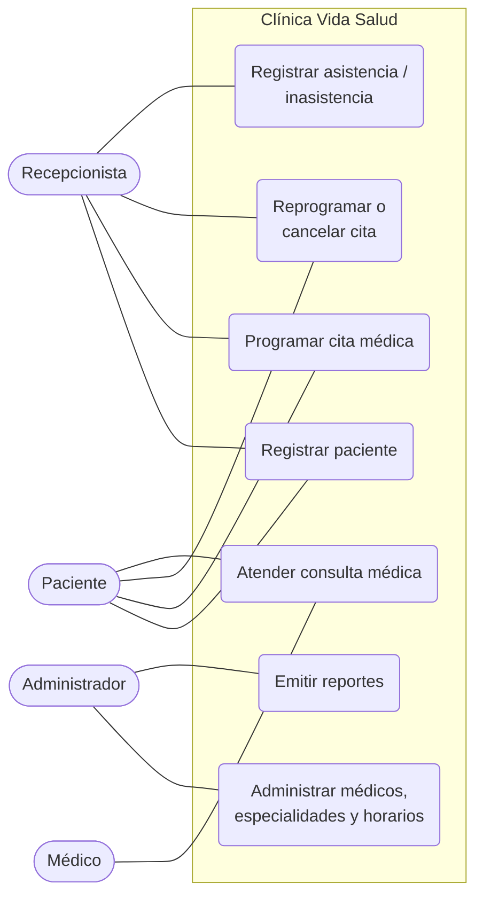

### 3.4 Diagrama de actividades / procesos del negocio

Proceso: **Programar cita médica** (CUN-03).

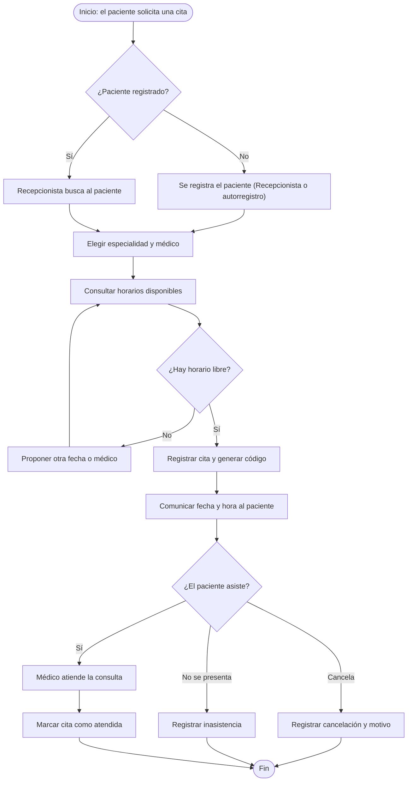

### 3.5 Reglas del negocio

Se aplican independientemente de lo que el usuario escriba en los formularios.

| Código | Regla                                                                                                                                                |
| ------ | ---------------------------------------------------------------------------------------------------------------------------------------------------- |
| RN01   | Cada paciente tendrá un identificador único.                                                                                                         |
| RN02   | Cada médico tendrá un identificador único.                                                                                                           |
| RN03   | Una cita deberá estar asociada a un paciente y a un médico válidos.                                                                                  |
| RN04   | El médico deberá estar activo para recibir nuevas citas.                                                                                             |
| RN05   | La cita deberá pertenecer al horario de atención del médico.                                                                                         |
| RN06   | No se podrán registrar citas en fechas pasadas.                                                                                                      |
| RN07   | Un médico no podrá tener citas superpuestas.                                                                                                         |
| RN08   | La duración de la cita deberá respetar la configuración del sistema.                                                                                 |
| RN09   | Las citas canceladas no ocuparán disponibilidad.                                                                                                     |
| RN10   | Las citas atendidas conservarán su registro histórico.                                                                                               |
| RN11   | No se eliminarán pacientes o médicos con citas históricas asociadas; se desactivarán.                                                                |
| RN12   | Solo los usuarios autorizados podrán realizar cada operación.                                                                                        |
| RN13   | La programación y reprogramación verificarán la disponibilidad en el servidor.                                                                       |
| RN14   | Los datos se almacenarán de forma persistente en PostgreSQL.                                                                                         |
| RN15   | El Paciente solo podrá cancelar o reprogramar una cita con al menos 24 horas de anticipación; la Recepcionista no tiene esta restricción (Ciclo #2). |
| RN16   | Un médico no puede atenderse a sí mismo: la persona del médico y la del paciente de una cita deben ser distintas (Ciclo #2).                         |

---

## 4. FT. Captura de requisitos

### 4.1 Requisitos funcionales

RF01 a RF13 provienen del enunciado. **RF14 a RF16 son derivados** del punto 3.4 del enunciado (perfil del paciente). Además, RF06, RF08, RF09 y RF12 se extienden para que el Paciente opere sobre **sus propias** citas.

| Código | Requisito                                                                                                                                                                                              | Origen          | Ciclo |
| ------ | ------------------------------------------------------------------------------------------------------------------------------------------------------------------------------------------------------ | --------------- | ----- |
| RF01   | Inicio de sesión y control de acceso por rol                                                                                                                                                           | Enunciado       | 1     |
| RF02   | Gestión de pacientes (registrar, listar, buscar, modificar, desactivar)                                                                                                                                | Enunciado       | 1     |
| RF03   | Gestión de médicos                                                                                                                                                                                     | Enunciado       | 1     |
| RF04   | Gestión de especialidades médicas                                                                                                                                                                      | Enunciado       | 1     |
| RF05   | Gestión de horarios de atención (la duración de la cita se define por especialidad)                                                                                                                    | Enunciado       | 1     |
| RF14   | Cuenta y perfil del paciente: registro propio o alta por la Recepcionista (contraseña temporal), verificación de la ficha, y consulta de su información médica y contacto de emergencia (solo lectura) | Derivado de 3.4 | 1     |
| RF06   | Registro de citas médicas (Recepcionista o Paciente)                                                                                                                                                   | Enunciado + 3.4 | 2     |
| RF07   | Prevención de citas duplicadas                                                                                                                                                                         | Enunciado       | 2     |
| RF08   | Reprogramación de citas                                                                                                                                                                                | Enunciado + 3.4 | 2     |
| RF09   | Cancelación de citas                                                                                                                                                                                   | Enunciado + 3.4 | 2     |
| RF10   | Control de asistencia y estados de la cita                                                                                                                                                             | Enunciado       | 2     |
| RF11   | Consulta de agenda médica                                                                                                                                                                              | Enunciado       | 2     |
| RF12   | Historial de citas por paciente                                                                                                                                                                        | Enunciado + 3.4 | 2     |
| RF13   | Reportes                                                                                                                                                                                               | Enunciado       | 2     |
| RF15   | Recordatorios de próximas consultas (aviso dentro del sistema)                                                                                                                                         | Derivado de 3.4 | 2     |
| RF16   | Historial médico: notas clínicas por cita atendida                                                                                                                                                     | Derivado de 3.4 | 2     |

**Decisiones de alcance** (tomadas para este proyecto, donde el enunciado no es explícito):

- **Identificador de acceso:** el Paciente inicia sesión con su **CI**; el personal (Administrador, Recepcionista, Médico) con su correo. El correo del Paciente es opcional.
- **Modelo de identidad:** una entidad `Persona` guarda los datos comunes (CI, primer nombre, segundo nombre, apellido paterno, apellido materno, fecha de nacimiento, sexo, teléfono, correo, dirección), más un nombre completo que la base calcula a partir de las partes. De ella cuelgan `Paciente` (ficha clínica y verificación), `Medico` (registro profesional) y `Usuario` (credenciales y rol). Una persona puede ser paciente y médico a la vez, pero su cuenta tiene un solo rol (Médico); como paciente la atiende la Recepcionista. El personal administrativo es una persona con cuenta y sin ficha. El CI es único en `Persona`.
- **Duración de la cita:** es un parámetro de la **especialidad** (en minutos), no del horario ni del médico. La cita hereda la duración de la especialidad elegida al reservar. Como la agenda de un médico puede mezclar duraciones, el anti-duplicados compara **intervalos**, no solo la hora de inicio (RF07, RNF17).
- **Códigos:** el «código» de paciente, médico y cita que piden RF02, RF03 y RF06 es su identificador único (`id`). En pantallas e impresos se muestra con formato (`PAC-000001`, `MED-000001`, `CM-000001`), que arma la aplicación a partir del `id`; no se guarda ni se escribe a mano.
- **Registro propio del Paciente:** primer nombre, apellido paterno, CI, celular y contraseña obligatorios; segundo nombre, apellido materno y correo opcionales. Se crea la cuenta y la ficha del paciente en estado **pendiente de verificación**. Si el CI ya tiene ficha, el registro propio se rechaza y se indica pedir el acceso en recepción.
- **Alta de cuenta por la Recepcionista:** para reducir la fricción, la Recepcionista también puede crear la cuenta del Paciente. El sistema genera una **contraseña temporal** aleatoria con vigencia de **72 horas**, la muestra **una sola vez** en pantalla (botones Copiar e Imprimir) y la Recepcionista se la entrega impresa o por mensaje de texto o WhatsApp. El sistema no envía correos ni mensajes. En su primer ingreso el Paciente debe cambiarla; si venció, no puede entrar hasta que se renueve.
- **Renovación y contraseña olvidada:** la Recepcionista o el Administrador pueden generar una nueva contraseña temporal en cualquier momento (porque venció o porque el titular olvidó la suya): se genera otra con nuevas 72 horas y la anterior deja de servir. El titular la solicita a recepción; la pantalla de inicio de sesión muestra el celular de la clínica para ese fin. Para evitar suplantaciones, la contraseña nueva se envía solo al celular registrado en la ficha del paciente (mensaje o WhatsApp) o se entrega en persona con documento, nunca a un número nuevo que indique quien llama. Es el caso de uso **CU-19**: la renovación exige indicar cómo se verificó la identidad y eso queda en la bitácora. La recuperación por cuenta propia del paciente (por correo) queda fuera del alcance: necesita un servicio de correo y el correo del paciente es opcional y no está verificado.
- **Verificación de la ficha:** una ficha de registro propio queda pendiente hasta que la Recepcionista compare el documento en persona y la marque como verificada; en ese acto puede renovar la contraseña, para sacar de la cuenta a quien se haya registrado con un CI ajeno. Mientras está pendiente, el Paciente puede iniciar sesión, ver su perfil básico y reservar citas, pero **no ve su información médica ni sus notas clínicas**. Una ficha creada por la Recepcionista queda verificada de inmediato.
- **Información médica y contacto de emergencia:** los registra y edita la Recepcionista. El Paciente los ve en solo lectura. El Médico los ve en solo lectura.
- **Edición del Paciente:** solo teléfono y contraseña. No edita nombre (identidad) ni correo (usuario de acceso).
- **RF15 Recordatorios:** aviso dentro del sistema, sin correo. Al iniciar sesión, el Paciente ve un banner con sus próximas citas (los siguientes 2 días).
- **RF16 Historial médico:** el Médico registra una nota clínica por cada cita atendida con motivo de consulta, diagnóstico, tratamiento o indicaciones, y observaciones. Cada Médico edita solo sus propias notas; al editarla se sobrescribe y se guarda quién y cuándo la modificó por última vez, sin conservar versiones. Ven las notas: el Médico, el Paciente y la Recepcionista, todas en solo lectura salvo el autor.
- **Acceso del Médico:** solo a los pacientes que tienen o tuvieron cita con él; ve sus datos básicos, información médica, contacto de emergencia y las notas clínicas, incluidas las de otros médicos.
- **Modalidad:** la cita tiene un campo `modalidad` (presencial o virtual).
- **Sucursal:** la base de datos incluye la tabla `sucursales` con una sola sucursal cargada y `sucursal_id` en horarios de atención y citas, para poder escalar. No hay pantalla de gestión de sucursales. El `consultorio` se registra en el horario de atención. No hay filtro por ubicación.

**Opcionales abiertos** (el enunciado los marca como opcionales; se implementan solo si el tiempo del Ciclo #2 lo permite):

- Feriados y bloqueos de agenda para excluir fechas de la disponibilidad (RF05).
- Exportación de reportes a CSV o PDF (RF13).

**Fuera del alcance** (descartado a propósito):

- Lista de espera.
- Recordatorios por SMS o correo (el aviso es solo dentro del sistema).
- Seguros médicos, pagos y verificación en dos pasos.

La lista de espera y los recordatorios por SMS o correo se mencionan como mejoras futuras en las conclusiones.

### 4.2 Requisitos no funcionales

| Código | Categoría      | Requisito                                                                                                                                                                                                                                                                                                                                                                         |
| ------ | -------------- | --------------------------------------------------------------------------------------------------------------------------------------------------------------------------------------------------------------------------------------------------------------------------------------------------------------------------------------------------------------------------------- |
| RNF01  | Tecnología     | Backend en PHP con el framework Laravel, base de datos PostgreSQL y acceso a datos sobre PDO (`pdo_pgsql`).                                                                                                                                                                                                                                                                       |
| RNF02  | Tecnología     | Interfaz con HTML5 y CSS3 generados en el servidor mediante plantillas Blade de Laravel; JavaScript para validaciones e interacción.                                                                                                                                                                                                                                              |
| RNF03  | Despliegue     | Ejecución en un entorno PHP local equivalente a Apache/XAMPP: en desarrollo, PHP 8.4 o superior (probado con 8.5.4) con su servidor embebido (`php artisan serve`) y PostgreSQL en un contenedor Docker; el directorio `public/` de Laravel es la raíz web. El servidor embebido es solo para desarrollo: un despliegue real usaría Apache o Nginx con PHP apuntando a `public/`. |
| RNF04  | Seguridad      | Contraseñas almacenadas con un hash seguro (`password_hash()` de PHP, que usa internamente el hasher de Laravel) y verificadas con `password_verify()` o su equivalente.                                                                                                                                                                                                          |
| RNF05  | Seguridad      | Consultas SQL parametrizadas para evitar inyección SQL.                                                                                                                                                                                                                                                                                                                           |
| RNF06  | Seguridad      | Uso de sesiones; las páginas internas rechazan el acceso sin sesión válida.                                                                                                                                                                                                                                                                                                       |
| RNF07  | Seguridad      | Los errores no muestran credenciales ni detalles internos al usuario.                                                                                                                                                                                                                                                                                                             |
| RNF08  | Integridad     | Validación de datos en cliente y en servidor.                                                                                                                                                                                                                                                                                                                                     |
| RNF09  | Datos          | Base de datos normalizada, sin duplicación innecesaria.                                                                                                                                                                                                                                                                                                                           |
| RNF10  | Mantenibilidad | Separación razonable entre interfaz, lógica de negocio y acceso a datos.                                                                                                                                                                                                                                                                                                          |
| RNF11  | Mantenibilidad | Código comentado, con buenas prácticas, publicado en GitHub.                                                                                                                                                                                                                                                                                                                      |
| RNF12  | Usabilidad     | Diseño profesional y mensajes de error comprensibles.                                                                                                                                                                                                                                                                                                                             |
| RNF13  | Seguridad      | Bitácora de auditoría: se registra usuario, acción, entidad afectada y fecha al iniciar sesión y al crear o modificar usuarios, pacientes, información médica y notas clínicas, y al crear o renovar cuentas y verificar fichas. Solo escrituras, sin registrar lecturas.                                                                                                         |
| RNF14  | Seguridad      | Cierre automático de la sesión tras 30 minutos de inactividad.                                                                                                                                                                                                                                                                                                                    |
| RNF15  | Seguridad      | Bloqueo de la cuenta durante 15 minutos tras 5 intentos fallidos seguidos de inicio de sesión, límite de 10 solicitudes de inicio de sesión por minuto desde una misma dirección IP, y token CSRF en los formularios que modifican datos.                                                                                                                                         |
| RNF16  | Privacidad     | Los avisos y recordatorios muestran solo fecha, hora y médico, nunca motivo, diagnóstico ni datos médicos.                                                                                                                                                                                                                                                                        |
| RNF17  | Integridad     | Además de la validación en PHP, la base de datos impide por restricción citas superpuestas del mismo médico (Ciclo #2).                                                                                                                                                                                                                                                           |
| RNF18  | Seguridad      | Las contraseñas temporales se generan de forma aleatoria con un generador criptográfico, vencen a las 72 horas, se muestran una sola vez, se guardan solo como hash y obligan a cambiarlas en el primer ingreso.                                                                                                                                                                  |
| RNF19  | Seguridad      | Control de acceso por permisos (RBAC): cada operación exige un permiso `recurso:accion` concedido por el rol de la cuenta. La interfaz oculta lo no permitido y el servidor lo verifica en cada solicitud (RN12).                                                                                                                                                                 |
| RNF20  | Seguridad      | El registro propio del paciente es público, así que se limita a 10 solicitudes por minuto por dirección IP, y una contraseña escrita nunca se vuelve a mostrar en el formulario.                                                                                                                                                                                                  |

### 4.3 Actores del sistema

| Actor             | Descripción                                                                                                                                                                                                            | Origen        |
| ----------------- | ---------------------------------------------------------------------------------------------------------------------------------------------------------------------------------------------------------------------- | ------------- |
| **Administrador** | Configura y supervisa el sistema: usuarios, roles, médicos, especialidades, horarios y reportes; renueva contraseñas temporales.                                                                                       | Enunciado 3.1 |
| **Recepcionista** | Gestiona pacientes (incluida su información médica y contacto de emergencia), crea cuentas de paciente con contraseña temporal, verifica fichas, renueva contraseñas temporales, gestiona citas y registra asistencia. | Enunciado 3.2 |
| **Médico**        | Consulta su agenda, marca citas atendidas y registra sus notas clínicas.                                                                                                                                               | Enunciado 3.3 |
| **Paciente**      | Tiene cuenta propia y entra con su CI; ve su perfil e información médica en solo lectura (una vez verificada su ficha), edita su teléfono y contraseña, y gestiona sus propias citas.                                  | Enunciado 3.4 |

### 4.4 Diagrama de casos de uso

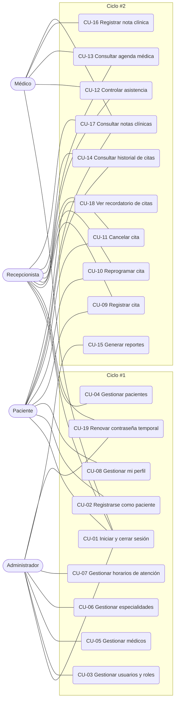

### 4.5 Priorización y selección de casos de uso por ciclo

| Caso de uso                          | RF         | Prioridad | Ciclo | Justificación                                                                                                                            |
| ------------------------------------ | ---------- | --------- | ----- | ---------------------------------------------------------------------------------------------------------------------------------------- |
| CU-01 Iniciar y cerrar sesión        | RF01       | Alta      | 1     | Base de seguridad; todo lo demás depende de él.                                                                                          |
| CU-02 Registrarse como paciente      | RF14       | Alta      | 1     | Permite que el Paciente tenga cuenta.                                                                                                    |
| CU-03 Gestionar usuarios y roles     | RF01       | Alta      | 1     | Habilita al personal y sus permisos.                                                                                                     |
| CU-04 Gestionar pacientes            | RF02, RF14 | Alta      | 1     | Dato maestro requerido por las citas; incluye información médica, contacto de emergencia, creación de cuenta y verificación de la ficha. |
| CU-05 Gestionar médicos              | RF03       | Alta      | 1     | Dato maestro requerido por las citas.                                                                                                    |
| CU-06 Gestionar especialidades       | RF04       | Alta      | 1     | Dato maestro requerido por médicos.                                                                                                      |
| CU-07 Gestionar horarios de atención | RF05       | Alta      | 1     | Define la disponibilidad que usa el Ciclo #2.                                                                                            |
| CU-08 Gestionar mi perfil            | RF14       | Media     | 1     | Consulta en solo lectura y edición de teléfono y contraseña.                                                                             |
| CU-09 Registrar cita                 | RF06, RF07 | Alta      | 2     | Núcleo del sistema; depende de CU-04 a CU-07.                                                                                            |
| CU-10 Reprogramar cita               | RF08       | Alta      | 2     | Depende de CU-09.                                                                                                                        |
| CU-11 Cancelar cita                  | RF09       | Alta      | 2     | Depende de CU-09.                                                                                                                        |
| CU-12 Controlar asistencia           | RF10       | Alta      | 2     | Depende de CU-09.                                                                                                                        |
| CU-13 Consultar agenda médica        | RF11       | Media     | 2     | Depende de CU-09.                                                                                                                        |
| CU-14 Consultar historial de citas   | RF12       | Media     | 2     | Depende de CU-09.                                                                                                                        |
| CU-15 Generar reportes               | RF13       | Media     | 2     | Requiere citas ya registradas.                                                                                                           |
| CU-16 Registrar nota clínica         | RF16       | Media     | 2     | Requiere citas atendidas (CU-12).                                                                                                        |
| CU-17 Consultar notas clínicas       | RF16       | Media     | 2     | Depende de CU-16.                                                                                                                        |
| CU-18 Ver recordatorio de citas      | RF15       | Baja      | 2     | Banner al iniciar sesión; depende de CU-09.                                                                                              |
| CU-19 Renovar contraseña temporal    | RF01, RF14 | Alta      | 1     | Recupera el acceso sin servidor de correo; es la vía de quien olvidó su contraseña.                                                      |

**Criterio:** el Ciclo #1 entrega la base (acceso y datos maestros) y el Ciclo #2 el núcleo de citas, que necesita esa base estable.

### 4.6 Especificación de casos de uso

Se especifican los casos de uso del Ciclo #1. Los del Ciclo #2 se agregan en la segunda presentación.

#### CU-01 Iniciar y cerrar sesión

|                   |                                                                             |
| ----------------- | --------------------------------------------------------------------------- |
| **Actores**       | Administrador, Recepcionista, Médico, Paciente                              |
| **Requisito**     | RF01                                                                        |
| **Precondición**  | El usuario tiene una cuenta activa.                                         |
| **Postcondición** | Existe una sesión válida con el rol del usuario, o la sesión queda cerrada. |

**Flujo principal**

1. El usuario ingresa su identificador (el Paciente su CI; el personal su correo) y su contraseña.
2. El sistema valida los datos en el servidor y verifica la contraseña con `password_verify()`.
3. El sistema inicia la sesión e identifica el rol de la cuenta y sus permisos.
4. El sistema muestra el menú según los permisos del rol.
5. El usuario cierra la sesión y el sistema la destruye.

**Flujos alternos**

- 2a. Credenciales incorrectas: se muestra un mensaje genérico y no se inicia sesión.
- 2b. Cuenta inactiva: se rechaza el acceso.
- 2c. Contraseña temporal vigente: tras validar, el sistema obliga a cambiarla antes de continuar.
- 2d. Contraseña temporal vencida: se rechaza el acceso y se indica pedir su renovación a recepción.
- 2e. El usuario olvidó su contraseña: la pantalla de inicio de sesión muestra el celular de la clínica para pedir a recepción una contraseña temporal nueva.
- 2f. Cuenta bloqueada: tras 5 intentos fallidos seguidos se bloquea durante 15 minutos y se informa el tiempo de espera.
- \*. Inactividad: tras 30 minutos sin actividad la sesión se cierra.
- \*. Cuenta desactivada con la sesión abierta: en la solicitud siguiente se cierra la sesión, porque se comprueba el estado de la cuenta en cada solicitud.
- \*. Acceso a una página interna sin sesión válida: se redirige al inicio de sesión.

#### CU-02 Registrarse como paciente

|                   |                                                                                                                                                |
| ----------------- | ---------------------------------------------------------------------------------------------------------------------------------------------- |
| **Actores**       | Paciente                                                                                                                                       |
| **Requisito**     | RF14, RF02                                                                                                                                     |
| **Precondición**  | El visitante no tiene cuenta.                                                                                                                  |
| **Postcondición** | Queda creada la cuenta con rol Paciente y su ficha en estado pendiente de verificación. La Recepcionista la verifica con el documento (CU-04). |

**Flujo principal**

1. El visitante completa el formulario (primer nombre, apellido paterno, CI, celular, contraseña; segundo nombre, apellido materno y correo opcionales).
2. El sistema valida los datos en cliente y servidor (incluido el formato del celular).
3. El sistema verifica que el CI no esté registrado como persona y que el correo, si se ingresó, no esté registrado.
4. El sistema guarda la contraseña con `password_hash()` y crea la ficha del paciente en estado pendiente de verificación junto con su cuenta.
5. El sistema confirma el registro.

**Flujos alternos**

- 3a. El CI ya está registrado: se rechaza el registro y se indica pedir el acceso en recepción.
- 3b. Correo ya registrado: se rechaza el registro con un mensaje.
- 3c. Dos registros simultáneos con el mismo CI o correo: el segundo se rechaza con el mismo mensaje y no deja datos a medias (el alta es una sola transacción).
- 2a. Datos inválidos: se indican los campos a corregir.

#### CU-03 Gestionar usuarios y roles

|                   |                                                                               |
| ----------------- | ----------------------------------------------------------------------------- |
| **Actores**       | Administrador                                                                 |
| **Requisito**     | RF01                                                                          |
| **Precondición**  | El Administrador inició sesión.                                               |
| **Postcondición** | El usuario queda creado, modificado, con rol asignado o activado/desactivado. |

**Flujo principal**

1. El Administrador abre la lista de usuarios del personal (las cuentas de pacientes se gestionan en CU-02 y CU-04).
2. Elige crear o modificar un usuario e ingresa los datos de la persona (CI, primer nombre, segundo nombre opcional, apellido paterno, apellido materno opcional, teléfono, correo) y el rol. Si el rol es Médico, selecciona el médico (CU-05) al que se vincula la cuenta.
3. El sistema valida los datos y que el CI y el correo sean únicos.
4. El sistema guarda el cambio. Al crear un usuario, genera una contraseña temporal aleatoria con vigencia de 72 horas y la muestra una sola vez, con botones Copiar e Imprimir; el Administrador se la entrega al empleado, quien debe cambiarla en su primer ingreso.
5. El Administrador puede activar o desactivar la cuenta.
6. Si el titular olvidó su contraseña o la temporal venció, el Administrador puede renovarla en cualquier momento: el sistema genera otra con nuevas 72 horas, la muestra una sola vez e invalida la anterior.

7. El Administrador puede modificar los datos personales de un usuario y cambiar su rol entre Administrador y Recepcionista. Los datos de una cuenta de Médico se editan en CU-05.

**Flujos alternos**

- 3a. CI o correo repetido: se rechaza el cambio. Si el CI pertenece a una persona sin cuenta (por ejemplo, un paciente), se reutiliza esa persona sin modificar sus datos personales.
- 3b. El médico seleccionado ya tiene una cuenta vinculada o está desactivado: se rechaza el cambio.
- 5a. El Administrador intenta desactivar su propia cuenta, cambiarse el rol o renovarse la contraseña: se rechaza (para su contraseña usa «Cambiar contraseña»).
- 5b. El cambio dejaría al sistema sin un Administrador activo: se rechaza.
- 5c. Se reactiva la cuenta de un médico cuya ficha sigue desactivada: se rechaza hasta reactivarlo en CU-05.
- 6a. Antes de renovar, el Administrador indica cómo verificó la identidad del titular (documento en persona o celular registrado); queda en la bitácora. No se renueva la contraseña de una cuenta desactivada.

#### CU-04 Gestionar pacientes

|                   |                                                                                                                               |
| ----------------- | ----------------------------------------------------------------------------------------------------------------------------- |
| **Actores**       | Recepcionista                                                                                                                 |
| **Requisito**     | RF02, RF14                                                                                                                    |
| **Precondición**  | La Recepcionista inició sesión.                                                                                               |
| **Postcondición** | El paciente queda registrado, modificado, verificado, con su cuenta creada o renovada, o desactivado sin perder su historial. |

**Flujo principal**

1. La Recepcionista busca por CI, nombre o apellido, o abre el formulario de alta.
2. Registra o modifica los datos personales (CI, primer nombre, segundo nombre, apellido paterno, apellido materno, fecha de nacimiento, sexo, teléfono, correo, dirección), la información médica (tipo de sangre, alergias, enfermedades crónicas, medicamentos, antecedentes relevantes) y el contacto de emergencia (nombre, parentesco, teléfono).
3. El sistema valida los datos. Si el CI ya existe como persona sin ficha de paciente (por ejemplo, un médico), reutiliza esa persona y le crea la ficha.
4. El sistema guarda los cambios.
5. Si el paciente no tiene cuenta, la Recepcionista la crea: el sistema genera una contraseña temporal aleatoria con vigencia de 72 horas y la muestra una sola vez, con botones Copiar e Imprimir. La Recepcionista se la entrega al paciente, impresa o por mensaje de texto o WhatsApp. El paciente entra con su CI.
6. Si el paciente se registró solo (CU-02), la Recepcionista compara su documento y marca la ficha como verificada; en ese acto puede renovar la contraseña.
7. Si el paciente olvidó su contraseña o la temporal venció, la Recepcionista puede renovarla en cualquier momento: el sistema genera otra con nuevas 72 horas e invalida la anterior.
8. Para dar de baja, la Recepcionista desactiva el registro; no se elimina. Si el paciente tiene cuenta de paciente, esta se desactiva con él y se reactiva si lo reactiva.

**Flujos alternos**

- 3a. El CI ya tiene ficha de paciente: se rechaza el registro (RN01).
- 5a. El paciente ya tiene cuenta: no se crea otra.
- 5b. El paciente está desactivado: no se crea ni se renueva su acceso.
- 5c. La persona ya tiene una cuenta con otro rol (por ejemplo, Médico): no se crea una cuenta de paciente; como paciente la atiende la recepción, y su contraseña la renueva el Administrador (CU-03).
- 6a. El documento no coincide con la ficha: la ficha sigue pendiente de verificación.
- 8a. Paciente con citas históricas: solo se permite desactivar (RN11).
- \*. Una ficha creada por la Recepcionista queda verificada de inmediato.

#### CU-05 Gestionar médicos

|                   |                                                                           |
| ----------------- | ------------------------------------------------------------------------- |
| **Actores**       | Administrador                                                             |
| **Requisito**     | RF03                                                                      |
| **Precondición**  | El Administrador inició sesión y existe al menos una especialidad activa. |
| **Postcondición** | El médico queda registrado, modificado o activado/desactivado.            |

**Flujo principal**

1. El Administrador abre el listado de médicos. Por defecto ve los **activos**; con las pestañas Activos, Inactivos y Todos, cada una con su cantidad, puede ver también los dados de baja. Puede buscar por nombre, especialidad, CI, registro profesional o código; la búsqueda incluye a los inactivos.
2. Registra o modifica los datos de la persona (CI, primer nombre, segundo nombre, apellido paterno, apellido materno, teléfono, correo), el número de registro profesional y las especialidades. El teléfono y el correo son obligatorios (RF03; con el correo el médico entra al sistema) y hay que elegir al menos una especialidad activa. Si el CI ya existe como persona sin ficha de médico (por ejemplo, un paciente), reutiliza esa persona sin modificar sus datos personales.
3. El sistema valida los datos y comprueba que el registro profesional (guardado en mayúsculas y sin espacios de más) y el correo no pertenezcan a otra persona.
4. El sistema guarda los cambios y los registra en la bitácora.
5. El Administrador desactiva o reactiva al médico; nunca se elimina. Al desactivarlo, su cuenta de médico, si la tiene, también se desactiva. Al reactivarlo, la cuenta no se reactiva sola: el Administrador la reactiva en CU-03.

**Flujos alternos**

- 3a. Registro profesional o correo repetido: se rechaza. Lo garantiza también la base de datos.
- 3b. El CI ya tiene ficha de médico: se rechaza el registro (RN02).
- 3c. Ninguna especialidad elegida, o una especialidad desactivada que el médico no tenía: se rechaza. Si ya la tenía, puede conservarla.
- 3d. Se quita una especialidad con la que el médico ya tiene citas: se rechaza y no se aplica ningún cambio; el mensaje dice cuál es.
- 5a. Un médico inactivo no recibe nuevas citas, pero conserva las históricas (RN04, RN11).

#### CU-06 Gestionar especialidades

|                   |                                                                      |
| ----------------- | -------------------------------------------------------------------- |
| **Actores**       | Administrador                                                        |
| **Requisito**     | RF04                                                                 |
| **Precondición**  | El Administrador inició sesión.                                      |
| **Postcondición** | La especialidad queda registrada, modificada o activada/desactivada. |

**Flujo principal**

1. El Administrador abre el listado de especialidades. Por defecto ve las **activas**; con las pestañas Activas, Inactivas y Todas, cada una con su cantidad, puede ver también las dadas de baja.
2. Registra o modifica el nombre, la descripción (opcional) y la duración de la cita en minutos (por ejemplo, 30; entre 5 y 240).
3. El sistema valida los datos y comprueba que el nombre normalizado no exista. El nombre se guarda sin espacios al inicio ni al final y con un solo espacio entre palabras, y no se distinguen mayúsculas.
4. El sistema guarda los cambios y los registra en la bitácora.
5. El Administrador puede desactivar o reactivar la especialidad; nunca se elimina, porque los médicos y las citas la referencian.

**Flujos alternos**

- 3a. Nombre repetido (por ejemplo, «Pediatría» y « pediatría »): se rechaza el registro. Lo garantiza también la base de datos, con un índice único sobre el nombre normalizado.
- 3b. Duración fuera del rango de 5 a 240 minutos, vacía o no entera: se rechaza el registro.
- 5a. Una especialidad desactivada no se ofrece para asignarla a médicos (CU-05) ni para nuevas citas; sus médicos y citas ya registrados se conservan.
- \*. Cambiar la duración afecta solo a las citas nuevas: las ya agendadas conservan su hora de inicio y de fin.

#### CU-07 Gestionar horarios de atención

|                   |                                                                                                                    |
| ----------------- | ------------------------------------------------------------------------------------------------------------------ |
| **Actores**       | Administrador                                                                                                      |
| **Requisito**     | RF05                                                                                                               |
| **Precondición**  | El Administrador inició sesión y el médico existe y está activo.                                                   |
| **Postcondición** | El horario del médico queda registrado, modificado o eliminado; el sistema puede calcular los bloques disponibles. |

**Flujo principal**

1. El Administrador abre «Horarios de atención», que lista a los médicos activos con el resumen de su semana (los que no tienen horarios se señalan), y elige uno para ver su semana.
2. Registra día, hora inicial, hora final y consultorio. La duración de la cita no se define aquí: la determina la especialidad con la que se reserva (CU-06). La sucursal es la única registrada, por lo que se asigna automáticamente.
3. El sistema valida que la hora final sea posterior a la inicial y que no se superponga con otro horario del médico.
4. El sistema guarda el horario y lo registra en la bitácora.
5. El Administrador puede modificar o eliminar un bloque de la semana.

**Flujos alternos**

- 3a. La hora final no es posterior a la inicial, o falta el día, una hora o tiene un formato inválido: se rechaza con un mensaje.
- 3b. El bloque se superpone con otro del mismo médico el mismo día: se rechaza y el mensaje nombra el bloque en conflicto. Dos bloques pegados (uno termina a las 12:00 y el otro empieza a las 12:00) no se superponen. Lo garantiza también la base de datos.
- 3c. El médico está desactivado: no se puede registrar, modificar ni eliminar su horario hasta reactivarlo (CU-05).
- 5a. Modificar o eliminar un bloque dejaría fuera de la atención a una cita futura ya agendada (programada o confirmada): se rechaza, el mensaje indica cuáles y se pide reprogramarlas o cancelarlas antes.
- 5b. No impiden el cambio las citas canceladas, las pasadas, las de otro médico, las que ya estaban fuera del horario antes del cambio ni las que cubre otro bloque.

#### CU-08 Gestionar mi perfil

|                   |                                                                 |
| ----------------- | --------------------------------------------------------------- |
| **Actores**       | Paciente                                                        |
| **Requisito**     | RF14                                                            |
| **Precondición**  | El Paciente inició sesión.                                      |
| **Postcondición** | El teléfono y/o la contraseña del Paciente quedan actualizados. |

**Flujo principal**

1. El Paciente abre su perfil, donde ve sus datos personales y, si su ficha está verificada, su información médica y su contacto de emergencia en solo lectura.
2. Modifica su teléfono o su contraseña.
3. El sistema valida los datos en cliente y servidor.
4. El sistema guarda los cambios.

**Flujos alternos**

- 2a. La contraseña se cambia desde el enlace «Cambiar contraseña» del perfil, con el mismo formulario del primer ingreso (pide la contraseña actual).
- 3a. Datos inválidos: se indican los campos a corregir. El teléfono es obligatorio y debe tener de 7 a 15 dígitos, con un + inicial opcional.
- 4a. Solo se registra en la bitácora el cambio de teléfono si el valor es distinto del anterior.
- 1a. Si la ficha está pendiente de verificación, el perfil avisa y oculta la información médica y el contacto de emergencia.
- El Paciente no puede modificar su nombre, CI, correo, información médica ni contacto de emergencia; esos cambios los realiza la Recepcionista.

#### CU-19 Renovar contraseña temporal

|                   |                                                                                                                                                                                |
| ----------------- | ------------------------------------------------------------------------------------------------------------------------------------------------------------------------------ |
| **Actores**       | Recepcionista (cuentas de pacientes) y Administrador (cuentas del personal, desde CU-03). El titular de la cuenta participa pidiendo la renovación.                            |
| **Requisito**     | RF01, RF14                                                                                                                                                                     |
| **Precondición**  | La cuenta existe y está activa. El titular pidió una contraseña nueva porque olvidó la suya o la temporal venció.                                                              |
| **Postcondición** | La cuenta tiene una contraseña temporal nueva de 72 horas, la anterior no sirve, se levantó el bloqueo y quedó en la bitácora quién la renovó y cómo se verificó la identidad. |

**Flujo principal**

1. El titular pide una contraseña nueva a recepción (la pantalla de inicio de sesión muestra el celular de la clínica) o, si es del personal, al Administrador.
2. La Recepcionista **comprueba la identidad** del titular: compara su documento de identidad en persona, o responde solo al celular registrado en su ficha.
3. Abre la ficha del paciente (CU-04), elige «Renovar contraseña temporal» e indica cómo verificó la identidad.
4. El sistema genera una contraseña temporal aleatoria de 14 caracteres con vigencia de 72 horas, invalida la anterior, pone en cero los intentos fallidos y levanta el bloqueo.
5. El sistema muestra la contraseña **una sola vez** (botones Copiar e Imprimir) y registra en la bitácora quién renovó, a quién y cómo se verificó la identidad.
6. La Recepcionista entrega la contraseña impresa, en persona, o por mensaje al celular registrado.
7. El titular entra (CU-01) y el sistema le obliga a elegir una contraseña propia.

**Flujos alternos**

- 2a. No se puede comprobar la identidad: no se renueva ni se entrega nada.
- 2b. Quien llama pide que se envíe a un número distinto del registrado: no se envía; debe presentarse con su documento.
- 3a. El sistema exige indicar cómo se verificó la identidad: sin esa indicación no se renueva.
- 3b. El paciente está desactivado: no se renueva; primero se reactiva (CU-04).
- 3c. La persona tiene una cuenta con otro rol (por ejemplo, Médico): la recepcionista no la renueva; lo hace el Administrador.
- 3d. El paciente no tiene cuenta: se crea su acceso (CU-04, paso 5) en lugar de renovar.
- 7a. La contraseña temporal vence sin usarse (72 horas): se vuelve a renovar.
- \*. Un Administrador olvida su contraseña: otro Administrador se la renueva. Si no hay otro, el administrador del servidor ejecuta en la consola `php artisan administrador:renovar-password {correo}`, que solo sirve para cuentas de Administrador y deja constancia en la bitácora, sin usuario actor.

**Fuera del alcance:** la recuperación por cuenta propia del paciente mediante un enlace enviado por correo.

### 4.7 Control de acceso (RBAC)

Cada operación exige un permiso con formato `recurso:accion`. Los permisos se agrupan en roles y cada cuenta tiene un único rol. El catálogo es fijo en este proyecto: el Administrador asigna el rol de una cuenta (CU-03), pero no edita qué permisos concede cada rol.

| Permiso                    | Administrador | Recepcionista | Médico | Paciente |
| -------------------------- | :-----------: | :-----------: | :----: | :------: |
| `usuarios:gestionar`       |       ✓       |               |        |          |
| `accesos:renovar`          |       ✓       |       ✓       |        |          |
| `pacientes:gestionar`      |               |       ✓       |        |          |
| `pacientes:consultar`      |               |       ✓       |   ✓    |          |
| `pacientes:verificar`      |               |       ✓       |        |          |
| `pacientes:crear_acceso`   |               |       ✓       |        |          |
| `medicos:gestionar`        |       ✓       |               |        |          |
| `especialidades:gestionar` |       ✓       |               |        |          |
| `horarios:gestionar`       |       ✓       |               |        |          |
| `perfil:gestionar`         |               |               |        |    ✓     |
| `citas:gestionar`          |               |       ✓       |        |          |
| `citas:gestionar_propias`  |               |               |        |    ✓     |
| `citas:atender`            |               |               |   ✓    |          |
| `agenda:consultar`         |               |       ✓       |   ✓    |          |
| `historial:consultar`      |               |       ✓       |        |    ✓     |
| `notas:registrar`          |               |               |   ✓    |          |
| `notas:consultar`          |               |       ✓       |   ✓    |    ✓     |
| `recordatorios:consultar`  |               |               |        |    ✓     |
| `reportes:consultar`       |       ✓       |               |        |          |
| **Total**                  |       6       |       9       |   5    |    5     |

**Alcance dentro del permiso.** El permiso dice qué acción se puede hacer, no sobre qué datos. La aplicación acota el alcance: el Paciente solo ve lo propio (`citas:gestionar_propias`, `historial:consultar`, `notas:consultar`), y solo con la ficha verificada; el Médico solo ve a los pacientes que tienen o tuvieron cita con él y edita solo sus notas.

**Aplicación en Laravel.** Cada permiso se declara como _Gate_; las rutas lo exigen con el middleware `can:` y las vistas ocultan lo no permitido (RNF19).

**Por qué normalizado.** Los permisos son filas validadas por claves foráneas, no un arreglo de texto: un permiso mal escrito se rechaza al cargarlo. Es una mejora sobre el modelo de Portal Watts, donde los permisos son un `text[]` sin validar.

---

## 5. FT. Análisis

### 5.1 Diagrama de clases de análisis

Modelo del sistema completo (Ciclos #1 y #2), porque el diseño de datos del Ciclo #1 ya necesita las clases de citas y notas clínicas.

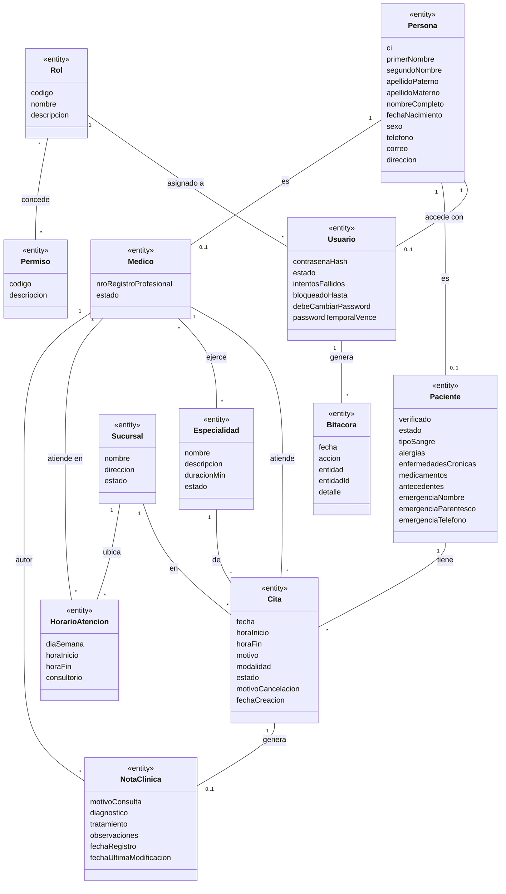

**Clases de interfaz y de control del Ciclo #1** (cada caso de uso tiene su `«boundary»` y su `«control»`; las `«entity»` son las del diagrama):

| Caso de uso                          | «boundary»                             | «control»             | «entity»                                 |
| ------------------------------------ | -------------------------------------- | --------------------- | ---------------------------------------- |
| CU-01 Iniciar y cerrar sesión        | FormLogin, MenuPrincipal               | ControlAcceso         | Persona, Usuario, Rol, Permiso, Bitacora |
| CU-02 Registrarse como paciente      | FormRegistro                           | ControlRegistro       | Persona, Paciente, Usuario               |
| CU-03 Gestionar usuarios y roles     | ListaUsuarios, FormUsuario             | ControlUsuario        | Persona, Usuario, Rol, Medico, Bitacora  |
| CU-04 Gestionar pacientes            | ListaPacientes, FormPaciente           | ControlPaciente       | Persona, Paciente, Usuario, Bitacora     |
| CU-05 Gestionar médicos              | ListaMedicos, FormMedico               | ControlMedico         | Persona, Medico, Especialidad            |
| CU-06 Gestionar especialidades       | ListaEspecialidades, FormEspecialidad  | ControlEspecialidad   | Especialidad                             |
| CU-07 Gestionar horarios de atención | ListaHorarios, FormHorario             | ControlHorario        | HorarioAtencion, Medico, Sucursal        |
| CU-08 Gestionar mi perfil            | VistaPerfil                            | ControlPerfil         | Persona, Paciente, Usuario               |
| CU-19 Renovar contraseña temporal    | FichaPaciente, ComprobanteCredenciales | ControlAccesoPaciente | Persona, Paciente, Usuario, Bitacora     |

### 5.2 Diagramas de comunicación / colaboración

Se presentan CU-01, CU-02 y CU-04 del Ciclo #1. Los números en las flechas indican el orden de los mensajes. Los demás casos se agregan en la segunda presentación.

**CU-01 Iniciar y cerrar sesión**

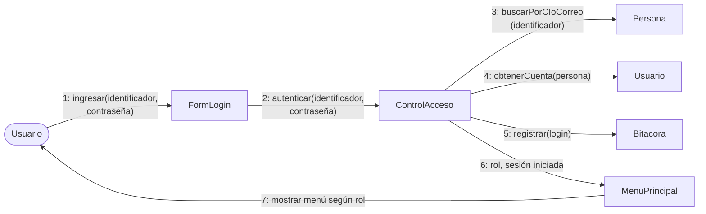

**CU-02 Registrarse como paciente**

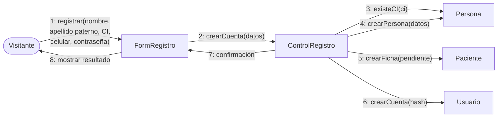

**CU-04 Gestionar pacientes**

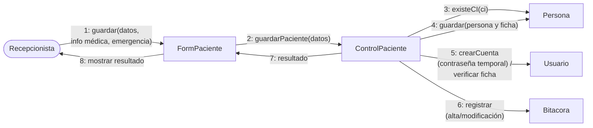

### 5.3 Diagrama de estados de la cita

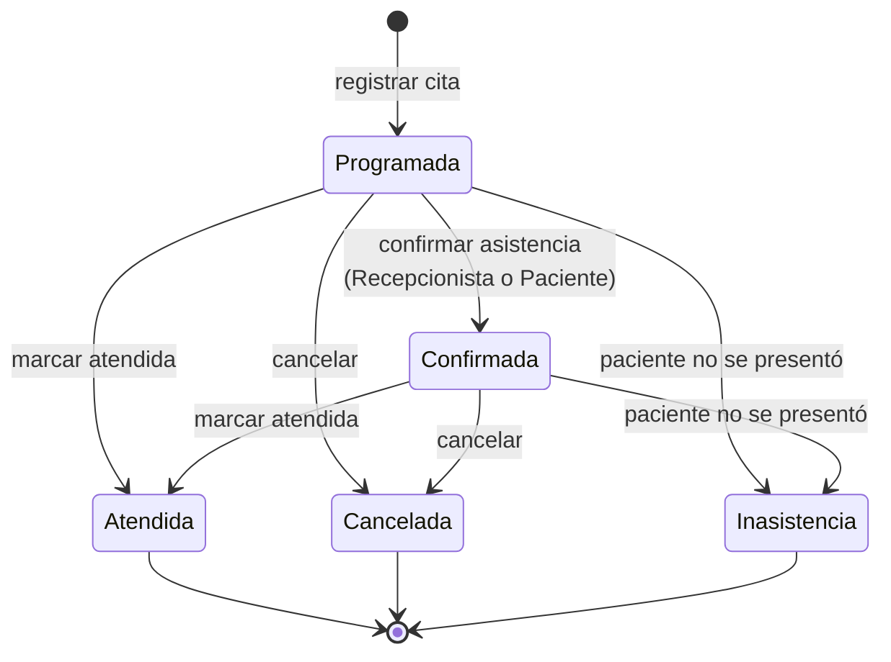

| Estado       | Ocupa horario  | Reprogramable | Cancelable |
| ------------ | -------------- | ------------- | ---------- |
| Programada   | Sí             | Sí            | Sí         |
| Confirmada   | Sí             | Sí            | Sí         |
| Atendida     | Sí (histórico) | No            | No         |
| Cancelada    | No (RN09)      | No            | No         |
| Inasistencia | Sí (histórico) | No            | No         |

Una cita cancelada no puede marcarse como atendida sin un procedimiento autorizado (RF10); ese procedimiento queda por definir en el Ciclo #2.

---

## 6. FT. Diseño

### 6.1 Diseño de arquitectura

#### 6.1.1 Arquitectura lógica

Arquitectura en capas sobre el patrón MVC de Laravel. Cada estereotipo del análisis (sección 5) se materializa en un artefacto concreto.

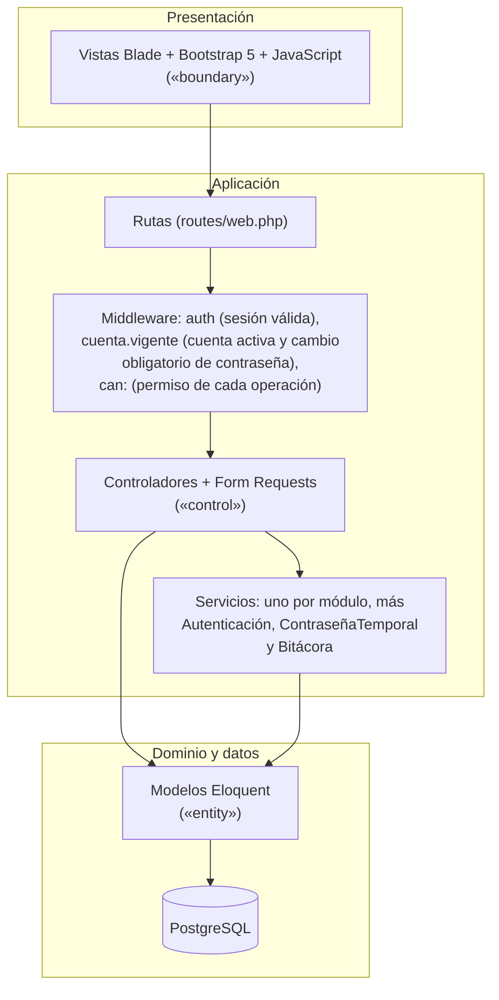

| Estereotipo del análisis                                                         | Artefacto en Laravel                                                                                            | Ubicación                                                                           |
| -------------------------------------------------------------------------------- | --------------------------------------------------------------------------------------------------------------- | ----------------------------------------------------------------------------------- |
| «boundary» (FormLogin, ListaPacientes...)                                        | Vistas Blade                                                                                                    | `resources/views/`                                                                  |
| «control» (ControlAcceso, ControlPaciente...)                                    | Controladores y Form Requests (validación)                                                                      | `app/Http/Controllers/`, `app/Http/Requests/`                                       |
| «entity» (Persona, Usuario, Paciente...)                                         | Modelos Eloquent                                                                                                | `app/Models/`                                                                       |
| Reglas de negocio y transversales (autenticación, contraseña temporal, bitácora) | Servicios                                                                                                       | `app/Services/`                                                                     |
| Formato de los códigos (`PAC-`, `MED-`, `CM-`)                                   | _Trait_ de los modelos                                                                                          | `app/Models/Concerns/TieneCodigoFormateado.php`                                     |
| Control de acceso (RNF06, RNF19)                                                 | Middleware `auth`, `cuenta.vigente` y `can:`, con el `Gate` de permisos                                         | `app/Http/Middleware/`, `bootstrap/app.php`, `app/Providers/AppServiceProvider.php` |
| Cierre por inactividad y bloqueo por intentos (RNF14, RNF15)                     | Configuración de la sesión (`SESSION_LIFETIME`), límite de solicitudes en las rutas y servicio de autenticación | `config/session.php`, `routes/web.php`, `app/Services/AutenticacionService.php`     |

**Reglas de la arquitectura**

- Las vistas no contienen lógica de negocio ni consultas.
- Los controladores no escriben SQL: usan los modelos y los servicios.
- Toda validación se hace en el servidor (Form Requests) y se refuerza en el cliente con JavaScript (RNF08).
- Las consultas pasan por Eloquent o por el constructor de consultas de Laravel, que usan sentencias parametrizadas (RNF05).

#### 6.1.2 Arquitectura física (despliegue)

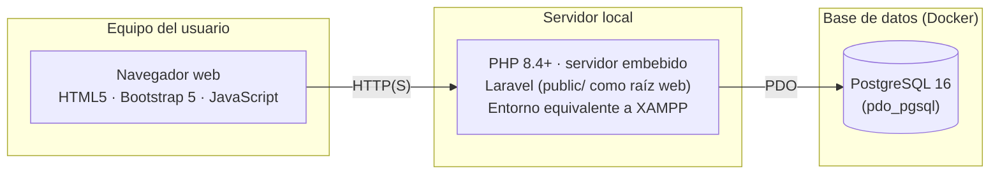

| Nodo                   | Software                                                                    | Responsabilidad                                                                |
| ---------------------- | --------------------------------------------------------------------------- | ------------------------------------------------------------------------------ |
| Cliente                | Navegador moderno                                                           | Muestra la interfaz y ejecuta las validaciones de JavaScript.                  |
| Servidor de aplicación | PHP 8.4 o superior con su servidor embebido (`php artisan serve`) y Laravel | Procesa las solicitudes, aplica las reglas de negocio y mantiene las sesiones. |
| Servidor de datos      | PostgreSQL 16 en un contenedor Docker (`docker-compose.yml`)                | Almacena los datos de forma persistente (RN14).                                |

El servidor embebido es solo para desarrollo. Un despliegue real sustituiría ese nodo por Apache o Nginx con PHP apuntando a `public/`, sin cambiar el código ni la base de datos (RNF03).

Los archivos de Bootstrap se sirven desde `public/`, sin depender de una conexión a internet.

### 6.2 Diseño de casos de uso (diagramas de secuencia)

Se diseñan CU-01, CU-02 y CU-04 (creación de cuenta con contraseña temporal). Los demás casos del Ciclo #1 siguen el mismo patrón de controlador, Form Request, servicio y modelo.

**CU-01 Iniciar sesión**

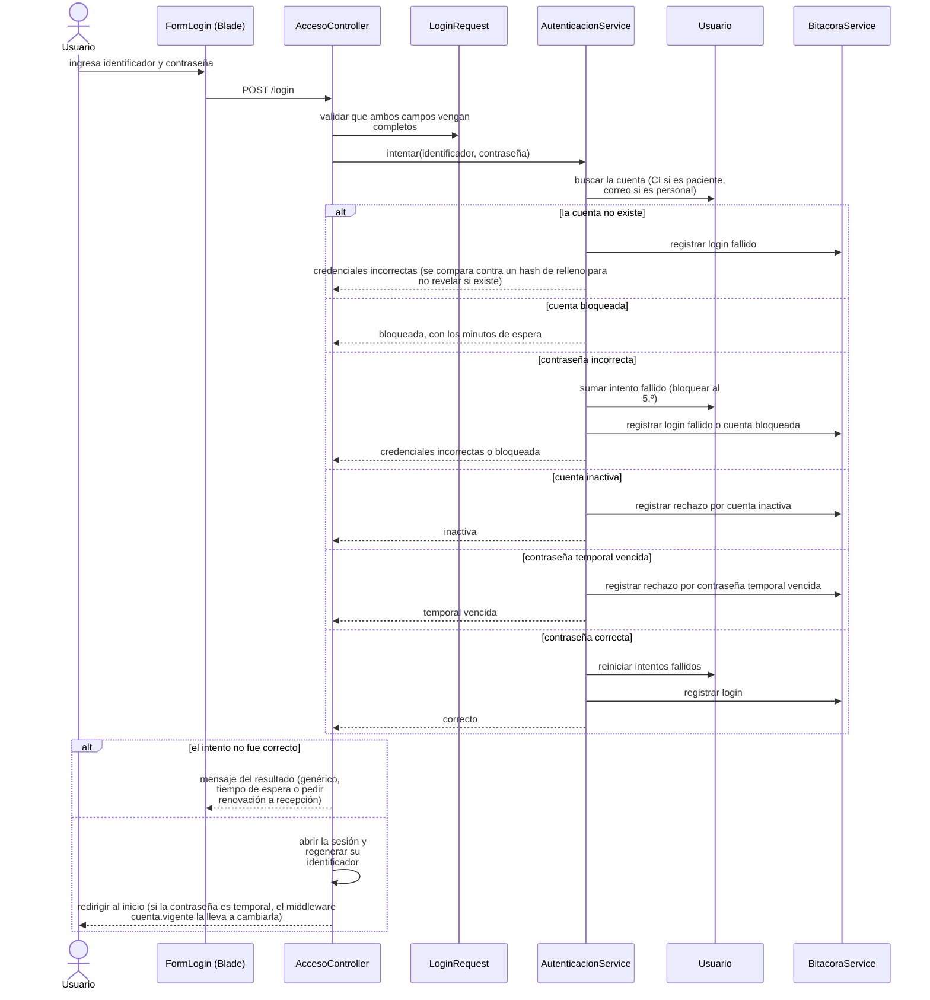

**CU-02 Registrarse como paciente**

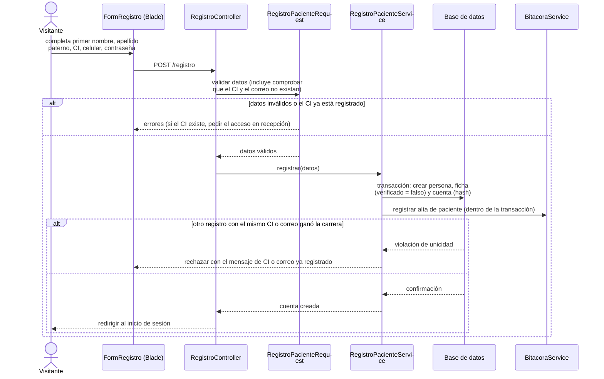

**CU-04 Crear la cuenta de un paciente**

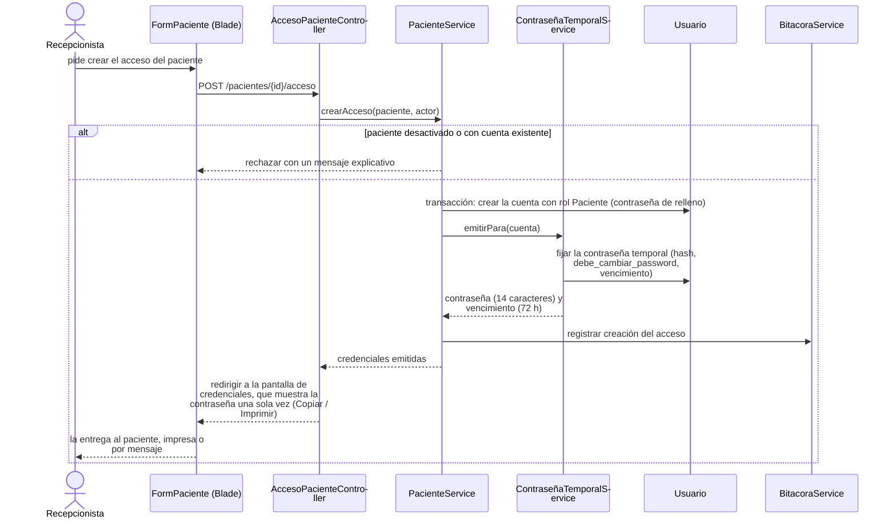

**CU-19 Renovar contraseña temporal**

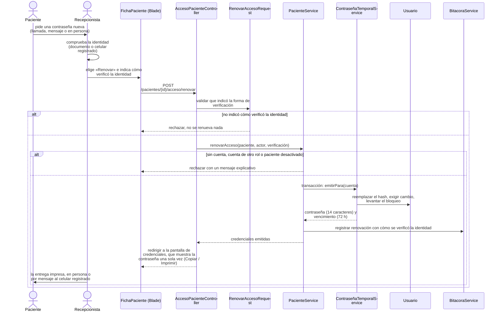

El Administrador renueva las cuentas del personal con el mismo flujo desde CU-03. Si el único Administrador olvida su contraseña, el administrador del servidor usa el comando de consola `php artisan administrador:renovar-password {correo}`, que deja constancia en la bitácora.

### 6.3 Diseño de datos

#### 6.3.1 Modelo lógico

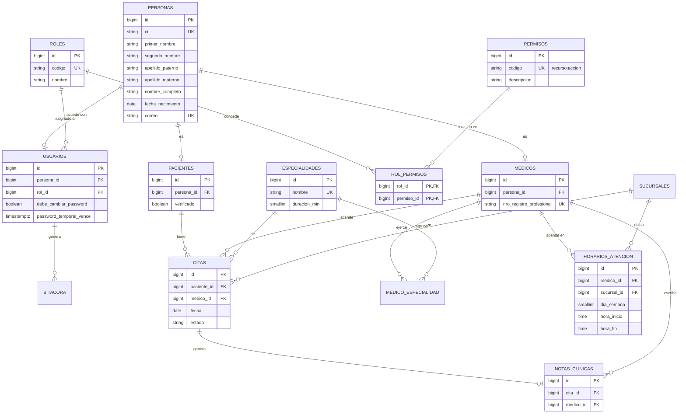

**Decisiones del modelo**

- Todos los textos son de tipo `TEXT`; los formatos que importan (CI, teléfono, correo, tipo de sangre, códigos) se acotan con `CHECK`.
- El nombre de la persona es atómico: `primer_nombre` y `apellido_paterno` obligatorios, `segundo_nombre` y `apellido_materno` opcionales (si se escriben, no pueden estar en blanco). `nombre_completo` es una columna generada que une las partes, así que nunca se desincroniza y sirve para buscar e imprimir.
- En `usuarios`, `debe_cambiar_password` y `password_temporal_vence` van siempre juntas (restricción `CHECK`): una contraseña temporal siempre tiene vencimiento y, al cambiarla, ambas se limpian a la vez. El contador `intentos_fallidos` se pone en cero al entrar bien o al renovar la contraseña.
- Una cuenta se da de baja desactivándola (`estado = false`), no eliminándola: la bitácora y las notas clínicas la referencian con `RESTRICT`, para no perder quién hizo cada cosa. La aplicación no ofrece eliminar cuentas.
- Todos los identificadores son `BIGINT`, para no mezclar tipos en las claves foráneas. `SMALLINT` se reserva para valores acotados por naturaleza: `duracion_min`, `dia_semana` e `intentos_fallidos`.
- El control de acceso es RBAC normalizado: `roles`, `permisos` y `rol_permisos` son tablas, y `usuarios.rol_id` es una clave foránea al rol. Los permisos tienen formato `recurso:accion` (restricción `CHECK`) y se asignan a los roles por claves foráneas, así que la base rechaza un permiso inexistente. Cada cuenta tiene un solo rol: una persona puede ser médico y paciente a la vez, pero su cuenta tiene rol Médico; como paciente la atiende la recepción. Los catálogos iniciales se cargan con `003_catalogos_iniciales.sql`.
- El estado activo/inactivo vive en cada especialización (`pacientes.estado`, `medicos.estado`), no en `personas`: desactivar a un paciente no debe desactivar a la misma persona como médico (RN11).
- `ON DELETE RESTRICT` en las claves hacia pacientes, médicos y citas: nada con historial se elimina, solo se desactiva (RN10, RN11).
- El CI es único en `personas`; el correo es único sin distinguir mayúsculas y solo cuando existe.
- Los datos del personal administrativo (Administrador, Recepcionista) viven en `personas` y `usuarios`, sin ficha.
- El correo es obligatorio para el personal y para el Paciente es opcional; esa regla la valida la aplicación, porque depende del rol.
- Una restricción de exclusión impide horarios de atención superpuestos del mismo médico en el mismo día (CU-07) y citas superpuestas del mismo médico (RNF17); las citas canceladas no cuentan.
- Una clave foránea compuesta exige que el médico de una cita ejerza la especialidad elegida, y otra ata la nota clínica al médico de su cita. Consecuencia: no se puede quitar una especialidad a un médico que tiene citas con ella.
- El código de paciente, médico y cita es el `id`, identificador único (RF02, RF03, RF06); el formato `PAC-000001` se arma al mostrarlo y no se guarda. Pueden quedar saltos en la numeración, porque el `id` no se revierte si el alta falla. La matrícula del médico (`nro_registro_profesional`) es un dato distinto: la emite una entidad externa y se guarda aparte, única y obligatoria.
- La bitácora es de solo escritura: un disparador impide modificar, borrar o vaciar sus filas. Su campo `detalle` guarda el contexto de la acción, por ejemplo cómo se verificó la identidad al renovar una contraseña (CU-19).
- Las claves foráneas llevan índice, porque PostgreSQL no los crea solo.
- Las reglas que cruzan tablas (cita dentro del horario del médico, duración de la cita, médico activo, fecha futura, transiciones de estado, que un médico no se atienda a sí mismo) las valida la aplicación y se cubren con pruebas.

#### 6.3.2 Modelo físico (DDL PostgreSQL)

El script es el contenido de `codigo/database/sql/001_esquema_base.sql` (Ciclo #1) y `002_citas_y_notas.sql` (Ciclo #2), que las migraciones de Laravel ejecutan; `003_catalogos_iniciales.sql` carga los datos de referencia (sucursal, roles y permisos, ver 4.7). Se verificó en PostgreSQL 16: los `CHECK` de formato, la restricción contra horarios y citas superpuestas, las claves foráneas compuestas, el control de acceso y la bitácora de solo escritura rechazan lo inválido, y `migrate:rollback` deja la base limpia. Las tablas propias del framework (`migrations`) no se listan.

```sql
-- Ciclo #1: identidad, acceso, datos maestros y bitácora.
-- Referencia de diseño: documento/Informe-Final.md, sección 6.3.2.
-- Los textos usan TEXT; los formatos se acotan con CHECK donde importa.

CREATE EXTENSION IF NOT EXISTS btree_gist;

CREATE TABLE sucursales (
    id         BIGSERIAL   PRIMARY KEY,
    nombre     TEXT        NOT NULL UNIQUE CHECK (btrim(nombre) <> ''),
    direccion  TEXT,
    estado     BOOLEAN     NOT NULL DEFAULT TRUE
);

CREATE TABLE personas (
    id               BIGSERIAL   PRIMARY KEY,
    ci               TEXT        NOT NULL UNIQUE CHECK (ci ~ '^[0-9]{5,10}(-[0-9A-Z]{1,2})?$'),
    primer_nombre    TEXT        NOT NULL CHECK (btrim(primer_nombre) <> ''),
    segundo_nombre   TEXT        CHECK (segundo_nombre IS NULL OR btrim(segundo_nombre) <> ''),
    apellido_paterno TEXT        NOT NULL CHECK (btrim(apellido_paterno) <> ''),
    apellido_materno TEXT        CHECK (apellido_materno IS NULL OR btrim(apellido_materno) <> ''),
    -- Nombre completo derivado: siempre coincide con sus partes y se puede buscar e imprimir.
    nombre_completo  TEXT        GENERATED ALWAYS AS (
        TRIM(BOTH FROM (
            primer_nombre
            || COALESCE(' ' || segundo_nombre, '')
            || ' ' || apellido_paterno
            || COALESCE(' ' || apellido_materno, '')
        ))
    ) STORED,
    fecha_nacimiento DATE        CHECK (fecha_nacimiento <= CURRENT_DATE),
    sexo             TEXT        CHECK (sexo IN ('M', 'F')),
    telefono         TEXT        CHECK (telefono ~ '^\+?[0-9]{7,15}$'),
    correo           TEXT        CHECK (correo ~* '^[^@[:space:]]+@[^@[:space:]]+\.[^@[:space:]]+$'),
    direccion        TEXT,
    created_at       TIMESTAMPTZ NOT NULL DEFAULT now(),
    updated_at       TIMESTAMPTZ NOT NULL DEFAULT now()
);
-- El correo es opcional, pero único (sin distinguir mayúsculas) cuando existe.
CREATE UNIQUE INDEX personas_correo_uq ON personas (lower(correo)) WHERE correo IS NOT NULL;

-- Control de acceso (RBAC): los permisos son datos validados por claves foráneas.
-- Cada permiso usa el formato recurso:accion (por ejemplo, pacientes:gestionar).
CREATE TABLE roles (
    id          BIGSERIAL   PRIMARY KEY,
    codigo      TEXT        NOT NULL UNIQUE CHECK (codigo ~ '^[A-Z_]+$'),
    nombre      TEXT        NOT NULL CHECK (btrim(nombre) <> ''),
    descripcion TEXT,
    created_at  TIMESTAMPTZ NOT NULL DEFAULT now()
);

CREATE TABLE permisos (
    id          BIGSERIAL   PRIMARY KEY,
    codigo      TEXT        NOT NULL UNIQUE CHECK (codigo ~ '^[a-z_]+:[a-z_]+$'),
    descripcion TEXT        NOT NULL CHECK (btrim(descripcion) <> ''),
    created_at  TIMESTAMPTZ NOT NULL DEFAULT now()
);

CREATE TABLE rol_permisos (
    rol_id     BIGINT NOT NULL REFERENCES roles (id) ON DELETE CASCADE,
    permiso_id BIGINT NOT NULL REFERENCES permisos (id) ON DELETE CASCADE,
    PRIMARY KEY (rol_id, permiso_id)
);
CREATE INDEX rol_permisos_permiso_idx ON rol_permisos (permiso_id);

CREATE TABLE usuarios (
    id                      BIGSERIAL   PRIMARY KEY,
    persona_id              BIGINT      NOT NULL UNIQUE REFERENCES personas (id) ON DELETE RESTRICT,
    password_hash           TEXT        NOT NULL,
    -- Un solo rol por cuenta. Una persona puede ser médico y paciente, pero entra con rol MEDICO.
    rol_id                  BIGINT      NOT NULL REFERENCES roles (id) ON DELETE RESTRICT,
    estado                  BOOLEAN     NOT NULL DEFAULT TRUE,
    intentos_fallidos       SMALLINT    NOT NULL DEFAULT 0 CHECK (intentos_fallidos >= 0),
    bloqueado_hasta         TIMESTAMPTZ,
    debe_cambiar_password   BOOLEAN     NOT NULL DEFAULT FALSE,
    password_temporal_vence TIMESTAMPTZ,
    created_at              TIMESTAMPTZ NOT NULL DEFAULT now(),
    updated_at              TIMESTAMPTZ NOT NULL DEFAULT now(),
    -- Las dos columnas van juntas: una contraseña temporal siempre tiene vencimiento.
    CHECK (debe_cambiar_password = (password_temporal_vence IS NOT NULL))
);
CREATE INDEX usuarios_rol_idx ON usuarios (rol_id);

CREATE TABLE pacientes (
    id                    BIGSERIAL   PRIMARY KEY,
    persona_id            BIGINT      NOT NULL UNIQUE REFERENCES personas (id) ON DELETE RESTRICT,
    verificado            BOOLEAN     NOT NULL DEFAULT FALSE,
    estado                BOOLEAN     NOT NULL DEFAULT TRUE,
    tipo_sangre           TEXT        CHECK (tipo_sangre IN ('A+', 'A-', 'B+', 'B-', 'AB+', 'AB-', 'O+', 'O-')),
    alergias              TEXT,
    enfermedades_cronicas TEXT,
    medicamentos          TEXT,
    antecedentes          TEXT,
    emergencia_nombre     TEXT,
    emergencia_parentesco TEXT,
    emergencia_telefono   TEXT        CHECK (emergencia_telefono ~ '^\+?[0-9]{7,15}$'),
    created_at            TIMESTAMPTZ NOT NULL DEFAULT now(),
    updated_at            TIMESTAMPTZ NOT NULL DEFAULT now()
);

CREATE TABLE medicos (
    id                       BIGSERIAL   PRIMARY KEY,
    persona_id               BIGINT      NOT NULL UNIQUE REFERENCES personas (id) ON DELETE RESTRICT,
    nro_registro_profesional TEXT        NOT NULL UNIQUE CHECK (btrim(nro_registro_profesional) <> ''),
    estado                   BOOLEAN     NOT NULL DEFAULT TRUE,
    created_at               TIMESTAMPTZ NOT NULL DEFAULT now(),
    updated_at               TIMESTAMPTZ NOT NULL DEFAULT now()
);

CREATE TABLE especialidades (
    id           BIGSERIAL   PRIMARY KEY,
    nombre       TEXT        NOT NULL CHECK (btrim(nombre) <> ''),
    descripcion  TEXT,
    duracion_min SMALLINT    NOT NULL DEFAULT 30 CHECK (duracion_min BETWEEN 5 AND 240),
    estado       BOOLEAN     NOT NULL DEFAULT TRUE
);
-- Nombre único normalizado: sin distinguir mayúsculas ni espacios en los extremos.
CREATE UNIQUE INDEX especialidades_nombre_uq ON especialidades (lower(btrim(nombre)));

CREATE TABLE medico_especialidad (
    medico_id       BIGINT   NOT NULL REFERENCES medicos (id) ON DELETE CASCADE,
    especialidad_id BIGINT   NOT NULL REFERENCES especialidades (id) ON DELETE RESTRICT,
    PRIMARY KEY (medico_id, especialidad_id)
);
CREATE INDEX medico_especialidad_especialidad_idx ON medico_especialidad (especialidad_id);

CREATE TABLE horarios_atencion (
    id          BIGSERIAL PRIMARY KEY,
    medico_id   BIGINT    NOT NULL REFERENCES medicos (id) ON DELETE CASCADE,
    sucursal_id BIGINT    NOT NULL REFERENCES sucursales (id) ON DELETE RESTRICT,
    dia_semana  SMALLINT  NOT NULL CHECK (dia_semana BETWEEN 1 AND 7),
    hora_inicio TIME      NOT NULL,
    hora_fin    TIME      NOT NULL,
    consultorio TEXT,
    CHECK (hora_fin > hora_inicio),
    -- Rango del bloque dentro de un día de referencia, para comparar superposiciones.
    rango TSRANGE GENERATED ALWAYS AS
        (tsrange(DATE '2000-01-01' + hora_inicio, DATE '2000-01-01' + hora_fin)) STORED,
    -- Un médico no puede tener dos bloques superpuestos el mismo día, ni en sucursales distintas.
    EXCLUDE USING gist (medico_id WITH =, dia_semana WITH =, rango WITH &&)
);
CREATE INDEX horarios_atencion_sucursal_idx ON horarios_atencion (sucursal_id);

-- La bitácora es solo de añadir: no se modifica, no se borra y no se vacía.
CREATE TABLE bitacora (
    id         BIGSERIAL   PRIMARY KEY,
    usuario_id BIGINT      REFERENCES usuarios (id) ON DELETE RESTRICT,
    accion     TEXT        NOT NULL CHECK (btrim(accion) <> ''),
    entidad    TEXT,
    entidad_id BIGINT,
    -- Contexto de la acción, por ejemplo cómo se verificó la identidad al renovar una contraseña.
    detalle    TEXT,
    fecha      TIMESTAMPTZ NOT NULL DEFAULT now()
);
CREATE INDEX bitacora_usuario_idx ON bitacora (usuario_id);
CREATE INDEX bitacora_fecha_idx ON bitacora (fecha);

CREATE OR REPLACE FUNCTION bitacora_solo_agregar() RETURNS TRIGGER
    LANGUAGE plpgsql
    AS $$
BEGIN
    RAISE EXCEPTION 'La bitácora es de solo escritura: no se permite % sobre bitacora', TG_OP;
END;
$$;

CREATE TRIGGER bitacora_sin_modificar
    BEFORE UPDATE OR DELETE ON bitacora
    FOR EACH ROW EXECUTE FUNCTION bitacora_solo_agregar();

CREATE TRIGGER bitacora_sin_vaciar
    BEFORE TRUNCATE ON bitacora
    FOR EACH STATEMENT EXECUTE FUNCTION bitacora_solo_agregar();
-- Ciclo #2: citas médicas y notas clínicas.
-- Referencia de diseño: documento/Informe-Final.md, sección 6.3.2.

CREATE TABLE citas (
    id                 BIGSERIAL   PRIMARY KEY,
    paciente_id        BIGINT      NOT NULL REFERENCES pacientes (id) ON DELETE RESTRICT,
    medico_id          BIGINT      NOT NULL,
    especialidad_id    BIGINT      NOT NULL,
    sucursal_id        BIGINT      NOT NULL REFERENCES sucursales (id) ON DELETE RESTRICT,
    fecha              DATE        NOT NULL,
    hora_inicio        TIME        NOT NULL,
    hora_fin           TIME        NOT NULL,
    modalidad          TEXT        NOT NULL DEFAULT 'PRESENCIAL'
                       CHECK (modalidad IN ('PRESENCIAL', 'VIRTUAL')),
    estado             TEXT        NOT NULL DEFAULT 'PROGRAMADA'
                       CHECK (estado IN ('PROGRAMADA', 'CONFIRMADA', 'ATENDIDA', 'CANCELADA', 'INASISTENCIA')),
    motivo             TEXT,
    motivo_cancelacion TEXT,
    created_at         TIMESTAMPTZ NOT NULL DEFAULT now(),
    updated_at         TIMESTAMPTZ NOT NULL DEFAULT now(),
    CHECK (hora_fin > hora_inicio),
    periodo TSRANGE GENERATED ALWAYS AS (tsrange(fecha + hora_inicio, fecha + hora_fin)) STORED,
    -- El médico solo puede atender una especialidad que ejerce.
    FOREIGN KEY (medico_id, especialidad_id)
        REFERENCES medico_especialidad (medico_id, especialidad_id) ON DELETE RESTRICT,
    -- Un médico no puede tener dos citas superpuestas; las canceladas no ocupan horario (RN07, RN09).
    EXCLUDE USING gist (medico_id WITH =, periodo WITH &&) WHERE (estado <> 'CANCELADA'),
    -- Permite que la nota clínica se ate al médico de la cita.
    UNIQUE (id, medico_id)
);
CREATE INDEX citas_paciente_idx ON citas (paciente_id);
CREATE INDEX citas_especialidad_idx ON citas (especialidad_id);
CREATE INDEX citas_sucursal_idx ON citas (sucursal_id);
CREATE INDEX citas_fecha_idx ON citas (fecha);

CREATE TABLE notas_clinicas (
    id               BIGSERIAL   PRIMARY KEY,
    cita_id          BIGINT      NOT NULL UNIQUE,
    medico_id        BIGINT      NOT NULL,
    motivo_consulta  TEXT,
    diagnostico      TEXT,
    tratamiento      TEXT,
    observaciones    TEXT,
    modificado_por   BIGINT      REFERENCES usuarios (id) ON DELETE RESTRICT,
    created_at       TIMESTAMPTZ NOT NULL DEFAULT now(),
    updated_at       TIMESTAMPTZ NOT NULL DEFAULT now(),
    -- La nota la escribe el médico de la cita.
    FOREIGN KEY (cita_id, medico_id) REFERENCES citas (id, medico_id) ON DELETE RESTRICT
);
CREATE INDEX notas_clinicas_medico_idx ON notas_clinicas (medico_id);
```

### 6.4 Diseño de interfaces

Interfaz en Blade con Bootstrap 5: barra de navegación superior cuyas opciones dependen del rol, formularios con validación en cliente y mensajes de error junto a cada campo. El verde de la clínica (`#0b6e6e`) es el color primario de toda la interfaz: botones, barra superior, pestañas, insignias, enlaces y el halo de los campos al enfocarlos.

**Pantallas del Ciclo #1**

| Pantalla                             | Rol                          | Caso de uso  | Contenido principal                                                                                                                                 |
| ------------------------------------ | ---------------------------- | ------------ | --------------------------------------------------------------------------------------------------------------------------------------------------- |
| Inicio de sesión                     | Público                      | CU-01        | CI o correo, contraseña, celular de la clínica para pedir una contraseña nueva                                                                      |
| Registro de paciente                 | Público                      | CU-02        | Primer nombre, apellido paterno, CI, celular, contraseña; segundo nombre, apellido materno y correo opcionales                                      |
| Cambio de contraseña                 | Todos                        | CU-01, CU-08 | Obligatoria en el primer ingreso con una contraseña temporal                                                                                        |
| Mi perfil                            | Paciente                     | CU-08        | Datos personales; información médica y contacto de emergencia en solo lectura si la ficha está verificada; edición de teléfono y contraseña         |
| Lista de pacientes                   | Recepcionista                | CU-04        | Búsqueda por CI, nombre o apellido; estado de verificación                                                                                          |
| Formulario de paciente               | Recepcionista                | CU-04        | Datos personales, información médica, contacto de emergencia; acciones: crear o renovar acceso, verificar ficha, desactivar                         |
| Credenciales temporales              | Recepcionista, Administrador | CU-03, CU-04 | Contraseña mostrada una sola vez, con vencimiento y botones Copiar e Imprimir                                                                       |
| Lista y formulario de usuarios       | Administrador                | CU-03        | Alta del personal, rol, vínculo con médico, activar o desactivar, renovar contraseña                                                                |
| Lista y formulario de médicos        | Administrador                | CU-05        | Búsqueda; pestañas Activos, Inactivos y Todos con su contador; datos, registro profesional, especialidades, estado                                  |
| Lista y formulario de especialidades | Administrador                | CU-06        | Pestañas Activas, Inactivas y Todas con su contador; nombre, descripción, duración de la cita, estado                                               |
| Horarios de atención                 | Administrador                | CU-07        | Lista de médicos activos con el resumen de su semana; por médico, la semana y el formulario de bloques: día, hora inicial, hora final y consultorio |

**Criterio para los listados con baja lógica** (aplicado hoy en especialidades). Los registros que se desactivan en lugar de eliminarse se listan en pestañas **Activas / Inactivas / Todas**, con la cantidad de cada una y las activas por defecto. El contador evita que lo dado de baja desaparezca sin aviso. Cada fila ofrece solo la acción que corresponde a su estado (Desactivar o Reactivar), y el cambio vuelve a la pestaña desde la que se hizo.

**Menú por rol**

| Rol           | Opciones                                       |
| ------------- | ---------------------------------------------- |
| Administrador | Usuarios · Médicos · Especialidades · Horarios |
| Recepcionista | Pacientes                                      |
| Médico        | (Ciclo #2: agenda y notas clínicas)            |
| Paciente      | Mi perfil (Ciclo #2: mis citas)                |

---

## 7. FT. Implementación

### 7.1 Herramientas de desarrollo

| Capa                  | Herramienta                                    | Versión                                                           | Uso en el proyecto                                                                                                                                    |
| --------------------- | ---------------------------------------------- | ----------------------------------------------------------------- | ----------------------------------------------------------------------------------------------------------------------------------------------------- |
| Lenguaje del servidor | PHP                                            | 8.4.1 o superior (lo exige el `composer.lock`); probado con 8.5.4 | Lógica de negocio y acceso a datos (RNF01).                                                                                                           |
| _Framework_           | Laravel                                        | 13.38                                                             | Rutas, controladores, validación, autenticación por sesión, Eloquent y plantillas Blade.                                                              |
| Base de datos         | PostgreSQL                                     | 16                                                                | Almacenamiento persistente (RN14). Corre en un contenedor Docker.                                                                                     |
| Acceso a datos        | PDO con `pdo_pgsql`                            | Incluido en PHP                                                   | Conexión con consultas parametrizadas, a través de Eloquent (RNF05).                                                                                  |
| Interfaz              | HTML5, CSS3 y Bootstrap                        | Bootstrap 5.3.8                                                   | Plantillas Blade con Bootstrap servido desde `public/vendor/bootstrap`, sin depender de internet. Hoja de estilos propia en `public/css/clinica.css`. |
| Cliente               | JavaScript                                     | Sin librerías                                                     | Validaciones de formularios en el navegador (`public/js/validaciones.js`), además de la validación en el servidor (RNF08).                            |
| Dependencias PHP      | Composer                                       | 2.x                                                               | Instala y fija las versiones de las librerías (`composer.lock`).                                                                                      |
| Entorno de la base    | Docker y Docker Compose                        | —                                                                 | Levanta PostgreSQL con `docker-compose.yml` (RNF03).                                                                                                  |
| Servidor local        | Servidor embebido de PHP (`php artisan serve`) | PHP 8.4 o superior                                                | Ejecuta la aplicación en desarrollo. Un despliegue real usaría Apache o Nginx (RNF03).                                                                |
| Pruebas               | PHPUnit                                        | 12.5                                                              | Pruebas unitarias y de funcionalidad con `php artisan test`.                                                                                          |
| Control de versiones  | Git y GitHub                                   | —                                                                 | Repositorio público del código y del informe (sección 7.4).                                                                                           |

El esqueleto de Laravel trae también Vite y Tailwind CSS (`package.json`), pero la interfaz no los usa: las vistas cargan Bootstrap y el JavaScript propio directamente desde `public/`, por lo que no hace falta Node.js para ejecutar la aplicación.

**Puesta en marcha.** El procedimiento completo está en el `README.md` del repositorio: copiar `.env.example` a `.env`, instalar las dependencias con Composer, generar la clave de la aplicación, levantar PostgreSQL con Docker, ejecutar las migraciones y cargar los datos iniciales con `php artisan db:seed`.

### 7.2 Implementación de la arquitectura del sistema

La arquitectura lógica de la sección 6.1 se materializó sin cambiar su forma: cada solicitud recorre las mismas capas, y cada capa vive en un directorio propio de `codigo/`. El recorrido de una solicitud del Ciclo #1 es:

```text
ruta (routes/web.php)
  -> middleware: auth, cuenta.vigente, can:<permiso>
  -> controlador (app/Http/Controllers)
  -> Form Request: validación en el servidor (app/Http/Requests)
  -> servicio: reglas de negocio (app/Services)
  -> modelo Eloquent (app/Models)
  -> PostgreSQL (database/sql)
  -> vista Blade (resources/views)
```

**Rutas y grupos de middleware.** `routes/web.php` separa dos zonas. Las rutas públicas (`/login` y `/registro`) están bajo el middleware `guest` y las solicitudes de entrada y de registro se limitan a 10 por minuto con `throttle:10,1` (RNF15, RNF20). Todas las páginas internas están bajo `auth` y `cuenta.vigente` (RF01, RNF06), y cada módulo agrega su permiso con `can:` (RNF19).

`routes/web.php`

```php
// Páginas internas: exigen sesión válida (RF01) y una cuenta vigente.
Route::middleware(['auth', 'cuenta.vigente'])->group(function () {
    Route::redirect('/', '/inicio');
    Route::get('/inicio', InicioController::class)->name('inicio');
    Route::post('/logout', [AccesoController::class, 'salir'])->name('logout');
// ...
    // CU-03: gestionar usuarios y roles del personal (solo el Administrador, con usuarios:gestionar).
    Route::prefix('usuarios')->name('usuarios.')->middleware('can:usuarios:gestionar')->group(function () {
        Route::get('/', [UsuarioController::class, 'index'])->name('index');
        Route::get('/nuevo', [UsuarioController::class, 'create'])->name('create');
        Route::post('/', [UsuarioController::class, 'store'])->name('store');
```

**Middleware `cuenta.vigente`.** El alias se registra en `bootstrap/app.php` y apunta a la clase `VerificarCuenta`.

`bootstrap/app.php`

```php
        $middleware->alias([
            'cuenta.vigente' => \App\Http\Middleware\VerificarCuenta::class,
        ]);
```

`VerificarCuenta` se ejecuta en cada solicitud de una sesión abierta. Si la cuenta fue desactivada, o si la contraseña temporal venció, cierra la sesión. Si la contraseña temporal sigue vigente, solo deja pasar las rutas de cambio de contraseña y de cierre de sesión (RNF18). Por eso la baja de una cuenta surte efecto en la solicitud siguiente.

`app/Http/Middleware/VerificarCuenta.php`

```php
        if (! $cuenta->estado) {
            return $this->cerrarSesion($request, 'Su cuenta fue desactivada. Comuníquese con recepción.');
        }

        if ($cuenta->debe_cambiar_password) {
            if ($cuenta->password_temporal_vence->isPast()) {
                return $this->cerrarSesion(
                    $request,
                    'La contraseña temporal venció. Pida una nueva en recepción: '.config('clinica.celular').'.'
                );
            }

            if (! $request->routeIs(self::RUTAS_PERMITIDAS)) {
                return redirect()->route('password.cambiar');
            }
        }
```

**Control de acceso por permisos (RBAC).** Los permisos tienen el formato `recurso:accion` (sección 4.7) y se guardan en las tablas `permisos` y `rol_permisos`. Para que `can:usuarios:gestionar` funcione, `AppServiceProvider` registra un `Gate::before` que consulta el rol de la cuenta; lo mismo sirve para `@can()` en las vistas y para `Gate::allows()` en el código (RN12, RNF19).

`app/Providers/AppServiceProvider.php`

```php
        // Cada permiso del catálogo (por ejemplo pacientes:gestionar) funciona como una
        // habilidad: Gate::allows(), @can() y el middleware can: lo consultan en el rol de la cuenta.
        Gate::before(fn (?Usuario $cuenta, string $habilidad) => $cuenta?->tienePermiso($habilidad) ? true : null);
```

**Controlador.** Cada controlador recibe la solicitud ya validada y delega la regla de negocio en un servicio; no escribe SQL ni decide reglas. `AccesoController` es el ejemplo más pequeño: el Form Request valida, el servicio decide y el controlador solo abre la sesión.

`app/Http/Controllers/AccesoController.php`

```php
    public function autenticar(LoginRequest $request, AutenticacionService $acceso): RedirectResponse
    {
        $intento = $acceso->intentar(
            $request->validated('identificador'),
            $request->validated('contrasena'),
        );

        if (! $intento->fueCorrecto()) {
            return back()
                ->withInput($request->only('identificador'))
                ->withErrors(['identificador' => $intento->mensaje()]);
        }

        Auth::login($intento->cuenta);
        // Nuevo identificador de sesión al entrar, para evitar la fijación de sesión.
        $request->session()->regenerate();
```

**Form Request.** La validación del servidor está en clases de `app/Http/Requests/` (RNF08); el cliente la refuerza con `public/js/validaciones.js`. Varias solicitudes comparten el trait `NormalizaDatosDePersona`, que deja el CI, el correo y los teléfonos en la forma en que se guardan antes de validarlos.

`app/Http/Requests/LoginRequest.php`

```php
    public function rules(): array
    {
        return [
            'identificador' => ['required', 'string', 'max:150'],
            'contrasena' => ['required', 'string', 'max:255'],
        ];
    }
```

**Servicio.** Las reglas de negocio viven en `app/Services/`, un servicio por módulo, más los transversales. Los servicios abren la transacción, aplican la regla, escriben en la bitácora y traducen los rechazos de la base de datos a un mensaje comprensible. `HorarioService` muestra este último punto: la restricción de exclusión de PostgreSQL (más abajo) es la última defensa, y el servicio convierte su error `23P01` en una regla de negocio.

`app/Services/HorarioService.php`

```php
    private function conReglasDeLaBase(\Closure $operacion): mixed
    {
        try {
            return $operacion();
        } catch (QueryException $e) {
            // 23P01: violación de la restricción de exclusión (bloques superpuestos del mismo médico).
            if (($e->errorInfo[0] ?? null) === '23P01') {
                throw new ReglaDeNegocioException('Este horario se superpone con otro del mismo médico el mismo día.');
            }

            throw $e;
        }
    }
```

`ReglaDeNegocioException` es la excepción común de todos los servicios. `bootstrap/app.php` la convierte en una redirección a la pantalla anterior con el mensaje, sin volver a poner en el formulario ninguna contraseña (RNF20); la plantilla base muestra ese mensaje.

`bootstrap/app.php`

```php
        $exceptions->render(
            fn (ReglaDeNegocioException $e) => back()
                ->withInput(request()->except(['password', 'password_confirmation', 'password_actual', 'contrasena']))
                ->with('error', $e->getMessage())
        );
```

**Modelo.** Los modelos de `app/Models/` son las entidades del análisis. `Usuario` es la cuenta de acceso: guarda el hash en la columna `password_hash`, nunca la expone al serializarse (`$hidden`) y la convierte en hash automáticamente al asignarla (`'hashed'`), de modo que ningún servicio escribe una contraseña en claro (RNF04).

`app/Models/Usuario.php`

```php
    protected $hidden = ['password_hash'];

    protected function casts(): array
    {
        return [
            // Al asignar una contraseña en texto plano se guarda su hash.
            'password_hash' => 'hashed',
            'estado' => 'boolean',
            'bloqueado_hasta' => 'datetime',
            'debe_cambiar_password' => 'boolean',
            'password_temporal_vence' => 'datetime',
        ];
    }
```

**Base de datos.** El esquema del Ciclo #1 está escrito en SQL puro en `database/sql/` (`001_esquema_base.sql`, `002_citas_y_notas.sql`, `003_catalogos_iniciales.sql`); las migraciones de `database/migrations/` solo ejecutan esos archivos. Así las restricciones no dependen de la aplicación: unicidad (CI, correo, registro profesional, nombre de especialidad), formatos con `CHECK`, claves foráneas y la restricción de exclusión de los horarios. Esta es la que impide que un médico tenga dos bloques superpuestos el mismo día:

`database/sql/001_esquema_base.sql`

```sql
    CHECK (hora_fin > hora_inicio),
    -- Rango del bloque dentro de un día de referencia, para comparar superposiciones.
    rango TSRANGE GENERATED ALWAYS AS
        (tsrange(DATE '2000-01-01' + hora_inicio, DATE '2000-01-01' + hora_fin)) STORED,
    -- Un médico no puede tener dos bloques superpuestos el mismo día, ni en sucursales distintas.
    EXCLUDE USING gist (medico_id WITH =, dia_semana WITH =, rango WITH &&)
```

**Vistas y menú por permisos.** El menú no está escrito en las vistas: sale de `config/menu.php`, donde cada opción declara el permiso que la habilita y el nombre de la ruta a la que lleva.

`config/menu.php`

```php
    'opciones' => [
        ['etiqueta' => 'Usuarios', 'permiso' => 'usuarios:gestionar', 'ruta' => 'usuarios.index'],
        ['etiqueta' => 'Médicos', 'permiso' => 'medicos:gestionar', 'ruta' => 'medicos.index'],
        ['etiqueta' => 'Especialidades', 'permiso' => 'especialidades:gestionar', 'ruta' => 'especialidades.index'],
        ['etiqueta' => 'Horarios de atención', 'permiso' => 'horarios:gestionar', 'ruta' => 'horarios.index'],
        ['etiqueta' => 'Pacientes', 'permiso' => 'pacientes:gestionar', 'ruta' => 'pacientes.index'],
        ['etiqueta' => 'Mi perfil', 'permiso' => 'perfil:gestionar', 'ruta' => 'perfil.mostrar'],
    ],
```

La clase `App\Support\Menu` filtra esas opciones con el mismo `Gate` que usan las rutas, de modo que la interfaz oculta lo que el servidor rechazaría. Una opción cuya ruta todavía no existe se muestra deshabilitada.

`app/Support/Menu.php`

```php
        foreach (config('menu.opciones') as $opcion) {
            if (! Gate::forUser($cuenta)->allows($opcion['permiso'])) {
                continue;
            }

            $opciones[] = [
                'etiqueta' => $opcion['etiqueta'],
                'url' => Route::has($opcion['ruta']) ? route($opcion['ruta']) : null,
            ];
        }
```

La plantilla base `resources/views/layouts/base.blade.php` dibuja la barra de navegación solo para sesiones abiertas (`@auth`), recorre el resultado de `Menu::para()` y deja el contenido de cada pantalla en `@yield('contenido')`. Todas las vistas del Ciclo #1 extienden esta plantilla. Los avisos de éxito y de error de la sesión también se muestran aquí, y el formulario de cierre de sesión incluye `@csrf`.

`resources/views/layouts/base.blade.php`

```blade
                    @foreach (\App\Support\Menu::para(auth()->user()) as $opcion)
                        <li class="nav-item">
                            @if ($opcion['url'])
                                <a class="nav-link" href="{{ $opcion['url'] }}">{{ $opcion['etiqueta'] }}</a>
                            @else
                                <span class="nav-link disabled" aria-disabled="true">{{ $opcion['etiqueta'] }}</span>
                            @endif
                        </li>
                    @endforeach
```

#### Aspectos transversales

**Bitácora de auditoría (RNF13).** `BitacoraService` es el único punto de escritura de la bitácora y solo sabe agregar. La base de datos refuerza esa regla: la tabla `bitacora` tiene disparadores que rechazan `UPDATE`, `DELETE` y `TRUNCATE` (`bitacora_sin_modificar` y `bitacora_sin_vaciar` en `001_esquema_base.sql`).

`app/Services/BitacoraService.php`

```php
    public function registrar(
        string $accion,
        ?Usuario $usuario = null,
        ?string $entidad = null,
        ?int $entidadId = null,
        ?string $detalle = null,
    ): void {
        Bitacora::create([
            'usuario_id' => $usuario?->id,
            'accion' => $accion,
            'entidad' => $entidad,
            'entidad_id' => $entidadId,
            'detalle' => $detalle,
        ]);
    }
```

**Límite de intentos y bloqueo de cuenta (RNF15).** `AutenticacionService::registrarFallo()` suma el intento en la base de forma atómica (`increment()`), vuelve a leer el valor real y, al llegar al máximo, bloquea la cuenta. Los valores (5 intentos, 15 minutos) están en `config/clinica.php`, no en el código. A esto se suma el límite de 10 solicitudes por minuto por IP de la ruta `/login`.

`app/Services/AutenticacionService.php`

```php
        $cuenta->increment('intentos_fallidos');
        $cuenta->refresh();

        if ($cuenta->intentos_fallidos >= config('clinica.login.max_intentos')) {
            $cuenta->forceFill([
                'intentos_fallidos' => 0,
                'bloqueado_hasta' => now()->addMinutes(config('clinica.login.bloqueo_minutos')),
            ])->save();
            $this->bitacora->registrar('cuenta_bloqueada', $cuenta, 'usuarios', $cuenta->id);

            return new IntentoAcceso(ResultadoAcceso::Bloqueada, $cuenta, $this->minutosRestantes($cuenta));
        }
```

**Contraseñas temporales (RNF18).** `ContrasenaTemporalService` genera la contraseña con `random_int()` (generador criptográfico), con 14 caracteres por defecto, y le fija 72 horas de vigencia. `emitirPara()` es el único lugar que asigna una contraseña temporal, tanto en el alta como en la renovación: la anterior deja de servir, se levanta el bloqueo y se obliga a cambiarla. Devuelve la contraseña en claro solo para mostrarla una vez; en la base queda su hash por el `cast` `hashed` de `Usuario`.

`app/Services/ContrasenaTemporalService.php`

```php
    public function emitirPara(Usuario $usuario): array
    {
        $contrasena = $this->generar();
        $vence = $this->vencimiento();

        $usuario->forceFill([
            'password_hash' => $contrasena,
            'debe_cambiar_password' => true,
            'password_temporal_vence' => $vence,
            'intentos_fallidos' => 0,
            'bloqueado_hasta' => null,
        ])->save();

        return ['contrasena' => $contrasena, 'vence' => $vence];
    }
```

**Cierre por inactividad (RNF14).** La duración de la sesión la fija la variable de entorno `SESSION_LIFETIME`, que `config/session.php` lee en minutos. El archivo `.env.example` la deja en 30 minutos, que es el valor que exige el requisito, y el valor por defecto de `config/session.php` también es 30: si la variable falta en el `.env`, la sesión sigue venciendo a los 30 minutos de inactividad.

`config/session.php`

```php
    'lifetime' => (int) env('SESSION_LIFETIME', 30),
```

### 7.3 Implementación de la arquitectura de subsistemas

Cada caso de uso del Ciclo #1 sigue el mismo patrón de 7.2: ruta con permiso, controlador, Form Request, servicio, modelos y vistas. Esta sección recorre los nueve casos de uso y señala, para cada uno, los archivos que lo implementan, las reglas que aplica y el fragmento de código que mejor las muestra. Los casos de uso del Ciclo #2 (CU-09 a CU-18) no están implementados todavía. Las rutas de cada módulo están en el Anexo B y las pruebas por módulo en el Anexo C.

Todos los servicios de este ciclo usan `BitacoraService` (RNF13) y `ReglaDeNegocioException` (sección 7.2); no se repite en cada tabla.

#### CU-01 Iniciar y cerrar sesión

| Elemento                | Archivo                                                                                                  |
| ----------------------- | -------------------------------------------------------------------------------------------------------- |
| Controlador             | `app/Http/Controllers/AccesoController.php` (`formulario`, `autenticar`, `salir`)                        |
| Solicitud de validación | `app/Http/Requests/LoginRequest.php`                                                                     |
| Servicio                | `app/Services/AutenticacionService.php` (devuelve un `IntentoAcceso` con un `ResultadoAcceso`)           |
| Middleware              | `app/Http/Middleware/VerificarCuenta.php` (cuenta desactivada o contraseña temporal vencida o pendiente) |
| Vistas                  | `resources/views/auth/login.blade.php`, `resources/views/layouts/base.blade.php`                         |
| Pruebas                 | `tests/Feature/Acceso/LoginTest.php`, `tests/Feature/Acceso/CambioPasswordTest.php`                      |

Reglas aplicadas:

- El paciente entra con su CI y el personal con su correo. El servicio busca la cuenta según el identificador y rechaza la combinación contraria (un paciente con correo o el personal con CI).
- Cuando la cuenta no existe, el servicio igual verifica la contraseña contra un hash de relleno, para que la respuesta tarde lo mismo y no revele si la cuenta existe; el mensaje de error es genérico (flujo alterno 2a).
- La contraseña se verifica con `Hash::check()` (RNF04). Una cuenta bloqueada no llega a esa verificación y devuelve el tiempo de espera (flujo alterno 2f, RNF15).
- Tras la verificación se rechaza la cuenta inactiva (2b) y la contraseña temporal vencida (2d, RNF18). Al entrar bien se ponen en cero los intentos y se registra `login` en la bitácora.
- El controlador abre la sesión y regenera su identificador (protección contra la fijación de sesión). `salir` registra `logout`, destruye la sesión y regenera el token.
- La pantalla de acceso muestra el celular de la clínica tomado de `config('clinica.celular')` (flujo alterno 2e).

`app/Services/AutenticacionService.php`

```php
        if ($cuenta->bloqueado_hasta?->isFuture()) {
            return new IntentoAcceso(ResultadoAcceso::Bloqueada, $cuenta, $this->minutosRestantes($cuenta));
        }

        if (! Hash::check($contrasena, $cuenta->password_hash)) {
            return $this->registrarFallo($cuenta);
        }

        if (! $cuenta->estado) {
            $this->bitacora->registrar('login_rechazado_inactiva', $cuenta, 'usuarios', $cuenta->id);

            return new IntentoAcceso(ResultadoAcceso::Inactiva, $cuenta);
        }

        if ($cuenta->debe_cambiar_password && $cuenta->password_temporal_vence->isPast()) {
            $this->bitacora->registrar('login_rechazado_temporal_vencida', $cuenta, 'usuarios', $cuenta->id);

            return new IntentoAcceso(ResultadoAcceso::TemporalVencida, $cuenta);
        }
```

#### CU-02 Registrarse como paciente

| Elemento                | Archivo                                                                                  |
| ----------------------- | ---------------------------------------------------------------------------------------- |
| Controlador             | `app/Http/Controllers/RegistroController.php` (`formulario`, `guardar`)                  |
| Solicitud de validación | `app/Http/Requests/RegistroPacienteRequest.php` (con el trait `NormalizaDatosDePersona`) |
| Servicio                | `app/Services/RegistroPacienteService.php`                                               |
| Vistas                  | `resources/views/auth/registro.blade.php`                                                |
| Pruebas                 | `tests/Feature/Acceso/RegistroTest.php`                                                  |

Reglas aplicadas:

- Las rutas `/registro` son públicas (`guest`) y limitadas a 10 solicitudes por minuto por IP (RNF20).
- El Form Request exige CI con formato válido, celular de 7 a 15 dígitos y una contraseña de al menos 8 caracteres con mayúsculas, minúsculas y números, confirmada (RNF08). Rechaza un CI que ya exista como persona (sea paciente, médico o personal) y un correo ya registrado (flujos 3a y 3b).
- El servicio crea la persona, la ficha con `verificado = false` y la cuenta con rol `PACIENTE` en una sola transacción, y registra `paciente_registro_propio`. La contraseña no es temporal: la elige el paciente.
- Si dos registros simultáneos pasan la validación, la base rechaza al segundo con `UniqueConstraintViolationException` y el servicio lo informa con el mismo mensaje, sin dejar datos a medias (flujo 3c).

`app/Services/RegistroPacienteService.php`

```php
        try {
            return DB::transaction(function () use ($datos) {
                $persona = Persona::create(Arr::only($datos, [
                    'ci', 'primer_nombre', 'segundo_nombre', 'apellido_paterno', 'apellido_materno', 'telefono', 'correo',
                ]));

                Paciente::create(['persona_id' => $persona->id, 'verificado' => false]);

                $cuenta = Usuario::create([
                    'persona_id' => $persona->id,
                    'rol_id' => Rol::where('codigo', 'PACIENTE')->firstOrFail()->id,
                    'password_hash' => $datos['password'],
                ])->refresh();

                $this->bitacora->registrar('paciente_registro_propio', $cuenta, 'usuarios', $cuenta->id);

                return $cuenta;
            });
        } catch (UniqueConstraintViolationException) {
```

#### CU-03 Gestionar usuarios y roles

| Elemento                | Archivo                                                                                      |
| ----------------------- | -------------------------------------------------------------------------------------------- |
| Controlador             | `app/Http/Controllers/UsuarioController.php` (con el trait `ListadoConPestanas`)             |
| Solicitud de validación | `app/Http/Requests/UsuarioRequest.php`, `app/Http/Requests/RenovarAccesoRequest.php`         |
| Servicio                | `app/Services/UsuarioService.php`, `app/Services/ContrasenaTemporalService.php`              |
| Vistas                  | `resources/views/usuarios/` (`index`, `create`, `edit`, `credenciales`, `_datos-personales`) |
| Pruebas                 | `tests/Feature/Usuarios/UsuarioTest.php`                                                     |

Reglas aplicadas:

- Todo el grupo `/usuarios` exige `usuarios:gestionar`, que solo concede el rol Administrador (RN12, RNF19). Además, `AppServiceProvider` enlaza el parámetro `{usuario}` solo a cuentas que no son de paciente: las de pacientes responden 404 aquí y se gestionan en CU-02 y CU-04.
- Al crear la cuenta se genera una contraseña temporal de 72 horas, que se muestra una sola vez (RNF18): el controlador la pasa a la pantalla `credenciales` en un mensaje de sesión que se pierde al recargar.
- Para el rol Médico la cuenta se vincula a un médico ya registrado y activo (flujo 3b); si el CI ya existe como persona sin cuenta, se reutiliza sin modificar sus datos personales (flujo 3a).
- Nadie se desactiva a sí mismo, se cambia el rol ni se renueva la contraseña desde esta pantalla (5a), y el sistema conserva siempre al menos un Administrador activo (5b).
- Una cuenta de médico no se reactiva mientras su ficha siga desactivada (5c). Los datos de una cuenta de médico se editan en CU-05; aquí solo se intercambian los roles Administrador y Recepcionista.
- La renovación de contraseña exige indicar cómo se verificó la identidad y lo deja en la bitácora (6a); es la misma operación de CU-19.

`app/Services/UsuarioService.php`

```php
    /** El sistema siempre conserva al menos un Administrador activo. */
    private function exigirOtroAdministradorActivo(Usuario $cuenta): void
    {
        if ($cuenta->rol->codigo !== 'ADMINISTRADOR' || ! $cuenta->estado) {
            return;
        }

        $hayOtro = Usuario::query()
            ->where('id', '!=', $cuenta->id)
            ->where('estado', true)
            ->whereHas('rol', fn ($rol) => $rol->where('codigo', 'ADMINISTRADOR'))
            ->exists();

        if (! $hayOtro) {
            throw new ReglaDeNegocioException('Debe quedar al menos un Administrador activo.');
        }
    }
```

#### CU-04 Gestionar pacientes

| Elemento                | Archivo                                                                                            |
| ----------------------- | -------------------------------------------------------------------------------------------------- |
| Controlador             | `app/Http/Controllers/PacienteController.php`, `app/Http/Controllers/AccesoPacienteController.php` |
| Solicitud de validación | `app/Http/Requests/PacienteRequest.php`, `app/Http/Requests/RenovarAccesoRequest.php`              |
| Servicio                | `app/Services/PacienteService.php`, `app/Services/ContrasenaTemporalService.php`                   |
| Vistas                  | `resources/views/pacientes/` (`index`, `create`, `edit`, `show`, `credenciales`, `_formulario`)    |
| Pruebas                 | `tests/Feature/Pacientes/PacienteTest.php`, `tests/Feature/Pacientes/AccesoPacienteTest.php`       |

Reglas aplicadas:

- El grupo `/pacientes` exige `pacientes:gestionar`; verificar la ficha, crear el acceso y renovar la contraseña exigen además `pacientes:verificar`, `pacientes:crear_acceso` y `accesos:renovar`, respectivamente (RN12, RNF19).
- Un CI no puede tener dos fichas de paciente (RN01): el Form Request lo rechaza al validar y el servicio lo vuelve a comprobar dentro de la transacción. Si el CI existe como persona sin ficha (por ejemplo, un médico), se reutiliza esa persona sin tocar sus datos personales.
- La ficha creada por la Recepcionista queda verificada de inmediato (`verificado => true`); la de registro propio (CU-02) se verifica con `verificar()`, que puede renovar la contraseña en el mismo acto.
- El paciente nunca se elimina: se desactiva (RN11), y su cuenta de paciente sigue ese estado, de modo que un paciente desactivado no puede iniciar sesión. No existe una ruta de eliminación.
- Crear el acceso genera una contraseña temporal de 72 horas, que se muestra una sola vez. No se crea si el paciente está desactivado ni si la persona ya tiene una cuenta (flujos 5a a 5c).

`app/Services/PacienteService.php`

```php
        return DB::transaction(function () use ($datos, $actor) {
            $persona = Persona::where('ci', $datos['ci'])->first();
            $reutilizada = $persona !== null;
            $persona ??= Persona::create(Arr::only($datos, self::CAMPOS_PERSONA));

            if ($persona->paciente()->exists()) {
                throw new ReglaDeNegocioException('Ya existe un paciente registrado con este CI.');
            }

            $paciente = Paciente::create(
                ['persona_id' => $persona->id, 'verificado' => true] + Arr::only($datos, self::CAMPOS_FICHA)
            )->refresh();

            $this->bitacora->registrar('paciente_creado', $actor, 'pacientes', $paciente->id);

            return [$paciente, $reutilizada];
        });
```

#### CU-05 Gestionar médicos

| Elemento                | Archivo                                                                         |
| ----------------------- | ------------------------------------------------------------------------------- |
| Controlador             | `app/Http/Controllers/MedicoController.php` (con el trait `ListadoConPestanas`) |
| Solicitud de validación | `app/Http/Requests/MedicoRequest.php`                                           |
| Servicio                | `app/Services/MedicoService.php`                                                |
| Vistas                  | `resources/views/medicos/` (`index`, `create`, `edit`, `_formulario`)           |
| Pruebas                 | `tests/Feature/Medicos/MedicoTest.php`                                          |

Reglas aplicadas:

- El grupo `/medicos` exige `medicos:gestionar` (RN12, RNF19).
- Un CI no puede tener dos fichas de médico (RN02). El número de registro profesional se guarda en mayúsculas y sin espacios de más, y es único: lo comprueba el Form Request y lo garantiza la columna `UNIQUE` de la base de datos (flujo 3a). El correo se valida sin distinguir mayúsculas.
- Hay que elegir al menos una especialidad, y solo activas; si el médico ya tenía una que luego se desactivó, puede conservarla (flujo 3c).
- No se puede quitar una especialidad con la que el médico ya tiene citas; el servicio lo comprueba antes de guardar, nombra la especialidad en el mensaje y no aplica ningún cambio (flujo 3d). La clave foránea de la base de datos es la segunda defensa.
- El médico nunca se elimina: se desactiva (RN04, RN11). Al desactivarlo, su cuenta de médico también se desactiva; al reactivarlo la cuenta no se reactiva sola, sino que lo decide el Administrador en CU-03.

`app/Services/MedicoService.php`

```php
        $quitadas = $medico->especialidades()->pluck('especialidades.id')
            ->diff(array_map('intval', $nuevas));

        if ($quitadas->isEmpty()) {
            return;
        }

        $conCitas = Cita::where('medico_id', $medico->id)
            ->whereIn('especialidad_id', $quitadas)
            ->distinct()
            ->pluck('especialidad_id');

        if ($conCitas->isNotEmpty()) {
            $nombres = Especialidad::whereIn('id', $conCitas)->orderBy('nombre')->pluck('nombre')->implode(', ');

            throw new ReglaDeNegocioException(
                "No se puede quitar la especialidad {$nombres}: el médico tiene citas registradas con ella."
            );
        }
```

#### CU-06 Gestionar especialidades

| Elemento                | Archivo                                                                      |
| ----------------------- | ---------------------------------------------------------------------------- |
| Controlador             | `app/Http/Controllers/EspecialidadController.php`                            |
| Solicitud de validación | `app/Http/Requests/EspecialidadRequest.php`                                  |
| Servicio                | `app/Services/EspecialidadService.php`                                       |
| Vistas                  | `resources/views/especialidades/` (`index`, `create`, `edit`, `_formulario`) |
| Pruebas                 | `tests/Feature/Especialidades/EspecialidadTest.php`                          |

Reglas aplicadas:

- El grupo `/especialidades` exige `especialidades:gestionar` (RN12, RNF19).
- El nombre se normaliza antes de validar (`prepareForValidation`): sin espacios al inicio ni al final y con un solo espacio entre palabras. La unicidad no distingue mayúsculas; el Form Request la comprueba con `lower(btrim(nombre))`, igual que el índice único `especialidades_nombre_uq` de `001_esquema_base.sql`, que la garantiza ante solicitudes simultáneas (flujo 3a).
- La duración de la cita es un entero entre 5 y 240 minutos, validado en el Form Request y con un `CHECK` en la columna `duracion_min` (flujo 3b). La duración vive en la especialidad, de modo que las citas del Ciclo #2 la tomarán de ahí (RN08).
- La especialidad nunca se elimina: solo se activa o desactiva con `PATCH /especialidades/{id}/estado`.

`app/Http/Requests/EspecialidadRequest.php`

```php
                // Nombre normalizado: no se distinguen mayúsculas ni espacios de más (como el índice único).
                function (string $atributo, mixed $valor, \Closure $fallar) use ($especialidad): void {
                    $repetido = Especialidad::query()
                        ->whereRaw('lower(btrim(nombre)) = ?', [mb_strtolower(trim($valor))])
                        ->when($especialidad, fn ($consulta) => $consulta->where('id', '!=', $especialidad->id))
                        ->exists();

                    if ($repetido) {
                        $fallar(EspecialidadService::MENSAJE_NOMBRE_REPETIDO);
                    }
                },
```

#### CU-07 Gestionar horarios de atención

| Elemento                | Archivo                                                                |
| ----------------------- | ---------------------------------------------------------------------- |
| Controlador             | `app/Http/Controllers/HorarioController.php`                           |
| Solicitud de validación | `app/Http/Requests/HorarioRequest.php`                                 |
| Servicio                | `app/Services/HorarioService.php`                                      |
| Vistas                  | `resources/views/horarios/` (`index`, `medico`, `edit`, `_formulario`) |
| Pruebas                 | `tests/Feature/Horarios/HorarioTest.php`                               |

Reglas aplicadas:

- El grupo `/horarios` exige `horarios:gestionar` (RN12, RNF19). Las rutas de un bloque llevan el médico o el horario en la URL, restringidos a números.
- Día entre 1 y 7, horas con formato `H:i` y hora final posterior a la inicial (flujo 3a). El consultorio es opcional. La duración de la cita no se define aquí: la determina la especialidad (CU-06).
- Un médico no puede tener dos bloques superpuestos el mismo día. El Form Request lo detecta y su mensaje nombra el bloque en conflicto (flujo 3b); como los bloques pegados no se superponen, la consulta compara con `<` y `>` estrictos. La restricción `EXCLUDE` de la base de datos (sección 7.2) cubre las solicitudes simultáneas.
- La sucursal se asigna automáticamente con `Sucursal::predeterminada()`, porque solo hay una.
- No se registra, modifica ni elimina el horario de un médico desactivado (`exigirMedicoActivo`, flujo 3c).
- Antes de modificar o eliminar un bloque, el servicio calcula las citas futuras programadas o confirmadas que quedarían fuera del horario; si el cambio deja alguna sin cubrir, lo revierte y nombra las citas. Las que ya estaban fuera antes del cambio no cuentan (flujos 5a y 5b). Las citas pertenecen al Ciclo #2: la tabla `citas` existe desde `002_citas_y_notas.sql`, pero en este ciclo no hay pantallas para crearlas.

`app/Http/Requests/HorarioRequest.php`

```php
            $choque = HorarioAtencion::query()
                ->where('medico_id', $medicoId)
                ->where('dia_semana', (int) $dia)
                ->where('hora_inicio', '<', $horaFin)
                ->where('hora_fin', '>', $horaInicio)
                ->when($ignorarId, fn ($consulta) => $consulta->where('id', '!=', $ignorarId))
                ->first();

            if ($choque !== null) {
                $fallar("Este horario se superpone con otro del mismo médico: {$choque->descripcion()}.");
            }
```

#### CU-08 Gestionar mi perfil

| Elemento                | Archivo                                                                                                                 |
| ----------------------- | ----------------------------------------------------------------------------------------------------------------------- |
| Controlador             | `app/Http/Controllers/PerfilController.php`, `app/Http/Controllers/CambioPasswordController.php` (cambio de contraseña) |
| Solicitud de validación | `app/Http/Requests/PerfilRequest.php`, `app/Http/Requests/CambiarPasswordRequest.php`                                   |
| Servicio                | Sin servicio propio: el controlador actualiza el teléfono y llama a `BitacoraService`                                   |
| Vistas                  | `resources/views/perfil/mostrar.blade.php`, `resources/views/auth/cambiar-password.blade.php`                           |
| Pruebas                 | `tests/Feature/Perfil/PerfilTest.php`, `tests/Feature/Acceso/CambioPasswordTest.php`                                    |

Reglas aplicadas:

- El grupo `/perfil` exige `perfil:gestionar`, que solo concede el rol Paciente (RN12, RNF19). Una cuenta sin ficha de paciente recibe 404.
- `PerfilRequest` solo acepta el teléfono, obligatorio y de 7 a 15 dígitos con un `+` inicial opcional. El nombre, el CI, el correo, la información médica y el contacto de emergencia no se pueden modificar desde aquí.
- El cambio se guarda y se registra en la bitácora solo si el teléfono es distinto del anterior.
- La contraseña se cambia con el mismo formulario del primer ingreso (`password.cambiar`): pide la contraseña actual, exige que la nueva sea distinta y cumpla la política (8 caracteres, mayúsculas, minúsculas y números), y al guardar limpia las dos columnas de la contraseña temporal a la vez, como exige la base de datos.
- Las pruebas cubren que la información médica se muestre solo con la ficha verificada.

`app/Http/Controllers/PerfilController.php`

```php
    public function actualizar(PerfilRequest $request, BitacoraService $bitacora): RedirectResponse
    {
        $paciente = $this->paciente();
        $telefono = $request->validated('telefono');

        if ($paciente->persona->telefono !== $telefono) {
            $paciente->persona->update(['telefono' => $telefono]);
            $bitacora->registrar('perfil_modificado', $request->user(), 'personas', $paciente->persona_id, 'Teléfono');
        }

        return redirect()->route('perfil.mostrar')->with('exito', 'Su teléfono fue actualizado.');
    }
```

#### CU-19 Renovar contraseña temporal

| Elemento                | Archivo                                                                                                                                                                                                  |
| ----------------------- | -------------------------------------------------------------------------------------------------------------------------------------------------------------------------------------------------------- |
| Controlador             | `app/Http/Controllers/AccesoPacienteController.php` (`renovar`, `credenciales`), `app/Http/Controllers/UsuarioController.php` (`renovar`), `app/Console/Commands/RenovarPasswordAdministrador.php`       |
| Solicitud de validación | `app/Http/Requests/RenovarAccesoRequest.php`                                                                                                                                                             |
| Servicio                | `app/Services/PacienteService.php` (`renovarAcceso`), `app/Services/UsuarioService.php` (`renovarContrasena`), `app/Services/ContrasenaTemporalService.php` (`emitirPara`)                               |
| Vistas                  | `resources/views/pacientes/credenciales.blade.php`, `resources/views/usuarios/credenciales.blade.php`, `resources/views/components/comprobante-credenciales.blade.php`                                   |
| Pruebas                 | `tests/Feature/Pacientes/AccesoPacienteTest.php`, `tests/Feature/Usuarios/UsuarioTest.php`, `tests/Feature/Consola/RenovarPasswordAdministradorTest.php`, `tests/Unit/ContrasenaTemporalServiceTest.php` |

Reglas aplicadas:

- La Recepcionista renueva las cuentas de pacientes (`POST /pacientes/{id}/acceso/renovar`) y el Administrador las del personal (`POST /usuarios/{id}/renovar`). Las dos rutas exigen `accesos:renovar` (RN12, RNF19).
- Sin indicar cómo se verificó la identidad (documento o celular registrado) no se renueva nada: `RenovarAccesoRequest` valida la clave y el servicio la vuelve a exigir (flujo 3a). La forma de verificar queda en el campo `detalle` de la bitácora (RNF13).
- No se renueva la contraseña de una cuenta de paciente cuyo paciente está desactivado (3b) ni de un paciente sin cuenta (3d). La Recepcionista tampoco renueva una cuenta con otro rol: lo hace el Administrador (3c).
- Nadie se renueva su propia contraseña desde esta función: para eso existe «Cambiar contraseña» (CU-08).
- `emitirPara()` genera una contraseña aleatoria de 14 caracteres con 72 horas de vigencia, deja sin efecto la anterior, pone en cero los intentos fallidos y levanta el bloqueo (RNF18). La contraseña se muestra una sola vez en la pantalla de credenciales.
- Recuperación de emergencia: el comando de consola `php artisan administrador:renovar-password {correo}` renueva solo cuentas de Administrador activas, pide confirmación (salvo con `--force`) y registra `acceso_renovado` sin usuario actor.

`app/Services/PacienteService.php`

```php
        $formaDeVerificar = self::VERIFICACION_IDENTIDAD[$verificacion]
            ?? throw new ReglaDeNegocioException('Indique cómo verificó la identidad del titular.');

        $cuenta = $paciente->persona->usuario;

        if ($cuenta === null) {
            throw new ReglaDeNegocioException('El paciente todavía no tiene una cuenta.');
        }

        if ($cuenta->rol->codigo !== 'PACIENTE') {
            throw new ReglaDeNegocioException('La cuenta de esta persona no es de paciente: la renueva el Administrador.');
        }

        if (! $paciente->estado) {
            throw new ReglaDeNegocioException('No se puede renovar el acceso de un paciente desactivado.');
        }
// ...
        return DB::transaction(function () use ($paciente, $cuenta, $actor, $formaDeVerificar) {
            $emitida = $this->contrasenas->emitirPara($cuenta);
            $this->bitacora->registrar(
                'acceso_renovado', $actor, 'usuarios', $cuenta->id, "Identidad verificada con: {$formaDeVerificar}"
            );

            return $emitida + ['usuario' => $paciente->persona->ci];
        });
```

### 7.4 Repositorio

El código fuente está publicado en GitHub, con la historia de commits atómicos del desarrollo y un `README.md` con las instrucciones para instalar y ejecutar el sistema.

|                    |                                                        |
| ------------------ | ------------------------------------------------------ |
| **URL**            | https://github.com/Einarpd26/2do-examen-ing-requisitos |
| **Rama principal** | `main`                                                 |
| **Visibilidad**    | Pública                                                |


Al escanear el código QR se abre la página del repositorio. La estructura de carpetas se describe en el Anexo A.

---

## 8. FT. Pruebas

### 8.1 Plan de pruebas

**Objetivo.** Comprobar que el sistema cumple los casos de uso y las reglas de negocio del Ciclo #1 (CU-01 a CU-08 y CU-19), que rechaza los datos y los accesos inválidos, y que la base de datos hace cumplir sus restricciones aunque la aplicación falle.

**Alcance.** Ciclo #1: acceso y roles, usuarios, pacientes, médicos, especialidades, horarios y perfil del paciente. Las pruebas 3 a 8 del enunciado dependen de las citas (CU-09 en adelante) y se ejecutan en el Ciclo #2.

**Estrategia.** Cada caso de uso se prueba en tres frentes: automatizado, contra la base de datos real y de forma manual.

| Nivel                              | Qué verifica                                                                                                                                           | Herramienta                                                             | Dónde está       |
| ---------------------------------- | ------------------------------------------------------------------------------------------------------------------------------------------------------ | ----------------------------------------------------------------------- | ---------------- |
| Unitarias                          | Reglas aisladas sin base de datos: códigos con formato (`PAC-000001`), contraseñas temporales y paleta de colores.                                     | PHPUnit                                                                 | `tests/Unit/`    |
| Funcionales (HTTP y base de datos) | Cada ruta del sistema con una solicitud real: permisos, validaciones, reglas de negocio, mensajes en español y registro en la bitácora.                | PHPUnit con `RefreshDatabase` sobre la base `clinica_test` (PostgreSQL) | `tests/Feature/` |
| Restricciones de la base           | Que PostgreSQL rechace los datos inválidos aunque se salte la aplicación: claves únicas de médicos y especialidades y bloques de horario superpuestos. | PHPUnit, pruebas «la base rechaza…»                                     | `tests/Feature/` |
| Manuales                           | El recorrido de cada caso de uso en el navegador, por rol, incluida la vista en un teléfono.                                                           | Lista de verificación por caso de uso                                   | Sección 8.3      |

Las pruebas funcionales usan la base de datos real y no una simulada, porque varias reglas viven en PostgreSQL (restricciones `UNIQUE`, `CHECK` y `EXCLUDE`), y una base simulada no las habría ejercitado.

**Tipos de caso por cada caso de uso.** Para cada uno se escriben, cuando aplican, pruebas de:

1. **Permisos:** solo el rol autorizado entra; los demás reciben el error 403 y quien no inició sesión es enviado al login.
2. **Flujo principal:** la operación se completa y el resultado queda guardado.
3. **Validación:** los datos inválidos se rechazan en el servidor con un mensaje en español y no se guarda nada.
4. **Reglas de negocio:** duplicados, bajas lógicas, superposiciones y demás reglas del modelo de negocio (RN).
5. **Concurrencia:** una solicitud simultánea que choca con la base se informa como regla de negocio, sin error técnico.
6. **Auditoría:** la acción queda en la bitácora (RNF13).

**Entorno.** PHP 8.5.4, Laravel 13, PHPUnit 12.5.40 y PostgreSQL 16 en un contenedor Docker, con la base `clinica_test` separada de la de desarrollo. Cada prueba parte de una base vacía y con los catálogos cargados.

**Criterio de aprobación.** Un caso se aprueba cuando se obtiene el resultado esperado. El ciclo se da por probado cuando la suite completa pasa sin fallos.

**Cronograma.**

| Ciclo | Pruebas                                                                                 | Estado                   |
| ----- | --------------------------------------------------------------------------------------- | ------------------------ |
| #1    | Pruebas 1, 2, 9 y 10 del enunciado y los casos por caso de uso de CU-01 a CU-08 y CU-19 | Ejecutadas (sección 8.2) |
| #2    | Pruebas 3 a 8 del enunciado y los casos de CU-09 a CU-18                                | Pendientes               |

### 8.2 Casos de prueba

#### 8.2.1 Pruebas mínimas del enunciado

Los resultados obtenidos salen de la ejecución de la suite del 24/10/2026 (sección 8.3). En cada fila, la prueba automatizada está indicada como `Clase::método`.

| N.º | Prueba                                               | Resultado esperado                                | Resultado obtenido                                                                                                                                                                                                                                                                                                                                                                                                                                                                    | Estado   |
| --- | ---------------------------------------------------- | ------------------------------------------------- | ------------------------------------------------------------------------------------------------------------------------------------------------------------------------------------------------------------------------------------------------------------------------------------------------------------------------------------------------------------------------------------------------------------------------------------------------------------------------------------- | -------- |
| 1   | Registrar un paciente nuevo                          | El paciente queda guardado                        | La Recepcionista registra al paciente: se crean la persona (con su nombre completo calculado) y la ficha en estado verificado y activo, y queda un registro `paciente_creado` en la bitácora. Con el registro propio se crea además la cuenta y la ficha queda pendiente de verificación. Pruebas `PacienteTest::registra_un_paciente_verificado_con_su_persona_y_su_ficha` y `RegistroTest::crea_la_persona_la_ficha_pendiente_y_la_cuenta_de_paciente`.                             | Aprobada |
| 2   | Registrar un paciente con CI duplicado               | El sistema rechaza el duplicado                   | El sistema devuelve un error en el campo CI y no crea otra ficha: la cantidad de pacientes sigue en uno. En el registro propio manda además al paciente a la recepción. Pruebas `PacienteTest::rechaza_un_ci_que_ya_tiene_ficha_de_paciente` y `RegistroTest::rechaza_un_ci_que_ya_esta_registrado_y_manda_a_recepcion`.                                                                                                                                                              | Aprobada |
| 3   | Programar una cita en horario disponible             | La cita queda registrada                          | Depende de CU-09                                                                                                                                                                                                                                                                                                                                                                                                                                                                      | Ciclo #2 |
| 4   | Programar otra cita superpuesta para el mismo médico | El sistema impide el conflicto                    | Depende de CU-09                                                                                                                                                                                                                                                                                                                                                                                                                                                                      | Ciclo #2 |
| 5   | Intentar reservar fuera del horario médico           | El sistema rechaza la cita                        | Depende de CU-09                                                                                                                                                                                                                                                                                                                                                                                                                                                                      | Ciclo #2 |
| 6   | Cancelar una cita                                    | Cambia a estado cancelado y conserva el historial | Depende de CU-11                                                                                                                                                                                                                                                                                                                                                                                                                                                                      | Ciclo #2 |
| 7   | Consultar el historial de un paciente                | Aparecen sus citas registradas                    | Depende de CU-14                                                                                                                                                                                                                                                                                                                                                                                                                                                                      | Ciclo #2 |
| 8   | Buscar las citas de un médico por fecha              | Se muestran los resultados correctos              | Depende de CU-13                                                                                                                                                                                                                                                                                                                                                                                                                                                                      | Ciclo #2 |
| 9   | Ingresar a una página interna sin iniciar sesión     | El acceso es denegado                             | El sistema redirige al formulario de inicio de sesión sin mostrar la página. Se comprueba en el inicio y en cada módulo de gestión (usuarios, pacientes, médicos, especialidades, horarios y perfil). Prueba `LoginTest::una_pagina_interna_sin_sesion_redirige_al_login` y `sin_sesion_se_redirige_al_login` de cada módulo.                                                                                                                                                         | Aprobada |
| 10  | Intentar ejecutar una operación con datos inválidos  | El servidor valida y rechaza la operación         | El servidor rechaza cada dato inválido con un error en el campo correspondiente y no guarda nada. En el alta de pacientes se prueban doce casos: sin nombre, sin apellido, sin CI, CI con letras, CI muy corto, teléfono inválido, teléfono de emergencia inválido, tipo de sangre inválido, sexo inválido, fecha de nacimiento futura, correo mal escrito y correo de otra persona. Prueba `PacienteTest::valida_los_datos_del_formulario`, con pruebas equivalentes en cada módulo. | Aprobada |

#### 8.2.2 Casos por caso de uso

| N.º   | CU            | Prueba                                                      | Resultado esperado                                                                                                                           | Prueba automatizada                                                                                                                                                                                                                                                           | Estado   |
| ----- | ------------- | ----------------------------------------------------------- | -------------------------------------------------------------------------------------------------------------------------------------------- | ----------------------------------------------------------------------------------------------------------------------------------------------------------------------------------------------------------------------------------------------------------------------------- | -------- |
| CP-01 | CU-01         | El personal entra con su correo y el paciente con su CI     | Entra al inicio; el correo no distingue mayúsculas                                                                                           | `LoginTest::el_personal_entra_con_su_correo`, `el_paciente_entra_con_su_ci`                                                                                                                                                                                                   | Aprobada |
| CP-02 | CU-01         | El CI se escribe con espacios y en minúsculas               | Entra igual que al registrarse                                                                                                               | `LoginTest::el_ci_se_acepta_con_espacios_como_al_registrarse`                                                                                                                                                                                                                 | Aprobada |
| CP-03 | CU-01         | Contraseña incorrecta y cuenta inexistente                  | Mismo mensaje en ambos casos, sin revelar si la cuenta existe                                                                                | `LoginTest::contrasena_incorrecta_y_cuenta_inexistente_dan_el_mismo_mensaje`                                                                                                                                                                                                  | Aprobada |
| CP-04 | CU-01         | Cinco fallos seguidos                                       | La cuenta se bloquea 15 minutos, aun con la contraseña correcta                                                                              | `LoginTest::el_quinto_fallo_bloquea_la_cuenta_15_minutos`, `una_cuenta_bloqueada_no_entra_ni_con_la_clave_correcta`                                                                                                                                                           | Aprobada |
| CP-05 | CU-01         | Intentos simultáneos con el contador desactualizado         | El bloqueo se aplica con el valor real de la base                                                                                            | `LoginTest::el_conteo_de_intentos_usa_el_valor_real_de_la_base`                                                                                                                                                                                                               | Aprobada |
| CP-06 | CU-01         | Más de 10 solicitudes de login en un minuto                 | La solicitud 11 recibe el error 429 con el aviso en español                                                                                  | `LoginTest::el_login_limita_las_solicitudes_por_minuto`                                                                                                                                                                                                                       | Aprobada |
| CP-07 | CU-01         | Contraseña temporal vigente y vencida                       | La vigente entra y obliga a cambiarla; la vencida no entra                                                                                   | `LoginTest::una_contrasena_temporal_vigente_entra_pero_obliga_a_cambiarla`, `una_contrasena_temporal_vencida_no_entra`                                                                                                                                                        | Aprobada |
| CP-08 | CU-01         | Cuenta desactivada con la sesión abierta                    | La sesión se cierra en la siguiente solicitud                                                                                                | `LoginTest::una_cuenta_desactivada_con_la_sesion_abierta_se_cierra_en_la_siguiente_solicitud`                                                                                                                                                                                 | Aprobada |
| CP-09 | CU-01         | Cada rol abre el menú                                       | Cada uno ve solo las opciones que su rol permite                                                                                             | `LoginTest::el_menu_muestra_solo_lo_que_el_rol_permite`                                                                                                                                                                                                                       | Aprobada |
| CP-10 | CU-01 / CU-08 | Cambiar la contraseña                                       | Se rechaza la actual incorrecta, la débil, la confirmación distinta y la repetida; con una válida se limpian las dos columnas de la temporal | `CambioPasswordTest` (9 pruebas)                                                                                                                                                                                                                                              | Aprobada |
| CP-11 | CU-02         | Registro propio del paciente                                | Se crean la persona, la ficha pendiente y la cuenta; puede entrar con su CI                                                                  | `RegistroTest::crea_la_persona_la_ficha_pendiente_y_la_cuenta_de_paciente`, `el_paciente_recien_registrado_puede_entrar_con_su_ci_aunque_su_ficha_siga_pendiente`                                                                                                             | Aprobada |
| CP-12 | CU-02         | CI de un médico o del personal, o correo repetido           | Se rechaza el registro                                                                                                                       | `RegistroTest::rechaza_un_ci_que_pertenece_a_un_medico_o_al_personal`, `rechaza_un_correo_ya_registrado_sin_distinguir_mayusculas`                                                                                                                                            | Aprobada |
| CP-13 | CU-02         | Fallo a mitad del registro                                  | No quedan filas a medias y la contraseña no vuelve al formulario                                                                             | `RegistroTest::no_deja_filas_a_medias_si_algo_falla`, `si_el_registro_falla_la_contraseña_no_vuelve_al_formulario`                                                                                                                                                            | Aprobada |
| CP-14 | CU-02         | Más de 10 registros por minuto                              | Se limita la solicitud                                                                                                                       | `RegistroTest::el_registro_publico_limita_las_solicitudes_por_minuto`                                                                                                                                                                                                         | Aprobada |
| CP-15 | CU-03         | Registrar usuarios del personal                             | Contraseña temporal de 72 horas, mostrada una sola vez; el empleado debe cambiarla al entrar                                                 | `UsuarioTest::crea_una_cuenta_de_recepcionista_con_contrasena_temporal_de_72_horas`, `la_contrasena_temporal_se_muestra_una_sola_vez`                                                                                                                                         | Aprobada |
| CP-16 | CU-03         | Cuenta con rol Médico                                       | Se vincula a un médico registrado y activo, sin cuenta previa                                                                                | `UsuarioTest::vincula_la_cuenta_a_un_medico_registrado_sin_pedir_datos_personales`, `rechaza_vincular_a_un_medico_que_ya_tiene_cuenta`                                                                                                                                        | Aprobada |
| CP-17 | CU-03         | CI o correo de otra persona                                 | Se rechaza; si el CI es de una persona sin cuenta, se reutiliza sin cambiar sus datos                                                        | `UsuarioTest::rechaza_un_ci_de_una_persona_que_ya_tiene_cuenta`, `reutiliza_la_persona_que_existe_sin_cuenta_y_no_toca_sus_datos`                                                                                                                                             | Aprobada |
| CP-18 | CU-03         | Protecciones de la cuenta propia y del último Administrador | No se desactiva ni cambia el rol de la propia cuenta; siempre queda un Administrador activo                                                  | `UsuarioTest::nadie_puede_desactivar_su_propia_cuenta`, `nadie_puede_cambiarse_su_propio_rol`, `el_sistema_conserva_siempre_un_administrador_activo`                                                                                                                          | Aprobada |
| CP-19 | CU-03         | Las cuentas de pacientes no se alcanzan desde Usuarios      | Error 404 al editar, desactivar o renovar                                                                                                    | `UsuarioTest::las_cuentas_de_pacientes_no_se_alcanzan_desde_aqui`                                                                                                                                                                                                             | Aprobada |
| CP-20 | CU-04         | Alta, búsqueda y edición de pacientes                       | Se guarda con su código `PAC-`; se busca por CI, nombre, apellido o código                                                                   | `PacienteTest::registra_un_paciente_verificado_con_su_persona_y_su_ficha`, `busca_por_ci_nombre_apellido_y_codigo`, `modifica_los_datos_personales_y_la_ficha`                                                                                                                | Aprobada |
| CP-21 | CU-04         | Desactivar al paciente                                      | No se elimina; su cuenta se desactiva con él y se reactiva si lo reactivan                                                                   | `PacienteTest::desactivar_y_reactivar_siguen_a_la_cuenta_del_paciente`                                                                                                                                                                                                        | Aprobada |
| CP-22 | CU-04         | Crear el acceso del paciente                                | Contraseña temporal de 72 horas, mostrada una sola vez                                                                                       | `AccesoPacienteTest::crea_la_cuenta_con_una_contraseña_temporal_de_72_horas`, `la_contraseña_temporal_se_muestra_una_sola_vez`                                                                                                                                                | Aprobada |
| CP-23 | CU-04         | Verificar una ficha pendiente                               | Pasa a verificada; no se verifica dos veces; puede renovar la contraseña en el mismo acto                                                    | `AccesoPacienteTest::verifica_una_ficha_pendiente`, `no_se_verifica_dos_veces`, `verificar_puede_renovar_la_contraseña_en_el_mismo_acto`                                                                                                                                      | Aprobada |
| CP-24 | CU-19         | Renovar la contraseña temporal                              | La anterior deja de servir y se levanta el bloqueo; exige indicar cómo se verificó la identidad y lo guarda en la bitácora                   | `AccesoPacienteTest::renovar_invalida_la_contraseña_anterior_y_levanta_el_bloqueo`, `renovar_exige_indicar_como_se_verifico_la_identidad`, `la_bitacora_guarda_como_se_verifico_la_identidad`; `UsuarioTest::renueva_la_contrasena_invalida_la_anterior_y_levanta_el_bloqueo` | Aprobada |
| CP-25 | CU-19         | Renovar la contraseña del Administrador por consola         | Genera una temporal nueva y deja constancia en la bitácora; no sirve para otros roles ni cuentas desactivadas                                | `RenovarPasswordAdministradorTest` (8 pruebas)                                                                                                                                                                                                                                | Aprobada |
| CP-26 | CU-05         | Registrar un médico                                         | Se crea con su persona y especialidades y su código `MED-`; rechaza CI o registro profesional repetidos                                      | `MedicoTest::registra_el_medico_con_su_persona_y_sus_especialidades`, `rechaza_un_ci_que_ya_tiene_ficha_de_medico`, `rechaza_un_registro_profesional_repetido_aunque_cambien_mayusculas_y_espacios`                                                                           | Aprobada |
| CP-27 | CU-05         | Desactivar y reactivar un médico                            | No se elimina; al desactivarlo su cuenta se desactiva y al reactivarlo no se reactiva sola                                                   | `MedicoTest::desactivar_baja_la_cuenta_de_medico_pero_reactivar_no_la_reactiva`, `reactivar_al_medico_no_reactiva_una_cuenta_desactivada_a_proposito`                                                                                                                         | Aprobada |
| CP-28 | CU-05         | Quitar una especialidad con citas                           | Se rechaza y no cambia nada                                                                                                                  | `MedicoTest::no_se_puede_quitar_una_especialidad_con_citas_y_no_cambia_nada`                                                                                                                                                                                                  | Aprobada |
| CP-29 | CU-05         | Búsqueda y pestañas                                         | Busca por nombre, especialidad, CI, registro y código; la búsqueda incluye a los inactivos                                                   | `MedicoTest::busca_por_nombre_apellido_especialidad_ci_registro_y_codigo`, `sin_busqueda_se_ven_los_activos_y_con_busqueda_tambien_los_inactivos`                                                                                                                             | Aprobada |
| CP-30 | CU-06         | Registrar una especialidad                                  | Se guarda y queda en la bitácora; la duración válida va de 5 a 240 minutos                                                                   | `EspecialidadTest::registra_una_especialidad_y_queda_en_la_bitacora`, `acepta_los_limites_de_la_duracion`, `valida_los_datos_del_formulario`                                                                                                                                  | Aprobada |
| CP-31 | CU-06         | Nombre repetido con otras mayúsculas o espacios             | Se rechaza                                                                                                                                   | `EspecialidadTest::rechaza_un_nombre_repetido_sin_distinguir_mayusculas_ni_espacios`, `la_base_rechaza_un_nombre_repetido_aunque_se_salte_la_aplicacion`                                                                                                                      | Aprobada |
| CP-32 | CU-06         | Desactivar una especialidad                                 | Conserva sus médicos y citas; cambiar la duración no altera las citas ya agendadas                                                           | `EspecialidadTest::desactivar_una_especialidad_conserva_sus_medicos_y_citas`, `cambiar_la_duracion_no_altera_las_citas_ya_agendadas`                                                                                                                                          | Aprobada |
| CP-33 | CU-07         | Registrar un bloque horario                                 | Se guarda con la única sucursal y queda en la bitácora                                                                                       | `HorarioTest::registra_un_bloque_con_la_unica_sucursal_y_queda_en_la_bitacora`                                                                                                                                                                                                | Aprobada |
| CP-34 | CU-07         | Bloques superpuestos y pegados                              | El superpuesto se rechaza; el pegado se acepta; la base lo hace cumplir aunque se salte la aplicación                                        | `HorarioTest::rechaza_un_bloque_que_se_superpone_con_otro_del_mismo_medico_y_dia`, `permite_bloques_pegados_el_mismo_dia_y_el_mismo_horario_otro_dia_u_otro_medico`, `la_base_rechaza_bloques_superpuestos_aunque_se_salte_la_aplicacion`                                     | Aprobada |
| CP-35 | CU-07         | Cambiar un horario con una cita agendada                    | Se rechaza si deja la cita fuera de la atención; se permite si la cita sigue dentro, está cancelada o pasó                                   | `HorarioTest::no_acorta_un_bloque_si_deja_una_cita_agendada_fuera_de_la_atencion`, `si_la_cita_sigue_dentro_del_bloque_si_se_puede_acortar_o_mover_el_consultorio`                                                                                                            | Aprobada |
| CP-36 | CU-07         | Horarios de un médico desactivado                           | No se registran, modifican ni eliminan                                                                                                       | `HorarioTest::no_registra_horarios_a_un_medico_desactivado`, `no_modifica_el_horario_de_un_medico_desactivado`                                                                                                                                                                | Aprobada |
| CP-37 | CU-08         | Ver el perfil con la ficha verificada y pendiente           | Verificada: muestra la información médica y el contacto de emergencia. Pendiente: avisa y los oculta                                         | `PerfilTest::muestra_los_datos_con_la_informacion_medica_si_la_ficha_esta_verificada`, `con_la_ficha_pendiente_oculta_la_informacion_medica`                                                                                                                                  | Aprobada |
| CP-38 | CU-08         | Modificar el teléfono                                       | Se guarda y queda en la bitácora; el teléfono inválido o vacío se rechaza                                                                    | `PerfilTest::actualiza_el_telefono_y_queda_en_la_bitacora`, `valida_el_telefono_en_el_servidor`                                                                                                                                                                               | Aprobada |
| CP-39 | CU-08         | Intentar cambiar otros datos                                | Solo el teléfono es editable; los demás datos no cambian aunque se envíen                                                                    | `PerfilTest::solo_el_telefono_es_editable_y_enlaza_al_cambio_de_contrasena`, `no_acepta_modificar_otros_datos_por_esta_via`                                                                                                                                                   | Aprobada |
| CP-40 | Todos         | Un rol sin permiso abre una pantalla de otro rol            | Error 403                                                                                                                                    | `solo_el_administrador_gestiona_…` y `solo_la_recepcionista_gestiona_pacientes` en cada módulo; `PerfilTest::solo_el_paciente_tiene_perfil`                                                                                                                                   | Aprobada |
| CP-41 | Todos | Páginas de error | Los errores 403, 404, 419 y 500 se muestran en español, con el diseño de la clínica y un botón para volver | `PaginasDeErrorTest` (6 pruebas) | Aprobada |

### 8.3 Evidencias

#### 8.3.1 Resultado de la suite automatizada

Comando: `php artisan test`, ejecutado el 24/10/2026 en el repositorio del proyecto, con PHP 8.5.4 y PHPUnit 12.5.40.

| Resultado          | Valor       |
| ------------------ | ----------- |
| Pruebas ejecutadas | 298         |
| Pruebas aprobadas  | 298         |
| Pruebas fallidas   | 0           |
| Aserciones         | 2405        |
| Duración           | 19 segundos |

La distribución por módulo está en el Anexo C. Extracto del informe de PHPUnit en formato `--testdox`, con las pruebas de los casos 1, 2, 9 y 10 del enunciado:

```text
Paciente (Tests\Feature\Pacientes\Paciente)
 Registra un paciente verificado con su persona y su ficha
 Rechaza un ci que ya tiene ficha de paciente
 Valida los datos del formulario

Login (Tests\Feature\Acceso\Login)
 Una pagina interna sin sesion redirige al login

Registro (Tests\Feature\Acceso\Registro)
 Crea la persona la ficha pendiente y la cuenta de paciente
```

#### 8.3.2 Las pruebas detectan los defectos

Para comprobar que una prueba sirve, se quita a propósito el arreglo que debe proteger y se verifica que falle. Con el corrector de la sección 8.2.2 (CP-05):

| Cambio                                              | Resultado de `LoginTest::el_conteo_de_intentos_usa_el_valor_real_de_la_base` |
| --------------------------------------------------- | ---------------------------------------------------------------------------- |
| Sin la relectura del contador (el defecto original) | 0 aprobadas, 1 fallida                                                       |
| Con la relectura del contador (el código actual)    | Aprobada                                                                     |

#### 8.3.3 Hallazgos de la revisión de código y su corrección

Una revisión del código del Ciclo #1 encontró cuatro problemas reales, que se corrigieron con su prueba, y los demás quedaron como limitaciones (sección Conclusión).

| Problema                                                                                              | Corrección                                                               | Prueba |
| ----------------------------------------------------------------------------------------------------- | ------------------------------------------------------------------------ | ------ |
| El inicio de sesión no limitaba las solicitudes por IP.                                               | Límite de 10 por minuto y página 429 en español.                         | CP-06  |
| El bloqueo por intentos fallidos no se activaba con intentos simultáneos.                             | Se vuelve a leer el contador de la base antes de compararlo.             | CP-05  |
| Reactivar al médico reactivaba su cuenta, aunque el Administrador la hubiera desactivado a propósito. | La cuenta ya no se reactiva sola; la reactiva el Administrador en CU-03. | CP-27  |
| El CI con espacios entraba al registro pero no al login.                                              | El login quita los espacios, igual que el registro.                      | CP-02  |

#### 8.3.4 Pruebas manuales

Lista de verificación para ejecutar en el navegador, por rol y por caso de uso. Complementa a las pruebas automatizadas: comprueba lo que ve y hace una persona, incluida la vista en un teléfono. Las columnas **Resultado obtenido** y **Estado** se completan al ejecutar cada prueba (Aprobada o Falló).

**Ejecutadas hasta ahora (24/10/2026):** PM-02, PM-44, PM-56, PM-57 y PM-76, que corresponden a las pruebas 1, 2, 9 y 10 del enunciado. Se ejecutaron en el navegador sobre el servidor de desarrollo, con una herramienta de automatización que escribió los datos y pulsó los botones, y se comprobó en la base de datos que los rechazos no dejaron registros. Las demás figuran como «Pendiente de ejecución».

**Cuentas para probar**

| Rol                         | Usuario                       | Contraseña  | Observación                                          |
| --------------------------- | ----------------------------- | ----------- | ---------------------------------------------------- |
| Administrador               | `demo.admin@clinica.test`     | `Demo-2026` | Usuarios, médicos, especialidades y horarios         |
| Recepcionista               | `demo.recepcion@clinica.test` | `Demo-2026` | Pacientes                                            |
| Médico                      | `demo.medico@clinica.test`    | `Demo-2026` | Médico con especialidad y horarios cargados          |
| Paciente (ficha verificada) | CI `8000003`                  | `Demo-2026` | Ve su información médica y su contacto de emergencia |
| Paciente (ficha pendiente)  | CI `8000004`                  | `Demo-2026` | Ve el aviso de verificación pendiente                |

El personal entra con su correo y los pacientes con su CI, en la misma pantalla de inicio de sesión. Son cuentas solo de pruebas: el comando que las crea se niega a correr fuera del entorno local.

**Cómo ejecutar el sistema** (detalle en el `README.md` del repositorio): `composer install`, `docker compose up -d`, `php artisan migrate`, `php artisan db:seed --class=DemoSeeder` y `php artisan serve`; luego abrir `http://127.0.0.1:8000`.

**Preparación**

- Servidor en `http://127.0.0.1:8000` y la base de datos levantada.
- Cuentas de demostración, para probar cada rol. Se cargan con `php artisan db:seed --class=DemoSeeder`; el usuario y la contraseña de cada caso de uso están además indicados debajo de su título.
- Una ventana privada por rol, para que las sesiones no se mezclen.
- Orden sugerido, para que cada prueba ya tenga sus datos: CU-06, CU-05, CU-07, CU-03, CU-04, CU-02, CU-08, CU-01 y CU-19.
- Quedan fuera las pruebas que dependen de las citas (quitar una especialidad con citas o cambiar un horario que deja una cita sin cubrir), que corresponden al Ciclo #2, y la regla de que siempre quede un Administrador activo, que desde la pantalla no se puede provocar y está cubierta por pruebas automáticas.

**CU-06 Gestionar especialidades** (rol: Administrador)

Usuario de prueba: Administrador `demo.admin@clinica.test` · Contraseña: `Demo-2026`

| N.º   | Prueba                                                             | Resultado esperado                                                                                | Resultado obtenido                                                                                                                                                                                                                  | Estado                 |
| ----- | ------------------------------------------------------------------ | ------------------------------------------------------------------------------------------------- | ----------------------------------------------------------------------------------------------------------------------------------------------------------------------------------------------------------------------------------- | ---------------------- |
| PM-01 | Crear «Cardiología» con duración 30.                               | Aparece en la pestaña Activas y el contador de la pestaña sube en uno.                            |                                                                                                                                                                                                                                     | Pendiente de ejecución |
| PM-02 | Crear una especialidad con duración 4 y otra con 241.              | Se rechazan con un mensaje en español y no se guardan.                                            | Con duración 4 y con 241 el navegador impidió el envío: el campo quedó en rojo con «Revise este campo.», junto a la ayuda «Entre 5 y 240», y la página no avanzó. No se creó ninguna especialidad (comprobado en la base de datos). | Aprobada               |
| PM-03 | Crear «cardiología» (en minúsculas, con espacios al final).        | Se rechaza por nombre repetido, sin distinguir mayúsculas ni espacios.                            |                                                                                                                                                                                                                                     | Pendiente de ejecución |
| PM-04 | Editar el nombre y la duración de una especialidad.                | Los cambios se ven en el listado.                                                                 |                                                                                                                                                                                                                                     | Pendiente de ejecución |
| PM-05 | Desactivar una especialidad.                                       | Pasa a Inactivas, la fila se ve atenuada y ya no está en Activas.                                 |                                                                                                                                                                                                                                     | Pendiente de ejecución |
| PM-06 | Reactivar la especialidad.                                         | Vuelve a Activas.                                                                                 |                                                                                                                                                                                                                                     | Pendiente de ejecución |
| PM-07 | Buscar por parte del nombre una especialidad inactiva.             | La búsqueda la encuentra y avisa que incluye a las inactivas.                                     |                                                                                                                                                                                                                                     | Pendiente de ejecución |
| PM-08 | Crear «Odontologia» y «Odontología» como especialidades distintas. | Limitación conocida: el sistema las acepta como dos. Se registra como observación, no como fallo. |                                                                                                                                                                                                                                     | Pendiente de ejecución |

**CU-05 Gestionar médicos** (rol: Administrador)

Usuario de prueba: Administrador `demo.admin@clinica.test` · Contraseña: `Demo-2026`

| N.º   | Prueba                                                                                                           | Resultado esperado                                                             | Resultado obtenido | Estado                 |
| ----- | ---------------------------------------------------------------------------------------------------------------- | ------------------------------------------------------------------------------ | ------------------ | ---------------------- |
| PM-09 | Registrar un médico con CI, nombres, teléfono, correo, nro. de registro profesional y al menos una especialidad. | Se crea con código MED-00000N y aparece en Activos.                            |                    | Pendiente de ejecución |
| PM-10 | Intentar registrar un médico sin ninguna especialidad.                                                           | Se rechaza con un mensaje que pide elegir una.                                 |                    | Pendiente de ejecución |
| PM-11 | Repetir el nro. de registro profesional de otro médico.                                                          | Se rechaza por registro repetido.                                              |                    | Pendiente de ejecución |
| PM-12 | Registrar un médico con el CI de una persona que ya existe sin ficha de médico (por ejemplo, un paciente).       | Reutiliza la persona y no duplica el CI.                                       |                    | Pendiente de ejecución |
| PM-13 | Editar los datos y cambiar las especialidades del médico.                                                        | Los cambios quedan guardados.                                                  |                    | Pendiente de ejecución |
| PM-14 | Desactivar un médico que tiene cuenta, y probar el ingreso con esa cuenta.                                       | El médico pasa a Inactivos y su cuenta ya no entra.                            |                    | Pendiente de ejecución |
| PM-15 | Reactivar al médico.                                                                                             | Vuelve a Activos, pero su cuenta no se reactiva sola: se reactiva en Usuarios. |                    | Pendiente de ejecución |
| PM-16 | Buscar por nombre, especialidad, CI, nro. de registro y código MED-.                                             | Cada búsqueda encuentra al médico.                                             |                    | Pendiente de ejecución |
| PM-17 | Buscar el nombre de un médico inactivo estando en la pestaña Activos.                                            | Lo muestra y avisa que la búsqueda incluye a los inactivos.                    |                    | Pendiente de ejecución |

**CU-07 Gestionar horarios de atención** (rol: Administrador)

Usuario de prueba: Administrador `demo.admin@clinica.test` · Contraseña: `Demo-2026`

| N.º   | Prueba                                                                                | Resultado esperado                                           | Resultado obtenido | Estado                 |
| ----- | ------------------------------------------------------------------------------------- | ------------------------------------------------------------ | ------------------ | ---------------------- |
| PM-18 | Agregar el bloque Lunes 08:00 a 12:00 con consultorio a un médico activo.             | Queda en la semana del médico.                               |                    | Pendiente de ejecución |
| PM-19 | Agregar un bloque con hora final menor o igual a la inicial.                          | Se rechaza con un mensaje claro.                             |                    | Pendiente de ejecución |
| PM-20 | Escribir una hora inválida como 25:00.                                                | Se rechaza como hora inválida, sin mostrar un error técnico. |                    | Pendiente de ejecución |
| PM-21 | Agregar un bloque que se superpone con otro del mismo día, por ejemplo 11:00 a 13:00. | Se rechaza por superposición.                                |                    | Pendiente de ejecución |
| PM-22 | Agregar un bloque pegado, por ejemplo 12:00 a 14:00 después del de 08:00 a 12:00.     | Se acepta: los bloques pegados sí, los superpuestos no.      |                    | Pendiente de ejecución |
| PM-23 | Editar un bloque y eliminar otro.                                                     | Ambos cambios se reflejan en la semana.                      |                    | Pendiente de ejecución |
| PM-24 | Abrir los horarios de un médico desactivado.                                          | Se ven, pero no permite agregar, editar ni eliminar bloques. |                    | Pendiente de ejecución |

**CU-03 Gestionar usuarios y roles** (rol: Administrador)

Usuario de prueba: Administrador `demo.admin@clinica.test` · Contraseña: `Demo-2026`

| N.º   | Prueba                                                                                           | Resultado esperado                                                     | Resultado obtenido | Estado                 |
| ----- | ------------------------------------------------------------------------------------------------ | ---------------------------------------------------------------------- | ------------------ | ---------------------- |
| PM-25 | Registrar un usuario con rol Recepcionista.                                                      | Muestra la contraseña temporal una sola vez, con vigencia de 72 horas. |                    | Pendiente de ejecución |
| PM-26 | Recargar la página de credenciales.                                                              | La contraseña no vuelve a mostrarse y avisa con un mensaje.            |                    | Pendiente de ejecución |
| PM-27 | Entrar con ese correo y la contraseña temporal.                                                  | Entra y lo obliga a cambiar la contraseña antes de seguir.             |                    | Pendiente de ejecución |
| PM-28 | Registrar un usuario con rol Administrador.                                                      | Se crea y el listado muestra los dos administradores.                  |                    | Pendiente de ejecución |
| PM-29 | Registrar un usuario con rol Médico.                                                             | Pide elegir un médico ya registrado y no pide datos personales.        |                    | Pendiente de ejecución |
| PM-30 | Abrir el formulario con rol Médico cuando no quedan médicos sin cuenta.                          | Avisa que no hay médicos activos sin cuenta.                           |                    | Pendiente de ejecución |
| PM-31 | Usar el CI de una persona que ya tiene cuenta.                                                   | Se rechaza e indica el rol que ya tiene.                               |                    | Pendiente de ejecución |
| PM-32 | Usar el CI de un paciente que no tiene cuenta.                                                   | Reutiliza la persona y no cambia sus datos personales.                 |                    | Pendiente de ejecución |
| PM-33 | Repetir un correo escrito en mayúsculas.                                                         | Se rechaza por correo repetido.                                        |                    | Pendiente de ejecución |
| PM-34 | Editar los datos personales y cambiar el rol entre Recepcionista y Administrador.                | Los cambios se guardan.                                                |                    | Pendiente de ejecución |
| PM-35 | Abrir la edición de una cuenta de Médico.                                                        | Muestra los datos de solo lectura y un enlace a Médicos.               |                    | Pendiente de ejecución |
| PM-36 | Mirar la fila del propio usuario en el listado.                                                  | Dice «Usted» y no ofrece el botón Desactivar.                          |                    | Pendiente de ejecución |
| PM-37 | En la edición del propio usuario, mirar el selector de rol.                                      | Está bloqueado con el aviso «No puede cambiar su propio rol».          |                    | Pendiente de ejecución |
| PM-38 | Desactivar a otro usuario, probar su ingreso y luego reactivarlo.                                | Desactivado no entra; al reactivarlo recupera el acceso.               |                    | Pendiente de ejecución |
| PM-39 | Reactivar la cuenta de un médico cuya ficha sigue desactivada.                                   | Se rechaza hasta reactivar al médico en Médicos.                       |                    | Pendiente de ejecución |
| PM-40 | Renovar la contraseña de otro usuario sin elegir cómo se verificó su identidad.                  | Se rechaza: la verificación es obligatoria.                            |                    | Pendiente de ejecución |
| PM-41 | Renovar con la verificación elegida e intentar entrar con la contraseña anterior y con la nueva. | Solo sirve la nueva, que se muestra una vez.                           |                    | Pendiente de ejecución |
| PM-42 | Probar la búsqueda por nombre, CI, correo y rol, y las pestañas Activos, Inactivos y Todos.      | Cada filtro responde y los contadores coinciden con el listado.        |                    | Pendiente de ejecución |
| PM-43 | Buscar una cuenta de paciente en el listado de usuarios.                                         | No aparece: las cuentas de pacientes se gestionan en Pacientes.        |                    | Pendiente de ejecución |

**CU-04 Gestionar pacientes** (rol: Recepcionista)

Usuario de prueba: Recepcionista `demo.recepcion@clinica.test` · Contraseña: `Demo-2026`

| N.º   | Prueba                                                                                   | Resultado esperado                                                                             | Resultado obtenido                                                                                                                                                                                                       | Estado                 |
| ----- | ---------------------------------------------------------------------------------------- | ---------------------------------------------------------------------------------------------- | ------------------------------------------------------------------------------------------------------------------------------------------------------------------------------------------------------------------------ | ---------------------- |
| PM-44 | Registrar un paciente con datos personales, información médica y contacto de emergencia. | Se crea con código PAC-00000N.                                                                 | El sistema mostró «Paciente registrado.» y creó la ficha PAC-000006 con CI 8100001, fecha de nacimiento 20/05/1990, información médica (tipo de sangre A+) y contacto de emergencia. La ficha quedó activa y verificada. | Aprobada               |
| PM-45 | Buscar por CI, nombre, apellido y código PAC-.                                           | Cada búsqueda lo encuentra.                                                                    |                                                                                                                                                                                                                          | Pendiente de ejecución |
| PM-46 | Editar los datos de un paciente y guardar.                                               | Los cambios aparecen en su ficha.                                                              |                                                                                                                                                                                                                          | Pendiente de ejecución |
| PM-47 | Crear el acceso de un paciente que no tiene cuenta.                                      | Muestra la contraseña temporal una sola vez, con botones Copiar e Imprimir.                    |                                                                                                                                                                                                                          | Pendiente de ejecución |
| PM-48 | Entrar como ese paciente con su CI y la contraseña temporal.                             | Entra y lo obliga a cambiar la contraseña.                                                     |                                                                                                                                                                                                                          | Pendiente de ejecución |
| PM-49 | Renovar la contraseña de un paciente sin indicar cómo se verificó su identidad.          | Se rechaza; con la verificación elegida genera otra y queda registrada.                        |                                                                                                                                                                                                                          | Pendiente de ejecución |
| PM-50 | Verificar una ficha pendiente, con y sin la casilla de renovar la contraseña.            | La ficha pasa a verificada; con la casilla, además se renueva la contraseña.                   |                                                                                                                                                                                                                          | Pendiente de ejecución |
| PM-51 | Desactivar a un paciente y probar su ingreso; luego reactivarlo.                         | No entra mientras está desactivado y el historial se conserva; al reactivarlo vuelve a entrar. |                                                                                                                                                                                                                          | Pendiente de ejecución |
| PM-52 | Abrir la ficha de una persona cuya cuenta tiene rol Médico.                              | Avisa que como paciente la atiende la recepción y no ofrece crear acceso.                      |                                                                                                                                                                                                                          | Pendiente de ejecución |
| PM-53 | Con la sesión de Administrador, abrir /pacientes.                                        | Error 403: el Administrador no gestiona pacientes.                                             |                                                                                                                                                                                                                          | Pendiente de ejecución |

**CU-02 Registro propio del paciente** (rol: Sin sesión)

Sin usuario: se prueba sin iniciar sesión. Para el paso de la ficha pendiente se usa la Recepcionista de demostración.

| N.º   | Prueba                                                             | Resultado esperado                                                               | Resultado obtenido                                                                                                                                                                                                          | Estado                 |
| ----- | ------------------------------------------------------------------ | -------------------------------------------------------------------------------- | --------------------------------------------------------------------------------------------------------------------------------------------------------------------------------------------------------------------------- | ---------------------- |
| PM-54 | Registrarse con CI, celular, contraseña y nombres, sin correo.     | Se crea la cuenta y se puede entrar con el CI.                                   |                                                                                                                                                                                                                             | Pendiente de ejecución |
| PM-55 | Mirar la ficha del registrado desde la sesión de la Recepcionista. | Aparece como pendiente de verificación.                                          |                                                                                                                                                                                                                             | Pendiente de ejecución |
| PM-56 | Registrarse con un CI que ya tiene cuenta o ficha.                 | Se rechaza con un mensaje claro que manda a la recepción.                        | El servidor rechazó el registro y mostró bajo el campo CI: «Este CI ya está registrado. Si es suyo, pida su acceso en recepción: +591 70000000.» No se creó ninguna persona nueva (comprobado en la base de datos).         | Aprobada               |
| PM-57 | Usar una contraseña débil y un celular inválido.                   | Se rechazan con mensajes en español; el navegador también avisa antes de enviar. | Con el celular «12» y la contraseña «abc» el navegador impidió el envío: Celular y Contraseña quedaron en rojo con «Revise este campo.» y la página no avanzó. No se creó ninguna persona (comprobado en la base de datos). | Aprobada               |
| PM-58 | Con la sesión iniciada, abrir /registro.                           | Redirige al inicio.                                                              |                                                                                                                                                                                                                             | Pendiente de ejecución |

**CU-08 Gestionar mi perfil** (rol: Paciente)

Usuarios de prueba: Paciente con la ficha verificada, CI `8000003`; Paciente con la ficha pendiente, CI `8000004` · Contraseña de ambos: `Demo-2026`

| N.º   | Prueba                                                            | Resultado esperado                                                           | Resultado obtenido | Estado                 |
| ----- | ----------------------------------------------------------------- | ---------------------------------------------------------------------------- | ------------------ | ---------------------- |
| PM-59 | Abrir Mi perfil con la ficha pendiente de verificación.           | Muestra el aviso y oculta la información médica y el contacto de emergencia. |                    | Pendiente de ejecución |
| PM-60 | Abrir Mi perfil después de que la recepción verifica la ficha.    | Aparecen la información médica y el contacto de emergencia, en solo lectura. |                    | Pendiente de ejecución |
| PM-61 | Cambiar el teléfono por uno válido.                               | Se guarda y muestra «Su teléfono fue actualizado».                           |                    | Pendiente de ejecución |
| PM-62 | Dejar el teléfono vacío o escribir «12».                          | Se rechaza con un mensaje en español.                                        |                    | Pendiente de ejecución |
| PM-63 | Buscar un campo para editar el nombre, el CI o el correo.         | No existe: solo el teléfono es editable.                                     |                    | Pendiente de ejecución |
| PM-64 | Usar «Cambiar contraseña» con la contraseña actual incorrecta.    | Se rechaza.                                                                  |                    | Pendiente de ejecución |
| PM-65 | Cambiar a una contraseña débil o igual a la actual.               | Se rechaza e indica el motivo.                                               |                    | Pendiente de ejecución |
| PM-66 | Cambiar a una contraseña válida, cerrar sesión y volver a entrar. | Entra con la nueva y no con la anterior.                                     |                    | Pendiente de ejecución |
| PM-67 | Con otro rol, abrir /perfil.                                      | Error 403 y el menú no ofrece Mi perfil.                                     |                    | Pendiente de ejecución |

**CU-01 Iniciar y cerrar sesión** (rol: Todos los roles)

Usuarios de prueba: Administrador `demo.admin@clinica.test`, Recepcionista `demo.recepcion@clinica.test`, Médico `demo.medico@clinica.test`, Paciente CI `8000003` · Contraseña de todos: `Demo-2026`

| N.º   | Prueba                                                                              | Resultado esperado                                                                         | Resultado obtenido                                                                       | Estado                 |
| ----- | ----------------------------------------------------------------------------------- | ------------------------------------------------------------------------------------------ | ---------------------------------------------------------------------------------------- | ---------------------- |
| PM-68 | Entrar como paciente con CI y contraseña.                                           | Va al inicio con el menú del paciente.                                                     |                                                                                          | Pendiente de ejecución |
| PM-69 | Entrar como personal con el correo.                                                 | Cada rol ve solo su menú; lo no implementado figura como «Próximamente».                   |                                                                                          | Pendiente de ejecución |
| PM-70 | Escribir el CI con espacios, por ejemplo «8000 003».                                | Entra igual que si estuviera bien escrito.                                                 |                                                                                          | Pendiente de ejecución |
| PM-71 | Escribir una contraseña incorrecta.                                                 | Mensaje genérico, sin revelar si la cuenta existe.                                         |                                                                                          | Pendiente de ejecución |
| PM-72 | Fallar la contraseña 5 veces seguidas.                                              | Bloquea la cuenta 15 minutos con aviso; la contraseña correcta tampoco entra en ese lapso. |                                                                                          | Pendiente de ejecución |
| PM-73 | Enviar más de 10 solicitudes de inicio de sesión en un minuto.                      | La solicitud 11 muestra «Demasiadas solicitudes» en español.                               |                                                                                          | Pendiente de ejecución |
| PM-74 | Entrar con una cuenta desactivada.                                                  | No entra.                                                                                  |                                                                                          | Pendiente de ejecución |
| PM-75 | Entrar con una contraseña temporal.                                                 | Lo lleva a cambiar la contraseña y bloquea el resto de las páginas hasta hacerlo.          |                                                                                          | Pendiente de ejecución |
| PM-76 | Abrir /usuarios sin sesión.                                                         | Redirige al login.                                                                         | El sistema redirigió al formulario de inicio de sesión y no mostró la lista de usuarios. | Aprobada               |
| PM-77 | Con el rol Paciente, abrir /usuarios.                                               | Error 403.                                                                                 |                                                                                          | Pendiente de ejecución |
| PM-78 | Cerrar sesión y usar el botón Atrás del navegador.                                  | No muestra páginas privadas: pide iniciar sesión.                                          |                                                                                          | Pendiente de ejecución |
| PM-79 | Desactivar una cuenta con su sesión abierta en otra ventana y recargar esa ventana. | Cierra la sesión en la siguiente solicitud.                                                |                                                                                          | Pendiente de ejecución |

**CU-19 Renovar contraseña temporal** (rol: Recepcionista y Administrador)

Usuarios de prueba: Recepcionista `demo.recepcion@clinica.test` (contraseñas de pacientes) y Administrador `demo.admin@clinica.test` (contraseñas del personal) · Contraseña de ambos: `Demo-2026`

| N.º   | Prueba                                                                                               | Resultado esperado                                                                     | Resultado obtenido | Estado                 |
| ----- | ---------------------------------------------------------------------------------------------------- | -------------------------------------------------------------------------------------- | ------------------ | ---------------------- |
| PM-80 | Renovar la contraseña de una cuenta bloqueada por intentos fallidos.                                 | Se levanta el bloqueo y la anterior deja de servir.                                    |                    | Pendiente de ejecución |
| PM-81 | Renovar la contraseña de una cuenta con la temporal vencida.                                         | La nueva entra y desaparece el bloqueo por vencimiento.                                |                    | Pendiente de ejecución |
| PM-82 | Ejecutar en la consola `php artisan administrador:renovar-password` con el correo del Administrador. | Genera una contraseña temporal para el Administrador y deja constancia en la bitácora. |                    | Pendiente de ejecución |
| PM-83 | Consultar la tabla `bitacora` en la base de datos.                                                   | Hay registros de ingresos, altas, cambios y renovaciones, con el usuario que actuó.    |                    | Pendiente de ejecución |

**Transversales** (rol: Todos los roles)

Usuarios de prueba: los mismos de CU-01.

| N.º   | Prueba                                                                | Resultado esperado                                                     | Resultado obtenido | Estado                 |
| ----- | --------------------------------------------------------------------- | ---------------------------------------------------------------------- | ------------------ | ---------------------- |
| PM-84 | Revisar el menú con cada rol.                                         | Administrador, Recepcionista, Médico y Paciente ven solo sus opciones. |                    | Pendiente de ejecución |
| PM-85 | Abrir las pantallas con un ancho de teléfono (unos 400 px).           | No hay desplazamiento horizontal fuera de las tablas.                  |                    | Pendiente de ejecución |
| PM-86 | Provocar un error de validación en cualquier formulario.              | Los datos escritos se conservan y el mensaje está en español.          |                    | Pendiente de ejecución |
| PM-87 | Mirar una hora guardada, como un horario o un ingreso en la bitácora. | Está en hora de La Paz.                                                |                    | Pendiente de ejecución |

Total: 87 pruebas manuales.

#### 8.3.5 Capturas de pantalla

Capturas del sistema en funcionamiento, tomadas el 24/10/2026 con las sesiones del Administrador, la Recepcionista y el Paciente sobre el servidor de desarrollo (`http://127.0.0.1:8000`).

**Figura 1.** Inicio del Administrador, con el menú y los accesos de su rol (CU-01).

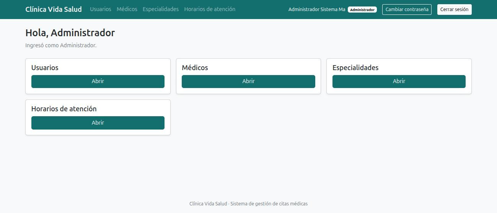

**Figura 2.** Lista de usuarios del personal, con pestañas Activos, Inactivos y Todos, búsqueda y acciones por fila (CU-03).

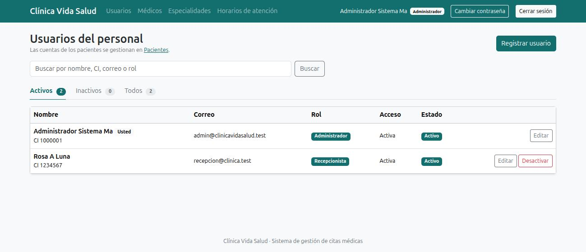

**Figura 3.** Formulario para registrar un usuario del personal (CU-03).

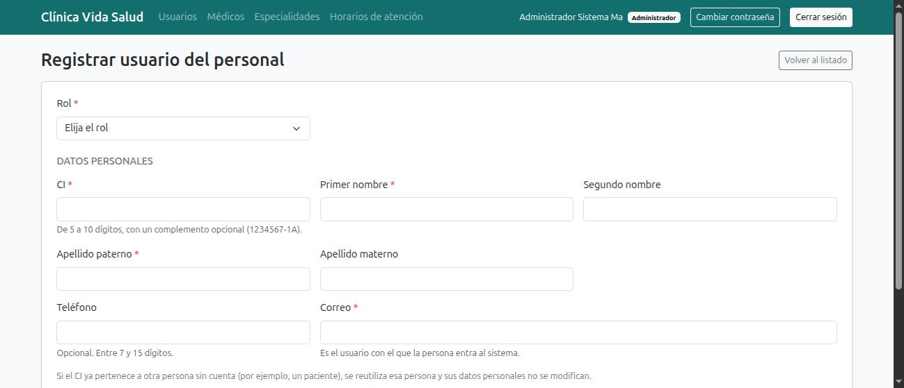

**Figura 4.** Lista de médicos, con código, registro profesional, especialidades y estado (CU-05).

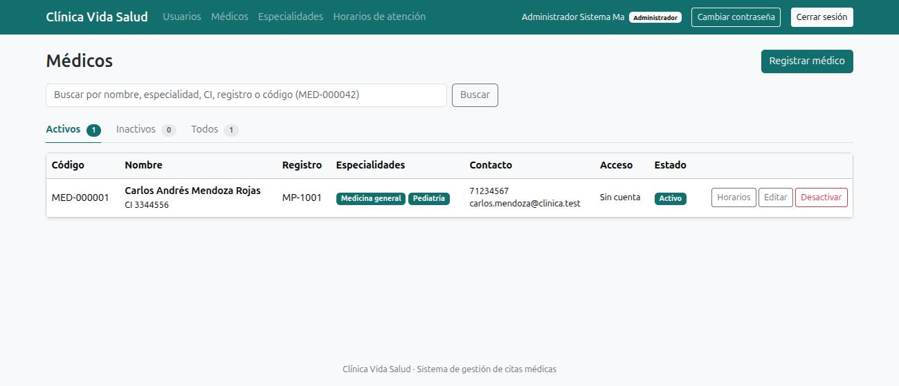

**Figura 5.** Lista de especialidades, con su duración de cita y cantidad de médicos (CU-06).

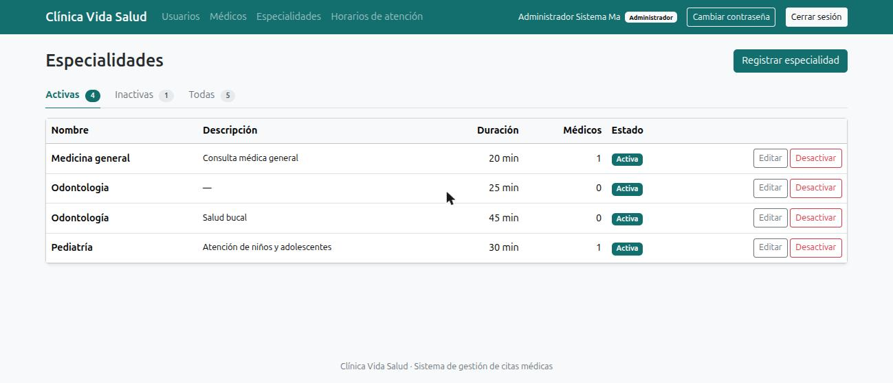

**Figura 6.** Horarios de atención de un médico: la semana y el formulario para agregar un bloque (CU-07).

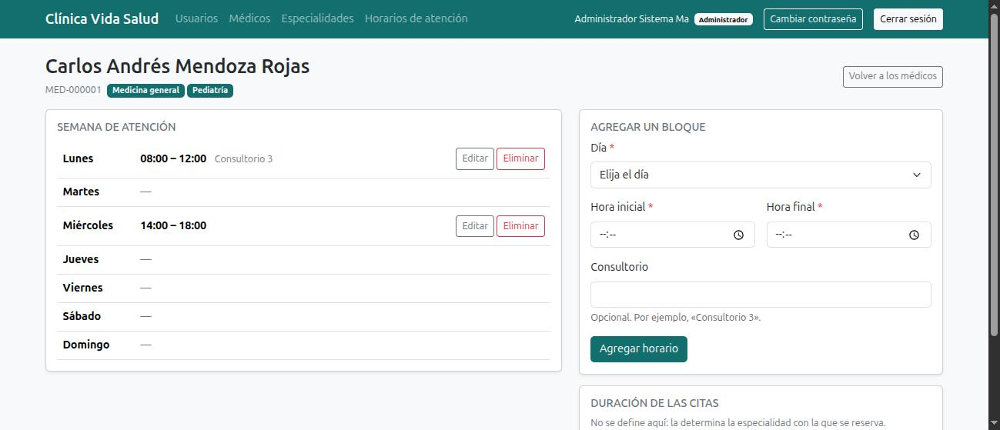

**Figura 7.** Cambio de contraseña (CU-01 y CU-08).

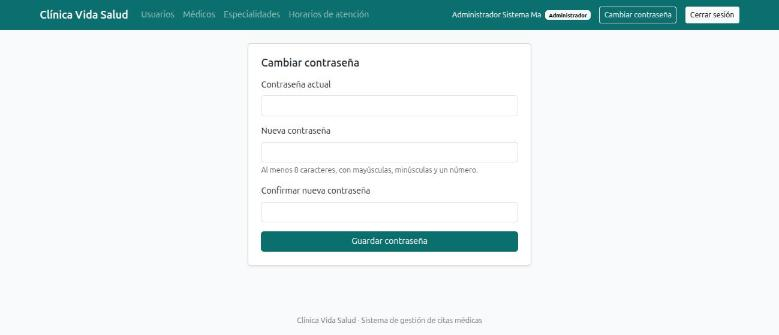

**Figura 8.** Lista de usuarios con un ancho de teléfono de 390 px: el menú se pliega en un botón, el título y el botón de acción pasan a filas separadas y la tabla se desplaza dentro de su propio recuadro, sin ensanchar la página.

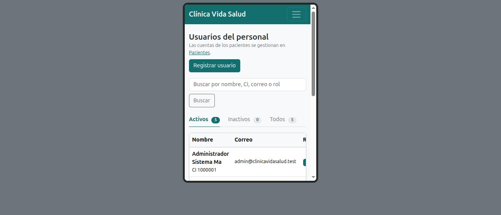

**Figura 9.** Pantalla de inicio de sesión, con un solo campo para el CI de los pacientes o el correo del personal (CU-01).

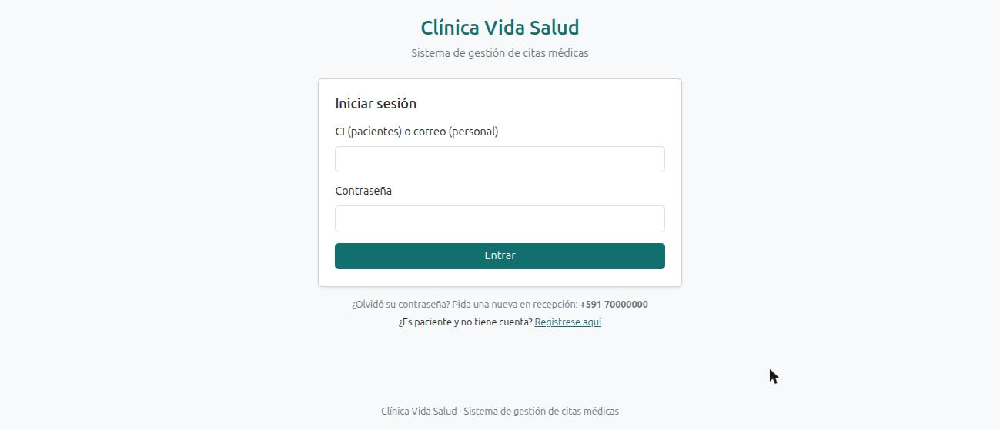

**Figura 10.** Formulario de registro propio del paciente (CU-02).

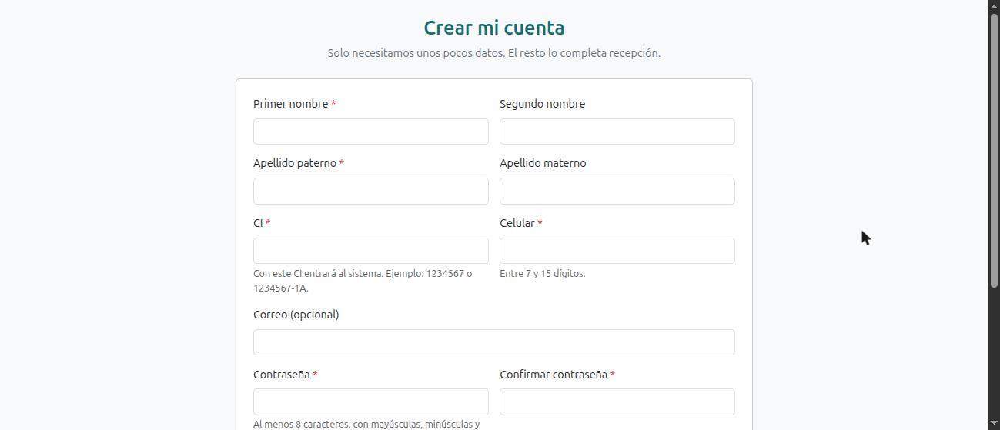

**Figura 11.** Inicio de la Recepcionista, que solo ve las opciones de su rol.


**Figura 12.** Lista de pacientes, con el estado de la ficha (verificada o pendiente) y del acceso (CU-04).

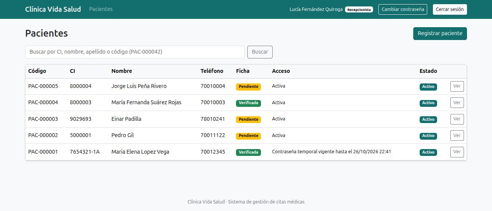

**Figura 13.** Formulario para registrar un paciente: datos personales, información médica y contacto de emergencia (CU-04).

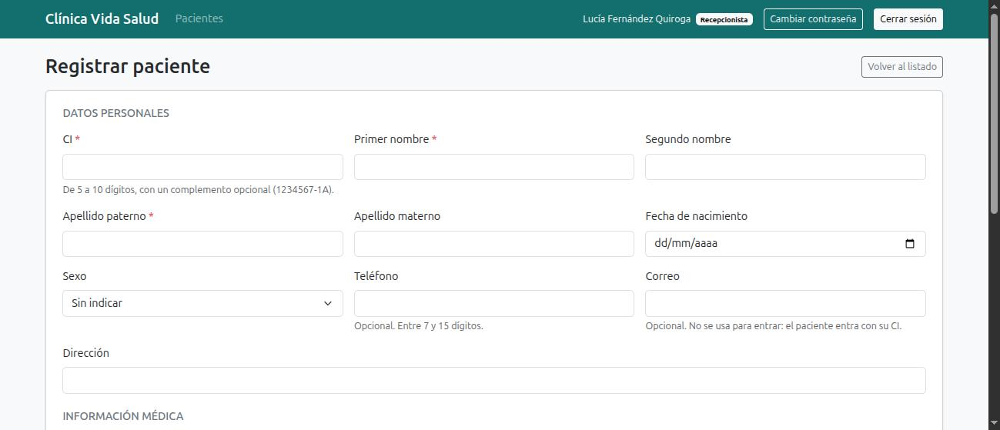

**Figura 14.** Ficha de un paciente con la ficha verificada, vista por la Recepcionista (CU-04).

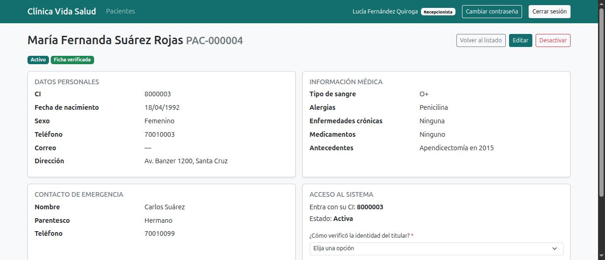

**Figura 15.** Ficha de un paciente que se registró solo: pendiente de verificación, con el aviso para comparar el documento de identidad (CU-04).

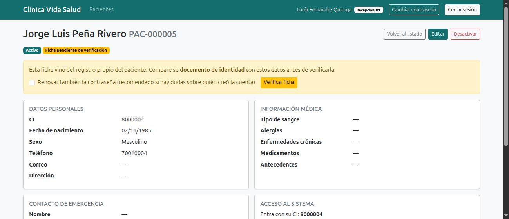

**Figura 16.** Inicio del Paciente, que solo ve su perfil.

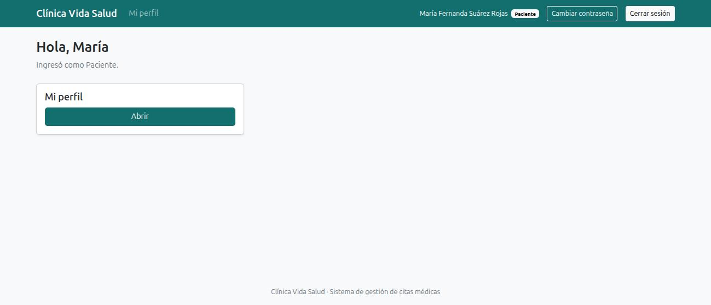

**Figura 17.** Perfil de un paciente con la ficha verificada: información médica y contacto de emergencia en solo lectura, y teléfono editable (CU-08).

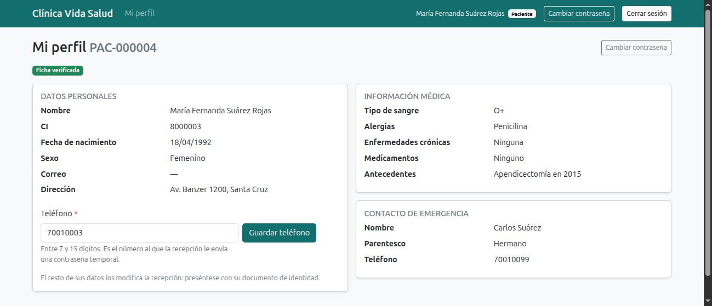

**Figura 18.** Perfil de un paciente con la ficha pendiente: el sistema avisa y oculta la información médica y el contacto de emergencia (CU-08).

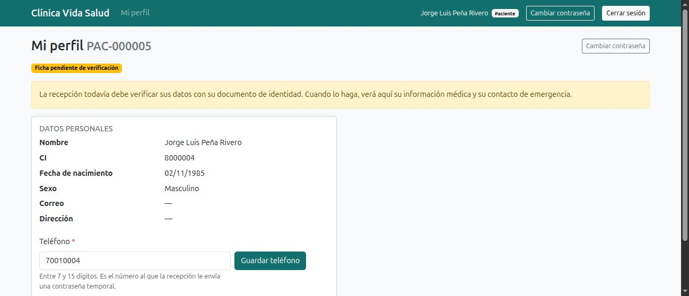

**Figura 19.** Perfil del paciente con un ancho de teléfono de 390 px (CU-08).

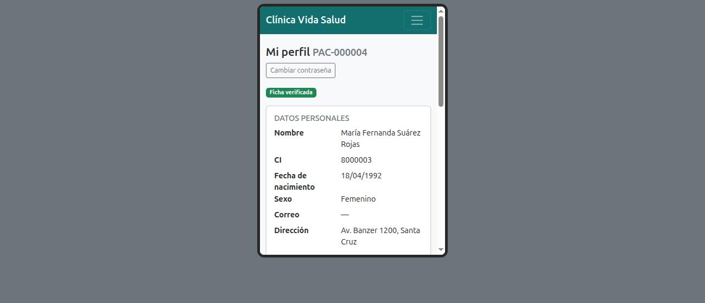

**Figura 20.** Página de error 404 en español, con el diseño de la clínica y un botón para volver al inicio.

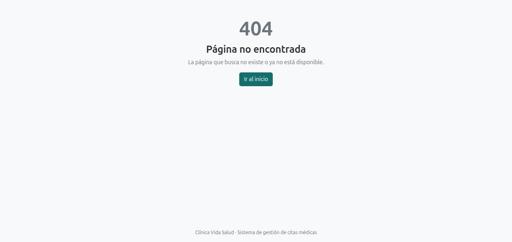

**Adaptación a pantallas angostas.** Se midió el ancho de las pantallas con 390 px de ancho y ninguna desborda horizontalmente. Con la sesión del Administrador: inicio, usuarios (lista, alta y edición), médicos (lista, alta y edición), especialidades (lista y alta), horarios (índice y semana de un médico) y cambio de contraseña. Con la sesión del Paciente: inicio, perfil y cambio de contraseña. El login y el registro, que son públicos, tampoco desbordan. En la medición se encontraron y corrigieron dos defectos: el texto oculto de las cabeceras de las tablas ensanchaba la página en las listas de usuarios, médicos y especialidades, y el título de cada pantalla quedaba pegado a su botón de acción. Las pantallas de la Recepcionista no se midieron en este ancho.

---

## Conclusión

Con la Presentación 1 queda terminado el **Ciclo #1**: la base de datos con control de acceso por roles y los nueve casos de uso que sostienen al sistema, es decir, CU-01 (iniciar y cerrar sesión), CU-02 (registro propio del paciente), CU-03 (usuarios y roles), CU-04 (pacientes), CU-05 (médicos), CU-06 (especialidades), CU-07 (horarios de atención), CU-08 (mi perfil) y CU-19 (renovar contraseña temporal). Los diez casos de uso restantes (CU-09 a CU-18), que son las citas y todo lo que gira en torno a ellas, dependen de esa base y corresponden al Ciclo #2.

Lo construido responde a los objetivos específicos que tocan a este ciclo:

- **Base de datos relacional con claves primarias y foráneas:** el esquema en PostgreSQL se implementa con migraciones que ejecutan los archivos de `database/sql/`, con restricciones que hacen cumplir las reglas aunque falle la validación de la aplicación (sección 6.3).
- **Registro, consulta, modificación y desactivación de pacientes y médicos:** los registros se desactivan y nunca se eliminan, de modo que el historial futuro de citas se conserva (RN11).
- **Especialidades y horarios de atención:** con nombre único normalizado, duración de cita por especialidad y bloques horarios sin superposición, que son la entrada que usará el cálculo de disponibilidad del Ciclo #2.
- **Validaciones y seguridad básica:** validación en el cliente y en el servidor, contraseñas con hash, contraseñas temporales aleatorias de un solo uso, control de acceso por permisos, bloqueo de cuenta tras intentos fallidos, límite de solicitudes por IP, token CSRF y bitácora de auditoría (RNF04, RNF13 a RNF20).
- **Pruebas:** la suite automatizada tiene **298 pruebas, y las 298 pasan** (sección 8 y Anexo C).

La decisión de modelar a la persona como una entidad separada de la cuenta, el paciente y el médico permitió que una misma persona tenga ficha clínica y cuenta de personal sin duplicar sus datos. También obligó a documentar una limitación (la primera de la lista siguiente).

Quedan fuera del Ciclo #1, por diseño, el módulo de citas (registro, reprogramación, cancelación, asistencia, agenda, historial y reportes), las notas clínicas y los recordatorios dentro del sistema. Son el contenido del Ciclo #2. La lista de espera y los recordatorios por SMS o correo quedaron descartados del alcance y se proponen como mejoras futuras (sección 4.1 y Recomendación).

### Limitaciones conocidas

- **Persona compartida entre fichas.** Una persona puede ser paciente y médico a la vez, pero su cuenta tiene un solo rol (Médico). Sus datos personales viven en una única fila de `personas`, de modo que al editar la ficha del paciente (CU-04) la Recepcionista también modifica el correo con el que el médico entra al sistema. CU-03 y CU-05 evitan este efecto porque reutilizan la persona sin modificar sus datos. Se acepta por ser un caso poco frecuente; evitarlo exigiría bloquear los datos personales en CU-04 cuando la persona tiene una cuenta con otro rol.
- **Nombres de especialidad con tildes.** La unicidad ignora mayúsculas y espacios, pero no las tildes: «Odontologia» y «Odontología» se aceptan como dos especialidades distintas. Resolverlo requiere la extensión `unaccent` de PostgreSQL.

## Recomendación

**Para el Ciclo #2**

- **Aprovechar la protección que ya tiene la base de datos.** El esquema incluye una restricción de exclusión de PostgreSQL sobre el médico y el intervalo de cada cita, que ignora las canceladas (`EXCLUDE USING gist` en `002_citas_y_notas.sql`, RNF17), igual que la de los bloques de horario en `001_esquema_base.sql`. Así dos solicitudes simultáneas no pueden registrar el mismo horario, aunque pasen la validación a la vez. En el Ciclo #2 hay que sumar la validación en PHP (RF07), ejecutar la comprobación final de disponibilidad dentro de una transacción, traducir el rechazo de la base a un mensaje claro y probarlo con un caso de citas superpuestas.
- **Reutilizar los servicios del Ciclo #1.** Los horarios y la duración por especialidad ya están modelados; el cálculo de disponibilidad debe apoyarse en ellos y no duplicar reglas.
- **Mantener la política de baja lógica.** Ninguna operación del módulo de citas debe eliminar registros: cancelar, reprogramar y marcar la asistencia cambian el estado de la cita y conservan el historial (RN10, RN11).
- **Probar primero.** Los casos de prueba 3 a 8 del enunciado dependen de las citas; conviene escribir esas pruebas junto con cada caso de uso, como se hizo en este ciclo.

**Para una versión posterior**

- **Despliegue real.** Servir la aplicación con Apache o Nginx y PHP, con HTTPS, y programar copias de seguridad de la base de datos. El sistema guarda datos personales y médicos, de modo que el despliegue debe revisarse con ese criterio.
- **Recuperación de contraseña por cuenta propia.** Exige un servicio de correo y verificar el correo del paciente, que hoy es opcional y no se verifica (sección 4.1).
- **Recordatorios por SMS o correo y lista de espera,** descartados del alcance actual.
- **Unicidad de especialidades sin distinguir tildes,** con la extensión `unaccent` de PostgreSQL (limitación conocida).

## Bibliografía

- Bergmann, S. (s. f.). _PHPUnit Documentation_. https://docs.phpunit.de/en/12.5/
- Docker Inc. (s. f.). _What is Docker?_ https://docs.docker.com/get-started/docker-overview/
- Ferraiolo, D. F., Sandhu, R., Gavrila, S., Kuhn, D. R. y Chandramouli, R. (2001). Proposed NIST standard for role-based access control. _ACM Transactions on Information and System Security, 4_(3), 224-274. https://doi.org/10.1145/501978.501980
- Jacobson, I., Booch, G. y Rumbaugh, J. (2000). _El Proceso Unificado de Desarrollo de Software_. Addison-Wesley. (Edición en español de _The Unified Software Development Process_, 1999.)
- Laravel. (s. f.-a). _CSRF Protection_. https://laravel.com/docs/13.x/csrf
- Laravel. (s. f.-b). _Routing_. https://laravel.com/docs/13.x/routing
- Laravel. (s. f.-c). _Blade Templates_. https://laravel.com/docs/13.x/blade
- Laravel. (s. f.-d). _Validation_. https://laravel.com/docs/13.x/validation
- Laravel. (s. f.-e). _Authorization_. https://laravel.com/docs/13.x/authorization
- Laravel. (s. f.-f). _Testing: Getting Started_. https://laravel.com/docs/13.x/testing
- Object Management Group. (s. f.). _Unified Modeling Language (UML)_. https://www.omg.org/spec/UML/
- OWASP Foundation. (s. f.-a). _SQL Injection Prevention Cheat Sheet_. https://cheatsheetseries.owasp.org/cheatsheets/SQL_Injection_Prevention_Cheat_Sheet.html
- OWASP Foundation. (s. f.-b). _Password Storage Cheat Sheet_. https://cheatsheetseries.owasp.org/cheatsheets/Password_Storage_Cheat_Sheet.html
- OWASP Foundation. (s. f.-c). _Cross-Site Request Forgery Prevention Cheat Sheet_. https://cheatsheetseries.owasp.org/cheatsheets/Cross-Site_Request_Forgery_Prevention_Cheat_Sheet.html
- OWASP Foundation. (s. f.-d). _Session Management Cheat Sheet_. https://cheatsheetseries.owasp.org/cheatsheets/Session_Management_Cheat_Sheet.html
- OWASP Foundation. (s. f.-e). _OWASP Top Ten_. https://owasp.org/www-project-top-ten/
- The PHP Documentation Group. (s. f.-a). _password_hash_. Manual de PHP. https://www.php.net/manual/es/function.password-hash.php
- The PHP Documentation Group. (s. f.-b). _PHP Data Objects_. Manual de PHP. https://www.php.net/manual/es/book.pdo.php
- The PHP Documentation Group. (s. f.-c). _Sesiones_. Manual de PHP. https://www.php.net/manual/es/features.sessions.php
- The PostgreSQL Global Development Group. (s. f.-a). _PostgreSQL 16 Documentation_. https://www.postgresql.org/docs/16/
- The PostgreSQL Global Development Group. (s. f.-b). _Constraints_. En _PostgreSQL 16 Documentation_. https://www.postgresql.org/docs/16/ddl-constraints.html

## Anexos

### Anexo A. Estructura del repositorio

| Ruta                      | Contenido                                                                                                                                                                                                                                  |
| ------------------------- | ------------------------------------------------------------------------------------------------------------------------------------------------------------------------------------------------------------------------------------------ |
| `codigo/`                 | Aplicación Laravel: `app/` (controladores, servicios, modelos, solicitudes de validación y _middleware_), `database/` (migraciones, seeders y esquema SQL), `resources/views/` (vistas Blade), `routes/`, `config/`, `public/` y `tests/`. |
| `codigo/database/sql/`    | Esquema en SQL puro: `001_esquema_base.sql`, `002_citas_y_notas.sql` y `003_catalogos_iniciales.sql`.                                                                                                                                      |
| `documento/`              | Este informe (`Informe-Final.md`) y las decisiones de arquitectura (`adr/`).                                                                                                                                                               |
| `diagramas/` y `pruebas/` | Reservadas para material de apoyo.                                                                                                                                                                                                         |

### Anexo B. Rutas del Ciclo #1

| Caso de uso | Rutas                                                                                                                                                                                                                                                                                                    |
| ----------- | -------------------------------------------------------------------------------------------------------------------------------------------------------------------------------------------------------------------------------------------------------------------------------------------------------- |
| CU-01       | `GET/POST /login`, `POST /logout`, `GET/PUT /cambiar-password`                                                                                                                                                                                                                                           |
| CU-02       | `GET/POST /registro`                                                                                                                                                                                                                                                                                     |
| CU-03       | `GET/POST /usuarios`, `GET /usuarios/nuevo`, `GET /usuarios/{usuario}/editar`, `PUT /usuarios/{usuario}`, `PATCH /usuarios/{usuario}/estado`, `POST /usuarios/{usuario}/renovar`, `GET /usuarios/{usuario}/credenciales`                                                                                 |
| CU-04       | `GET/POST /pacientes`, `GET /pacientes/nuevo`, `GET /pacientes/{paciente}`, `GET /pacientes/{paciente}/editar`, `PUT /pacientes/{paciente}`, `PATCH /pacientes/{paciente}/estado`, `POST /pacientes/{paciente}/acceso`, `POST /pacientes/{paciente}/verificar`, `GET /pacientes/{paciente}/credenciales` |
| CU-19       | `POST /pacientes/{paciente}/acceso/renovar` (la renovación de la contraseña del personal por el Administrador es la ruta `POST /usuarios/{usuario}/renovar` de CU-03)                                                                                                                                    |
| CU-05       | `GET/POST /medicos`, `GET /medicos/nuevo`, `GET /medicos/{medico}/editar`, `PUT /medicos/{medico}`, `PATCH /medicos/{medico}/estado`                                                                                                                                                                     |
| CU-06       | `GET/POST /especialidades`, `GET /especialidades/nueva`, `GET /especialidades/{especialidad}/editar`, `PUT /especialidades/{especialidad}`, `PATCH /especialidades/{especialidad}/estado`                                                                                                                |
| CU-07       | `GET /horarios`, `GET/POST /horarios/medico/{medico}`, `GET /horarios/{horario}/editar`, `PUT /horarios/{horario}`, `DELETE /horarios/{horario}`                                                                                                                                                         |
| CU-08       | `GET/PUT /perfil`                                                                                                                                                                                                                                                                                        |
| Comunes     | `GET /inicio`, `GET /` (redirige a `/inicio`)                                                                                                                                                                                                                                                            |

Son 48 rutas en total, según `php artisan route:list --except-vendor`. Solo el inicio de sesión (CU-01) y el registro (CU-02) son públicos. Todas las demás exigen una sesión válida y una cuenta vigente (RNF06) y, las de gestión de cada caso de uso, además el permiso correspondiente, por ejemplo `usuarios:gestionar` o `perfil:gestionar` (RNF19).

### Anexo C. Pruebas automatizadas por módulo

Resultado de `php artisan test`: **298 pruebas, 298 aprobadas, 2405 aserciones**, en unos 19 segundos, contra la base `clinica_test`.

| Módulo                                             | Pruebas | Cubre                                         |
| -------------------------------------------------- | ------- | --------------------------------------------- |
| `Feature\Usuarios\UsuarioTest`                     | 50      | CU-03                                         |
| `Feature\Medicos\MedicoTest`                       | 39      | CU-05                                         |
| `Feature\Horarios\HorarioTest`                     | 34      | CU-07                                         |
| `Feature\Especialidades\EspecialidadTest`          | 33      | CU-06                                         |
| `Feature\Acceso\LoginTest`                         | 25      | CU-01                                         |
| `Feature\Pacientes\PacienteTest`                   | 20      | CU-04                                         |
| `Feature\Pacientes\AccesoPacienteTest`             | 20      | CU-04 y CU-19                                 |
| `Feature\Acceso\RegistroTest`                      | 15      | CU-02                                         |
| `Feature\Perfil\PerfilTest`                        | 13      | CU-08                                         |
| `Feature\Acceso\CambioPasswordTest`                | 9       | CU-01 y CU-08                                 |
| `Feature\Consola\RenovarPasswordAdministradorTest` | 8       | Comando `administrador:renovar-password`      |
| `Feature\Consola\DemoSeederTest`                   | 4       | Datos de demostración (solo en entorno local) |
| `Feature\Acceso\PaginasDeErrorTest` | 6 | Páginas de error 403, 404, 419, 429 y 500 en español |
| `Unit\CodigoFormateadoTest`                        | 13      | Códigos con formato (`PAC-`, `MED-`, `CM-`)   |
| `Unit\ContrasenaTemporalServiceTest`               | 5       | Contraseñas temporales (RNF18)                |
| `Unit\PaletaTest`                                  | 3       | Paleta de colores de la interfaz              |
| `Unit\ExampleTest`                                 | 1       | Prueba de ejemplo del esqueleto de Laravel    |
